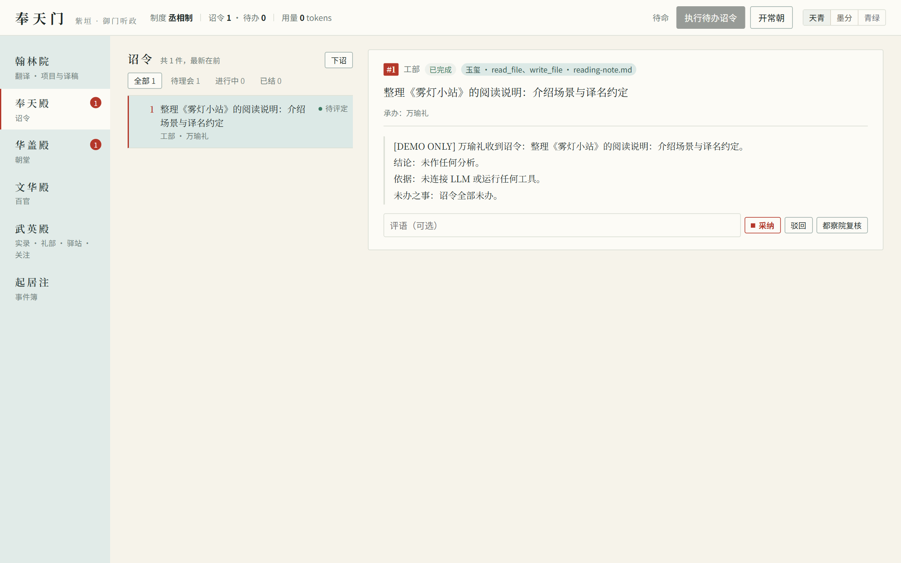

# 紫垣 ZiYuan

[](https://github.com/YuuUehara/Ziyuan/actions/workflows/ci.yml) [](https://github.com/YuuUehara/Ziyuan/releases/latest)

> 你下诏安排任务，官员协作办理；回奏后由你审阅，准奏后才把改动写入文件。紫垣用中国古代朝廷的称呼组织这套受控工作流，也可作为本地小说翻译与审校工作台使用。

版本变化见 [CHANGELOG](CHANGELOG.md)，各版检查与边界见[文档目录](docs/README.md)，已公开的下载包以 [GitHub Releases](https://github.com/YuuUehara/Ziyuan/releases) 为准。测试通过不代表译文已达到文学或出版质量，重要稿件仍须人工把关。

- **先试用，不必先配置模型**：未设置 `ZIYUAN_LLM_MODEL` 时只演示派工，不会真的分析或修改文件。
- **接入模型后才执行真实工作**：支持 OpenAI 兼容接口（已有 DeepSeek 与本地 Ollama 实测）。默认只能读取授权范围内的文件；修改文件和运行测试须另行授权。
- **模型提出改动，你决定是否写入**：任务完成不等于文件已修改，要审阅 diff 后执行 `apply` 准奏才落盘。
- **逐块与整本译书**：支持从日文或英文原文建立项目，在本地预览分段并导入，逐块下诏初译、请只读审校、逐段朱批、修订与御览定稿；也可不调用模型，在网页、命令行或终端里手写**人工译稿**，用**御笔札记**记下认可译法。
- **找回定稿译法**：译文记忆默认关闭、不联网。设置 `ZIYUAN_MEMORY_PROVIDER=local` 后只在本机计算；`deterministic` 为可重复的固定本机算法；远程嵌入须先按项目 `text memory authorize` 授权。记忆仅提供字面相近的参考译法，不自动改稿、不自动批准。

### 译书与本地文本工具概览

- **原文预览、追加修订与成稿导出**：TXT／Markdown 导入前先预览章序、分段（默认按非空行，可改按空行并拆分超长段）与安全注音，核对指纹后再写入；支持 DOCX／EPUB／SRT 导入与定稿回填、原文追加或单章修订，以及双语通读、交稿预检和 TXT／Markdown／HTML（保留注音与着重号）成稿打包导出，见[预览与导入](docs/novel-translation.md#预览与确认导入)、[版本与回填](docs/novel-translation.md#译稿版本与格式回填)与[通读与导出](docs/novel-translation.md#原件与成稿导出)。
- **手工翻译优先与模型译校**：网页「翰林院 → 译稿」默认开启独立的「手工翻译」开关，提供双语逐段编辑与注音／着重／粗斜体标记工具；关闭开关可展开三栏对照、逐段朱批与模型初译／审校／修订流程。人工与模型译稿都保留三态版本快照，也可搭配局部词证与六事勘校记录使用，见[人工译稿](docs/novel-translation.md#人工译稿)与[词证与逐段勘校](docs/novel-translation.md#词证与逐段勘校)。
- **资料、检索、译文记忆与备份**：在「资料」页签可集中维护人物、术语与称谓规则草稿（支持 CSV／TBX／TMX 交换）、确定性检查、御笔札记、审校评论与跨章待查；「全文检索与草稿替换」可快速定位原文、现行译文与人工草稿。「项目管理」支持完整工作区备份与迁机恢复；若启用局部／远程译文记忆并显式选用参考，外发前可预览全部提示文本，见[本地译文记忆](docs/memory.md#显式选用参考)与[兼容边界](docs/stability.md#140显式选用参考)。
- **用量账本与更新提醒**：`ziyuan text usage <项目ID>` 按阶段汇总已报告用量与分币种估价，见[账本与精简边界](docs/novel-translation.md#逐阶段用量账本与请求材料精简)；「武英殿 · 作品关注」支持 syosetu 更新提醒与新章节自动入队（只记目录变化，不下载正文），见[作品更新提醒](docs/subscriptions.md)。

### 第一次启动（不用命令行）

- **Windows**：解压发布包，双击 `start-ziyuan.bat`（或直接进入译书工作台的 `start-translation.bat`）。
- **macOS / Linux**：在解压目录运行 `./start-ziyuan.sh`（或 `./start-translation.sh`）。
- 脚本会初始化工作区、启动本地 Web、把登录令牌复制到剪贴板并打开浏览器；在登录框粘贴即可。
- 关闭服务窗口（或结束 `ziyuan serve` 进程）即停止；所有记录保存在当前工作目录。

### 第一次建立译书项目（不用命令行）

主导航首项即为「**翰林院**」（也可直接打开 `/#translation` 或使用译书专用启动脚本），工作台分为「**译稿、资料、通读交稿、项目管理**」四个页签；工作区显示书名和「第1章 · 第1段」「译稿第1组」等可读位置（内部段号与块号仍稳定保留）。

1. 打开「翰林院」，点左侧「新建项目」。
2. 填标题、原文语言、来源与权利声明（作者、版本、日期与使用范围可选）；来源与权利只是自述，软件不作核验。
3. 建立后会自动进入「项目管理」，在「导入原文」选择 UTF-8 TXT／Markdown 文件（原文合计上限 `8 MiB`，JSON 请求上限 `24 MiB`），按需调整章序与选项：
   - TXT 分段默认按「每个非空行一段（常见小说排版）」，若原文为排版换行可改选「按空行分段」；超长自然段可勾选「TXT 过长段落拆为工作段」。
   - 先点「重新预览」核对章序、段落与警告（超过 200 段的章节默认先展示前 120 段并可点击展开全文，超过 50 条的警告默认折叠），确认无误后再点「确认预览并导入」。一个项目只导入一次原文。

### 第一次使用本地资料与段旁提示（不用命令行）

1. 在「翰林院」切换到「资料」页签，点「读取本地资料」。
2. 点「向导式新建」或「新增术语」「新增人物」，填名称与译法；不确定的字段留空。
3. 点「保存草稿」——保存只写本地草稿，不等于批准，也不进入生产译文。
4. 点「校验」，通过后点「准备生产资料」整理到 `context/glossary.json`。
5. 在译书操作区点「批准上下文」（或运行 `ziyuan text context approve`），生成不可变快照后才供翻译与勘校采用。
- 在「临时关联」选择或填写本段人物、称呼对象与说话人并点「刷新段旁提示」，可只读预览本段适用的术语、人物与称谓规则；「对比草稿与生产」可只读列出未批准变更。

---

本文中的“皇帝”指用户，“官员”指执行任务的智能体，“诏令”就是任务，“准奏”是批准写入文件。命令名称保持这些约定，不需要先熟悉官制才能使用。



## 安装

可从 [GitHub Releases](https://github.com/YuuUehara/Ziyuan/releases/latest) 下载适合系统的压缩包，解压后运行其中的 `ziyuan`（Windows 为 `ziyuan.exe`）。Linux 预编译包需要 glibc 2.35 或更新版本。

也可以从源码安装，需要 Rust 1.89 或更新版本：

```bash
cargo install --git https://github.com/YuuUehara/Ziyuan ziyuan-cli --locked   # 安装 `ziyuan` 到 ~/.cargo/bin
cargo install --path crates/ziyuan-cli --locked                               # 或在本仓库中
```

正式发行版会通过标签触发的可信发布流程上传到 crates.io；首次发布须先手工完成，之后由发布作业自动跟进。是否可用、有哪些版本，以 crates.io 上显示的内容为准；尚未发布时请用上面的源码方式安装。

### 平台支持

| 平台 | 任务、审阅、GitHub 对接、Web/TUI | 测试命令的隔离环境（“号舍”） |
| --- | --- | --- |
| Linux | 支持 | bubblewrap（另装；按域名放行还要 socat） |
| macOS | 支持 | 系统自带的 Seatbelt |
| Windows | 支持 | 暂缺，默认拒绝运行需要隔离的命令。设 `ZIYUAN_SANDBOX=off` 会取消隔离，风险见 [ADR-0001](docs/adr/0001-windows-sandbox.md) |

## 快速开始

安装后，在一个独立目录试用。下面的命令可在 PowerShell 或常见 Linux/macOS shell 中逐行执行；使用已有目录时不要重新运行 `mkdir`。

```bash
mkdir ziyuan-demo
cd ziyuan-demo
ziyuan init
ziyuan court
ziyuan officials
ziyuan edict --dept works "概述当前目录的文件"
ziyuan tasks
ziyuan history
```

记录保存在当前目录的 `.ziyuan/`。未配置模型时，结果会注明只是演示；若已配置模型，上述任务会读取授权范围内的文件并产生模型费用。

想用图形界面，执行 `ziyuan serve`，再打开终端打印的本机地址。不要把带令牌的地址发给他人。终端界面用 `ziyuan tui` 启动。

接下来可按需要阅读：

- [接入真实模型](docs/guide.md#接入真实模型)：设置模型名称、服务地址和密钥。
- [让模型修改文件](docs/guide.md#工部动手受控写权限)：授权后先看 `ziyuan diff <任务ID>`，确认后再 `ziyuan apply <任务ID>`。将占位的任务 ID 替换为实际数字，不要直接输入尖括号。
- [权限与安全](SECURITY.md)：哪些文件会交给模型，哪些操作需要你批准。

## 任务如何分配？

三种制度决定任务经过哪些角色。这些规则由程序执行，不是只在提示中要求模型遵守：

| 制度 | 仿照 | 路线 | 品级（尚书 / 侍郎 / 郎中） |
|---|---|---|--- |
| **丞相制** `chancellor` | 元·中书省 | 皇帝 → 中书右丞相（左丞相署理）→ 本部尚书 → 郎中 | 正三品 / 正四品 / 从五品；右、左丞相正一品 |
| **废相亲政** `direct` | 明初·洪武罢中书省 | 皇帝 → 本部尚书 → 郎中 | 正二品 / 正三品 / 正五品 |
| **内阁制** `cabinet` | 明中后期 | 皇帝 → 内阁首辅（次辅署理）→ 本部尚书 → 郎中 | 正二品 / 正三品 / 正五品；首辅、次辅本官正五品 |

- 正职空缺时由副职署理（丞相 → 左丞相，首辅 → 次辅，尚书 → 侍郎），路线中注明「署理」；正副俱缺则拒绝派工。
- 改制会撤销旧制度协调机构（中书省/内阁）的全部官职，防止旧身份在改制后继续自动保有最高权力；六部官员保留，品级随制度变化。新制度需要明确任命协调者。
- 开国时（#1–#10）设丞相一人，吏部、工部各有尚书与郎中，户、礼、兵、刑四部各有尚书（本部无郎中时尚书亲办），六部诏令都能承接；左都御史不设（设了常朝会自动复核、多花 token）。`init` 与 `court` 会列出缺位的官职及其影响，并由吏部荐举闲居且专长相符的官员；任命仍须皇帝确认。
- 官员姓名在开国与 `recruit`（未指定姓名时）按常见姓氏与士大夫取名用字随机生成，记入事件簿后重放不变。
- `officials`、Web 与 TUI 显示每位官员的官职、品级与所用模型（`ZIYUAN_LLM_MODEL`；未设置时为演示后端）。

内阁制下诏令须先「票拟」再由皇帝「批红」，丞相制下丞相自行派工；详见[内阁、皇权与昏君模式](docs/guide.md#内阁皇权与昏君模式)。

## 使用前需要知道

1. **你决定权限和任免**：模型不能靠一句话把自己变成用户；改制、任免必须通过程序提供的操作入口。
2. **官员和官职不是一回事**：官员换职后编号不变，便于追查同一执行者的记录。
3. **改制不等于停止任务**：改制调整分配路线，执行机制仍然保留；停止或撤销任务要用相应操作。
4. **权限不能由模型自行扩大**：模型可以提出建议，但不能自行授予新的系统权限。
5. **演示后端不是代码分析**：`DemoBackend` 只验证调度线路，绝不声称已完成真实分析。
6. **记录保存在本地**：`.ziyuan/court.log` 保存任务和操作记录，多进程写入会协调。`.ziyuan/huidian` 只是加快启动的缓存，损坏时会按记录重建。新版可读旧记录；旧版未必认识新事件，先用 `ziyuan migrate` 检查最低版本要求。

1.0 起的兼容承诺见[稳定性约定](docs/stability.md)。ChatGPT 订阅与 HTTP MCP 仍为实验性；内部 Rust 接口和 Web 页面不在兼容承诺范围内。

支持 `recruit` 动态扩充官员；同部门多个郎中按任务量均衡派工。择优任用通过 `recommend` 给出建议，由皇帝决定是否任命。

## 开发与发布

发布产品由十一个 crate 组成：`core` 定义任务与角色，`governance` 执行分配规则，`runtime` 执行模型与工具调用，`llm` 和 `github` 连接外部服务，`storage` 保存记录，`memory` 提供本地译文记忆索引与检索，`app` 提供各界面共用的功能，`cli`、`web`、`tui` 负责交互。工作区另有未发布的 `sandbox-windows` 独立启动探针，尚未完成文件／网络隔离验收，不接入生产；Windows 受保护执行仍失败关闭，见 [ADR-0001](docs/adr/0001-windows-sandbox.md)。其余分层说明见[体系结构](docs/architecture.md)。

在仓库根目录检查和构建：

```bash
cargo fmt --all -- --check
cargo check --workspace --all-targets --all-features
cargo test --workspace
cargo build --workspace
bash scripts/smoke.sh
```

最后一条需要 Bash 及脚本所需的运行环境；前端模块化脚本另可通过 `node --test crates/ziyuan-web/src/*.test.mjs` 检查。常规 CI 还检查 Rust 1.89、Linux glibc 2.35 基线，并在 macOS 和 Windows 上运行测试，具体流程见 `.github/workflows/ci.yml`。

推送与 `Cargo.toml` 版本一致的 `v*` 标签会触发发布：先建草稿，上传四个平台的包，再在对应平台重新下载验证，全部通过才公开；公开后按依赖顺序发布十一个 crate（含 `memory`，已存在的版本跳过）。可信发布配置与首次发布准备见[发布指南](docs/releasing.md)，发布说明取 `CHANGELOG.md` 中对应版本一节。

## 文档

- [使用指南](docs/guide.md)：各项功能的详细用法。
  - 前端：[奉天门：Web 界面](docs/guide.md#奉天门web-界面)、[紫禁城：终端界面](docs/guide.md#紫禁城终端界面)、[命令行：JSON 与补全](docs/guide.md#命令行json-与补全)
  - 模型与执行：[接入真实模型](docs/guide.md#接入真实模型)、[任务队列与并发](docs/guide.md#任务队列与并发)、[常朝：常驻执行与自动复核](docs/guide.md#常朝常驻执行与自动复核)、[外藩朝贡：MCP 工具](docs/guide.md#外藩朝贡mcp-工具)
  - 权限与改动：[玉玺：限定官员的权限](docs/guide.md#玉玺限定官员的权限)、[工部动手：受控写权限](docs/guide.md#工部动手受控写权限)、[户部度支：预算与限额](docs/guide.md#户部度支预算与限额)、[刑部与锦衣卫：防提示注入](docs/guide.md#刑部与锦衣卫防提示注入)
  - 评定与监督：[吏部：评定、考绩与荐举](docs/guide.md#吏部评定考绩与荐举)、[都察院：复核回奏与证据核验](docs/guide.md#都察院复核回奏与证据核验)、[廷推与廷杖](docs/guide.md#廷推与廷杖)、[内阁、皇权与昏君模式](docs/guide.md#内阁皇权与昏君模式)
  - 协作与文书：[多官协作：分办与汇总](docs/guide.md#多官协作分办与汇总)、[人格、字号与廷议](docs/guide.md#人格字号与廷议)、[翰林院：诏令模板](docs/guide.md#翰林院诏令模板)、[礼部：科举与文书](docs/guide.md#礼部科举与文书)、[礼部修 CHANGELOG](docs/guide.md#礼部修-changelog)
  - 记录与对接：[起居注：按诏令、官员、类型、时间查](docs/guide.md#起居注按诏令官员类型时间查)、[翰林院修史：实录与前例](docs/guide.md#翰林院修史实录与前例)、[兵部：驿传与八百里加急](docs/guide.md#兵部驿传与八百里加急)、[兵部驿站 · GitHub](docs/guide.md#兵部驿站--github)、[版本控制：Jujutsu](docs/guide.md#版本控制jujutsu)
- [翰林院译书指南](docs/novel-translation.md)：项目导入与追加修订、手工翻译优先与模型译校、资料词证勘校、检索版本、通读交稿导出、备份恢复与版权边界。
- [本地译文记忆](docs/memory.md)：启用、建库、查询、远程嵌入授权及显式选用参考。
- [作品更新提醒](docs/subscriptions.md)：syosetu 关注列表、定时检查与新章节自动入队（不下载正文）。
- [体系结构](docs/architecture.md)：分层、事件簿与设计取舍。
- [稳定性约定](docs/stability.md)：1.0 起冻结哪些接口。
- [路线图](docs/roadmap.md)：已完成里程碑与未来规划。
- [文档目录](docs/README.md)：全部文档与版本验收归档的分类入口。
- [CHANGELOG](CHANGELOG.md)：各版变化。
- [发布指南](docs/releasing.md)：标签发布、四平台验收与 crates.io 可信发布约定。

## 许可

本项目采用 **MIT OR Apache-2.0** 双许可证，你可以任选其一使用：

- [MIT License](LICENSE-MIT)
- [Apache License 2.0](LICENSE-APACHE)

除非另有明确说明，你有意提交并被本项目接纳的贡献也将按上述双许可证授权。

Web 界面内置的 [JetBrains Mono](https://github.com/JetBrains/JetBrainsMono) 字体按 SIL Open Font License 1.1 随附，许可证见 [`crates/ziyuan-web/src/fonts/JetBrainsMono-OFL.txt`](crates/ziyuan-web/src/fonts/JetBrainsMono-OFL.txt)（发行包中为 `JetBrainsMono-OFL.txt`）。界面推荐的中文、日文字体也都是 OFL 1.1，不随程序附带，见[使用指南 · 字体](docs/guide.md#字体)。

软件的 MIT / Apache-2.0 许可不授权第三方文学原文、译文或书库品牌；模型上传、再分发与商业出版仍须逐项核对权利，见[版权、来源与再分发边界](docs/novel-translation.md#版权来源与再分发边界)。
