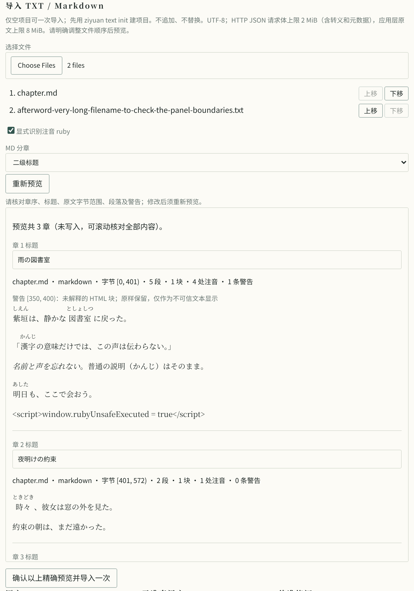
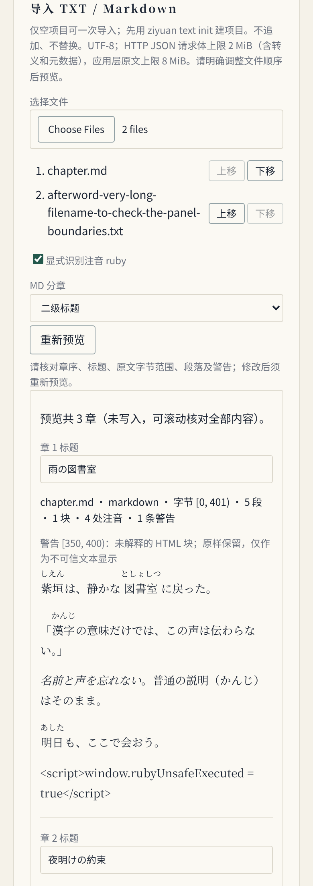
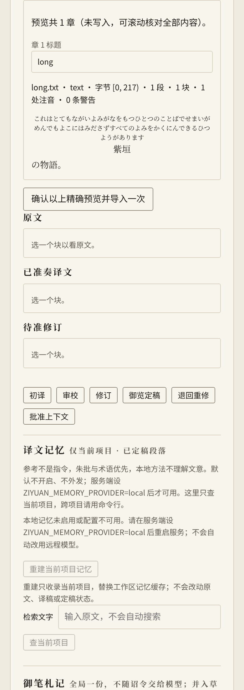

# 1.4 第一批：章节导入与日文注音本地验收

> 阶段归档：下文版本与“未发布”均指记录当时，不代表当前状态。1.4.0 最终工程与发行进度见[版本验收](1.4.0.md)。

日期：2026-10-31。基于 1.3.0 后的工作区源码，Linux x86_64 orb 本地检查通过；记录时未提交、未推送、未发布。这不是完整 1.4 或跨平台发布验收，当前公开版本仍为 1.3.0。

范围：TXT／Markdown 预览、显式 H1／H2 分章、保守的 ruby／强调解析、精确指纹确认、CLI／Web 一次性空项目导入，以及模型材料与原文安全显示。用法和完整语法限制见[文本工具](../text-projects.md#unreleased--14-第一批源码预览与确认导入)，剩余需求见[1.4 方案](../novel-translation-1.4.md)。

## 已执行检查

| 检查 | 结果 |
| --- | --- |
| `cargo fmt --all --check` | 通过 |
| `cargo test --workspace` | 33 个 Cargo 顶层测试套件，合计 658 passed、0 failed、0 ignored；包含单元、集成与文档测试，不重复累计临时文件探测的子进程输出 |
| `cargo clippy --workspace --all-targets -- -D warnings` | 通过 |
| `cargo +1.89.0 check --workspace --all-targets --locked` | 通过 |
| `cargo build -p ziyuan-cli` | 通过，浏览器实际运行重建后的二进制 |
| `git diff --check` | 通过 |

测试覆盖原件 UTF-8 字节范围、BOM／CRLF、标题前正文和围栏假标题、混合文件顺序、重复章名、破损和危险 HTML、注音与强调、组合字符和迭代符、容量限制、指纹失效与重复导入拒绝。解析器包含 578 组对抗片段／格式组合，不是对全部日文方言的兼容证明。

旧 schema 1 TXT 项目读取、段号、原件和提示块编码不变已作回归检查；新写入清单是 schema 2，旧 1.3 程序不能读取，须升级。Web 真实 HTTP 测试覆盖只读预览、精确确认、章名和原文改变、观政拒绝及客户端伪造文件系统路径。

## 模型请求捕获

在临时工作区用自写日文夹具通过 Web 导入，实际执行 `text translate` 和 `run`，把 OpenAI 兼容地址仅指向 orb 内模拟 HTTP 服务。模拟服务先请求 `read_file` 读取实际导出的 `source.json`，再检查下一次 HTTP 请求中的工具结果；实际捕获同时包含 `紫垣／しえん`、`図書室／としょしつ` 配对，断言通过。

未使用外部模型、未发送真实小说、未生成译稿、未准奏文件。这只证明原文和读音会进入真实传输路径，不证明模型会采纳或提高文学质量。

## 浏览器实跑

Chromium，DPR 2；三主题（天青／墨分／青绿），1280 与 390 CSS 像素宽度。窄屏仅为桌面 Chromium 缩窄，不是实体手机或触摸／Safari 验收。

- 自写 Markdown 两个二级标题与 TXT 后记按上传顺序预览为三章；五处 ruby、强调、普通括号及危险脚本的字面文本可见。源码脚本节点为 0，测试标记未执行。
- 实际上下移动文件使旧确认禁用；改标题也必须重新预览，随后可确认导入。目录保留人工章名，原文保留注音；录屏包含经过相邻控件的真实指针、逐字编辑、重新预览和确认后状态。
- 预览可以聚焦并滚动，全部章节可核对；周期轮询未清空文件／标题草稿。重新加载后从已发布项目读取导入结果。
- 非法 UTF-8 显示读取错误，预览／确认禁用；观政身份没有上传控件，只显示只读说明。
- 2026-11-01 根据界面反馈统一了文件选择按钮、分章下拉框和章名输入框，复用已有表单／按钮样式及 `.text-scroll` 细边框。三主题、两种宽度逐一检查字段的字体、底色、圆角、边框与内边距；文件选择按钮复用现有按钮的悬停色，预览内有焦点环留白和章节分隔线。长文件名自然折行，排序按钮靠右且不越过导入面板。
- 选择文件后，重新预览、改名和切换主题均保留原生文件选择器的两份文件，不再显示“未选择文件”；切换项目不带入别的项目文件。
- 窄屏页面 `scrollWidth = innerWidth = 390`；加边框后的预览区域 `scrollWidth = clientWidth = 314`。长读音完整折行，基底保持一组，不把阅读中的一条注音错误拆配给分开的汉字。

截图为实际运行结果，已检查，不是设计图。桌面预览：

窄屏滚动预览（底部内容须继续滚动核对）：

长读音边界：

## 2026-11-01：Windows HTTP 复验

第一批已推送。[该提交的 CI](https://github.com/YuuUehara/Ziyuan/actions/runs/41263319534) 中，macOS、Linux 基线、工作区检查／smoke、Rust 1.89 与依赖审计通过；Windows 两次分别在订阅设置和拆分任务的观政 POST 上收到 10053 连接中止。新增导入测试两次均通过，业务接口与鉴权实现未改动。

两次失败均发生在鉴权直接返回 403、不消费请求体的路径。仅凭这些日志不能确认 Windows socket 中止的全部成因；本地临时 TCP 夹具另行验证了“读完请求头即返回 403 并关闭连接”的机制：原测试客户端上传 4 MiB 正文时报 BrokenPipe，使用标准 `Expect: 100-continue` 后取得 403。临时夹具验证后删除，不作为额外维护的测试。

测试客户端的 POST 统一使用该握手，让早期拒绝先返回；不重放 POST，不改生产鉴权，不删除真实 HTTP 覆盖或放宽状态／事件断言。既有观政测试还验证 1 MiB 被拒请求返回 403、朝廷不变。本地 `cargo test -p ziyuan-web --locked` 为 36 passed，严格 clippy 和格式检查通过；Windows 修正后的远端结果仍须复验，不能将本地对照视为 Windows 验收已过。

## 尚未交付或验证

- 本批已推送，Windows HTTP 修正后的跨平台 CI 仍待完成；不能用此前 1.3.0 的绿灯替代本批跨平台验证。
- 章节有效定稿的 TXT／MD 成稿导出是第二批，参考选择和任务绑定是第三批；本批没有实现这些入口。
- 不含连载追加、替换原文、全方言兼容、Kakuyomu 抓取、EPUB 或自动出版。
- 尚无真实模型文学试译、双语盲评或成本收益结论。完整 1.4 发版还需分批验收、跨平台 CI 与正式包验收。
