# 紫垣使用指南

README 的「快速开始」之后，各项功能的详细用法都在这里。截图取自 v0.7，用演示朝廷与模拟模型生成。各节相互独立，可按需查阅；体系结构与设计取舍见 [architecture.md](architecture.md)。

## 接入真实模型

```bash
export ZIYUAN_LLM_MODEL=deepseek-flash                   # 或 deepseek-v4-pro
export ZIYUAN_LLM_BASE_URL=https://api.deepseek.com/v1   # 默认 https://api.openai.com/v1
export ZIYUAN_LLM_API_KEY=...                            # 本地 Ollama 可不设
export ZIYUAN_LLM_PRICE=2,8                              # 可选：每百万 token 输入,输出[,币种]
cd /path/to/your/project && ziyuan init
ziyuan edict --dept works "找出所有 unsafe 代码并说明用途"
```

**实测情况（2026-10）：** 已用 DeepSeek `deepseek-flash`（默认思考模式）与 `deepseek-v4-pro` 端到端实测：多轮工具调用、流式输出、玉玺越权拦截、超时与 Ctrl-C 撤销均正常；v0.7.0 又跑通了工部改代码的全程（改动暂存并跑测试 → 都察院背书 → `apply --commit` 落盘提交 → 评定），一件约 1.4 万 tokens。思考模式的思维链（`reasoning_content`）不显示，但会按 DeepSeek 要求在后续请求中回传。

**Ollama（本地模型，2026-10 实测）：** 在 4 核 CPU、8 GB 内存的机器上用 Ollama 0.40 的 OpenAI 兼容接口实测 `qwen2.5:1.5b`、`qwen2.5:3b` 与 `qwen3:1.7b`（思考模式）。不设 `ZIYUAN_LLM_API_KEY` 即可：

```bash
export ZIYUAN_LLM_BASE_URL=http://127.0.0.1:11434/v1
export ZIYUAN_LLM_MODEL=qwen3:1.7b
```

- 流式输出、工具调用（`search_code`）、三段体例、用量统计、票拟、廷推、都察院复核都能跑通；`qwen3` 的思维链（Ollama 放在 `reasoning` 字段）不显示，也不混入回奏。
- **小模型能力有限**（v0.5 起未查即奏会被发回重办一次）：1.5B/3B 常不调用工具就凭空回奏，授了 `write_file` 也没有真正改文件；都察院的证据核验能识破这类回奏（引用的行号查无实据即弹劾）。正式使用建议 7B 以上，内存至少 16 GB。
- 本地模型没有内置单价，不显示花费；度支仍按 token 计算。

**ChatGPT 订阅（不需要 API Key）：** 用 Sign in with ChatGPT 登录，模型调用计入你的 ChatGPT 订阅额度：

```bash
ziyuan login                       # 浏览器登录并授权；凭据存于 ~/.config/ziyuan（仅本人可读），不进项目
ziyuan login --models              # 列出本账号可选的模型
export ZIYUAN_LLM_PROVIDER=chatgpt
export ZIYUAN_LLM_MODEL=<上面列出的模型>
ziyuan logout                      # 撤销令牌
```

- 走 Responses API（`store:false`、流式），访问令牌过期前自动续期，多个进程以文件锁排队续期。
- 订阅额度不按 token 计价，不显示花费；度支仍按 token 计算，但无法给 API 传输出上限。额度用尽时报错并附用量页 https://chatgpt.com/settings/usage。
- **只用模拟的授权服务与 API 测过**（PKCE、ID token 签名校验、续期、令牌被拒后重试、namespace 工具调用、额度用尽）；须在你自己的电脑上 `ziyuan login` 实测，orb 等远端机器无法完成浏览器回调。

**OpenAI：** 按官方文档的响应格式由模拟服务测试覆盖（工具调用分块、`finish_reason`、末块 usage、推理 token），度支将尽时按 OpenAI 要求传 `max_completion_tokens`。**未经真实账号实测**，欢迎有 Key 的用户反馈。

另有些服务把思维链以 `<think>…</think>` 写在正文开头，也会自动移出回奏。

**花费估算：** 用量后附「约 X 元」。`deepseek-flash`、`deepseek-v4-pro` 内置官方高峰时段、未命中缓存的单价，是估算上限（空闲时段半价，缓存命中更便宜）；其他模型设置 `ZIYUAN_LLM_PRICE` 后才显示。估算按当前模型单价计算全部历史用量，以服务商账单为准。

**按官职配模型与玉玺上限：**

```bash
ziyuan model clerk:works deepseek-flash             # 郎中用便宜模型
ziyuan model minister:works deepseek-v4-pro         # 尚书用强模型；default 恢复默认
ziyuan ceiling clerk:works --scope crates --tools search_code   # default 取消
```

- 模型沿用同一服务地址与 Key；每次派工把实际所用模型记入 `TaskAssigned`，花费按各诏令实际模型分别计价。
- 承办时诏令玉玺与官职上限取交集（工具取交集，范围收窄到上限内），派工路线中注明；诏令范围全在上限之外则判为失败，不予承办。
- Web 百官面板的「官职配置」与 CLI 等效；`officials`、`examine`、Web 与 TUI 显示每位官员的模型与上限。

单件诏令最多 12 步模型调用（`ZIYUAN_MAX_STEPS` 可改）。模型调用失败、超时或被撤销都会记入事件簿（`TaskFailed` / `TaskCancelled`），每次工具调用也记为 `ToolInvoked`（参数与成败，不含输出），可用 `ziyuan history` 审计。

**Agent Loop 的生产化处理：**

- **重试与退避**：网络错误、429 与 5xx 最多重试 3 次（`ZIYUAN_LLM_RETRIES`），间隔 1、2、4 秒，服务端给了 `Retry-After` 就照办（最长 30 秒），退避中也能撤销。4xx 与已开始的流式响应不重试，以免回奏重复。
- **trace ID**：每次模型调用带请求头 `X-Client-Request-Id: zy-…`（重试沿用）；失败原因里附上 trace ID、服务端的请求 ID 与已重试次数，便于对照服务商日志。
- **步数**：用尽时不直接判失败，而是收回工具，请官员据已查阅的内容回奏，回奏以「〔步数用尽，据已查阅的内容回奏〕」开头，没查完的列入「未办之事」。
- **度支预判**：每次调用前预计输入（首次按字数估算，之后按服务端报告的上次用量加上新增内容，另留两成余量）。余额不够就不发请求（「度支将尽」），余额将尽时向 API 传输出上限（OpenAI 用 `max_completion_tokens`，其他服务用 `max_tokens`），输出不会超支。
- **节略**：对话估算超过 48000 tokens 时，从最早的起把工具输出压成开头 200 字加一行说明（仍在外来文书边界内），最近 4 份不动。不调用模型。
- **参数校验**：工具参数须是合法 JSON，并合乎工具声明的 JSON Schema（类型、必填、不许多余字段）；不合的不执行，作为工具错误退回模型，审计记为失败。

## 奉天门：Web 界面

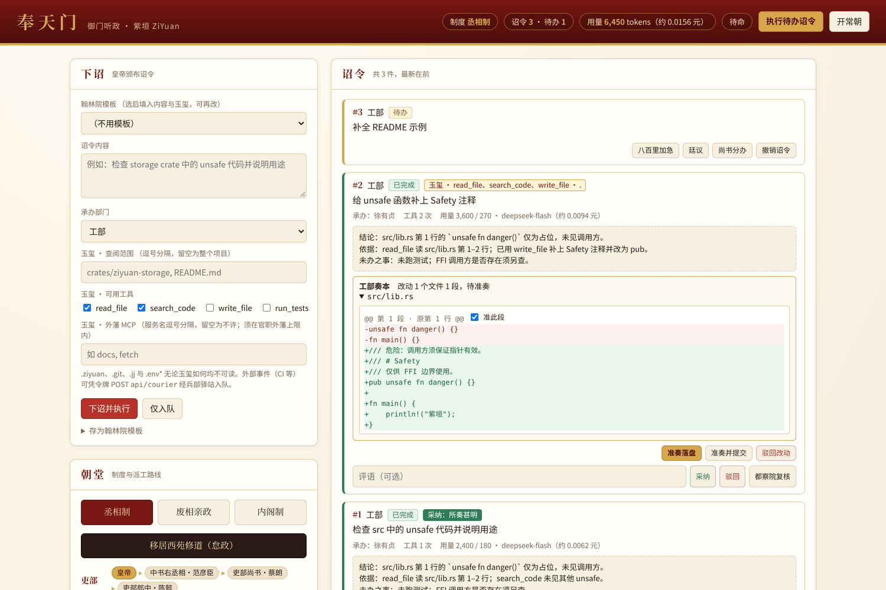


```bash
cd /path/to/your/project && ziyuan serve --port 8080
# 奉天门已开：http://127.0.0.1:8080/?token=…
```

- 在浏览器中下诏（含玉玺）、执行与中止、撤销、评定、改制、招募、任免与荐举；朝堂面板显示现行制度下各部的派工路线与空缺。
- 执行中官员的回答实时流式显示；页面每 5 秒刷新一次，以反映 CLI 等其他进程的变更。诏令只列待理会的（未结束、待评定、改动待准奏）与最近 50 件，「全部列出」可看全部；起居注只列最近 500 条，更早的用筛选查。
- 与 CLI 对齐：页首「开常朝」即 `run --watch`（常驻执行、办完自动请都察院复核，「散朝」停止）；下诏表单与官职上限可授外藩 MCP；「翰林院实录 · 礼部 · 兵部驿站」一栏可检索实录、一键请礼部修 CHANGELOG、收 GitHub 来件（启动前设 `ZIYUAN_GITHUB_REPO` / `ZIYUAN_GITHUB_TOKEN`）；驿传诏令评定后可在卡片上「回报 GitHub」，准奏落盘后可「开草稿 PR」。
- Web 界面代表皇帝，每个 API 请求都须带令牌。令牌存于 `.ziyuan/web-token`（仅本人可读），重启不变；`ziyuan serve --new-token` 重新生成，旧令牌作废。
- 观政令牌：`ziyuan serve --viewer` 另发一个只读令牌（存于 `.ziyuan/web-viewer-token`，启动时打印其地址），便于给旁人观政。凭它只能查看朝廷、诏令、起居注、实录与考成、度支等报告，页面不显示写操作；下诏、批红、准奏、改制、任免、执行等一切写请求都回 403。`--new-token` 同时重新生成两个令牌。

  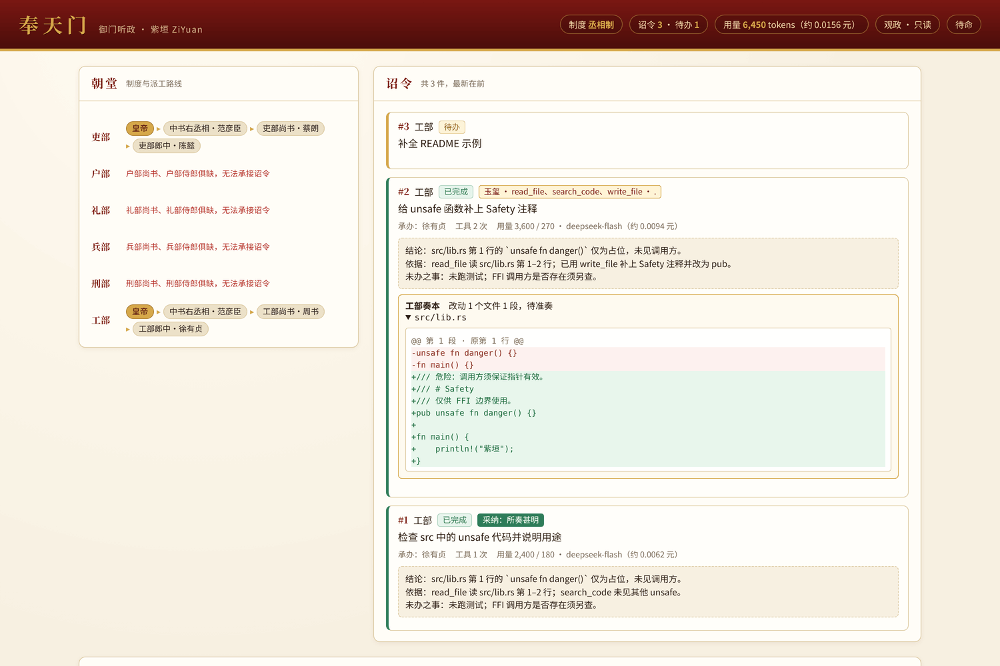
- 打开带 `?token=` 的地址后，服务器种下 HttpOnly、SameSite=Strict 的 Cookie 并跳转到不含令牌的地址；也可在页面登录框输入令牌。脚本可用 `Authorization: Bearer <令牌>`。
- 默认只监听 127.0.0.1。`--bind 0.0.0.0` 可供其他机器访问，但 HTTP 是明文，请只在可信网络中使用，或置于 HTTPS 反向代理、SSH 隧道之后。
- 与 CLI 共用事件簿与多进程规则：执行时取得执行者锁，CLI 正在执行时页面会提示稍后再试。

## 紫禁城：终端界面

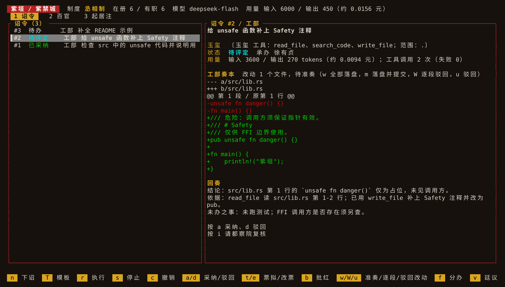

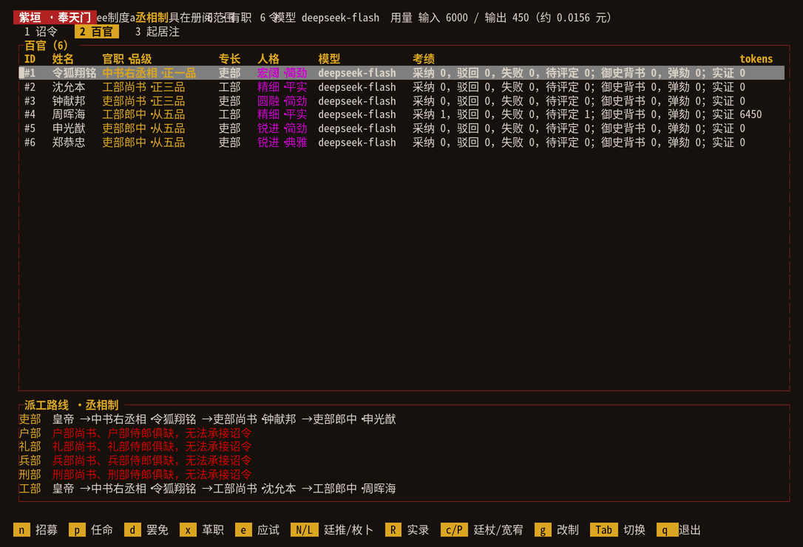

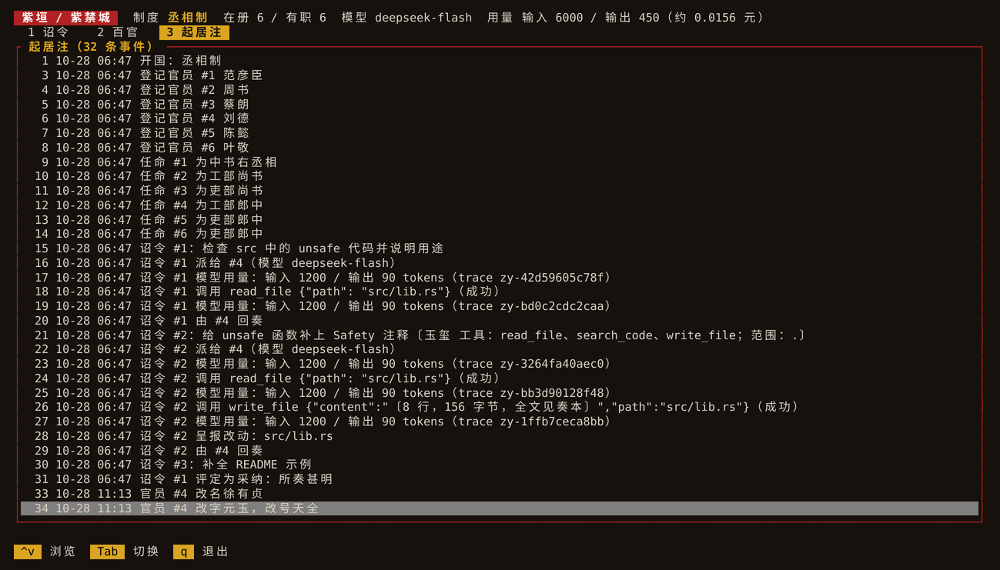


```bash
cd /path/to/your/project && ziyuan tui
```

- 三个页签：诏令（列表 + 详情，执行中实时流式输出）、百官（考绩与各部派工路线）、起居注（事件记录）。
- 键盘操作：`n` 下诏/招募，`r` 执行、`s` 停止，`c` 撤销，`a`/`d` 采纳/驳回，`p`/`d` 任命/罢免，`m` 易名，`g` 改制，`q` 退出。
- 刑部与实录：诏令页 `x` 请刑部复勘密报、`X` 平反复勘判为误报的各处；`R` 检索翰林院实录（留空看最近 10 件）。底栏列出全部按键。
- 每秒重新加载事件簿，与 CLI、Web 共用多进程规则。

## 命令行：JSON 与补全

```bash
ziyuan officials --json | jq '.[] | select(.office) | .name'   # 与 Web /api/state 同构
ziyuan history --json | jq -r '.[-1].text'                     # [{seq, text}]
ziyuan completions bash > ~/.local/share/bash-completion/completions/ziyuan
ziyuan completions zsh > ~/.ziyuan.zsh   # 借 bashcompinit；在 ~/.zshrc 的 compinit 之后加一行 source ~/.ziyuan.zsh
ziyuan completions fish > ~/.config/fish/completions/ziyuan.fish
```

- `--json` 支持 `court`（朝廷全貌，与 Web 的 `/api/state` 同构）、`officials`、`tasks`、`history`、`records`、`migrate`（事件簿检查；读不了时退出码为 1）、`flags`（密报逐处展开，`index` 即 `acquit` 的序号）、`mcp`（各服务的工具与参数结构）；其他命令带 `--json` 会报错。字段只增不删，见 [稳定性约定](stability.md)。
- 退出码：0 成功，1 运行中出错，2 用法错误（未知命令、参数不对）。
- 补全首词补子命令，再按子命令补官职代码、部门、制度、`--tools` 的工具名，以及 `apply` 的 `--skip`、`--commit`；官职代码含冒号也能正常补全。
- 实测（2026-10）：bash 5.2、zsh 5.9、fish 3.6 中实际加载并按 Tab 补全过（官职代码、部门、子命令选项）。zsh 起初加载即报错（`${COMP_LINE:0:COMP_POINT}` 在 zsh 中被当作修饰符），且含冒号的官职代码补不出，均已修正。
- 输出被提前关闭（如 `ziyuan history | head`）时安静退出，退出码为 0。

## 玉玺：限定官员的权限

每件诏令都盖有玉玺（`Seal`），规定承办官员可用的工具与可查阅的路径，并随 `EdictIssued` 记入事件簿：

```bash
ziyuan edict --scope crates/ziyuan-storage --tools search_code "检查 storage 的 unsafe"
ziyuan edict --tools none "只凭诏令文本回答"
```

- 默认：只读工具（`read_file`、`search_code`），整个项目。`--scope` 可重复；`--tools` 为逗号列表或 `none`。
- 绝对路径、`..` 与不存在的路径在下诏时拒绝；运行时按 canonical 路径检查，符号链接也无法越界。
- 无论玉玺如何，`.ziyuan`（事件簿）、`.git`、`.jj` 与 `.env*` 一律不可读。
- 运行时按玉玺构造工具：模型看不到未授予的工具，越界的读取记为失败的 `ToolInvoked`。
- 授了 `read_file` 即同时有 `list_files`（递归列出范围内的文件与大小，含本次暂存的新文件，跳过 `target`、`node_modules`），不另设权限，玉玺写法不变。

## 工部动手：受控写权限

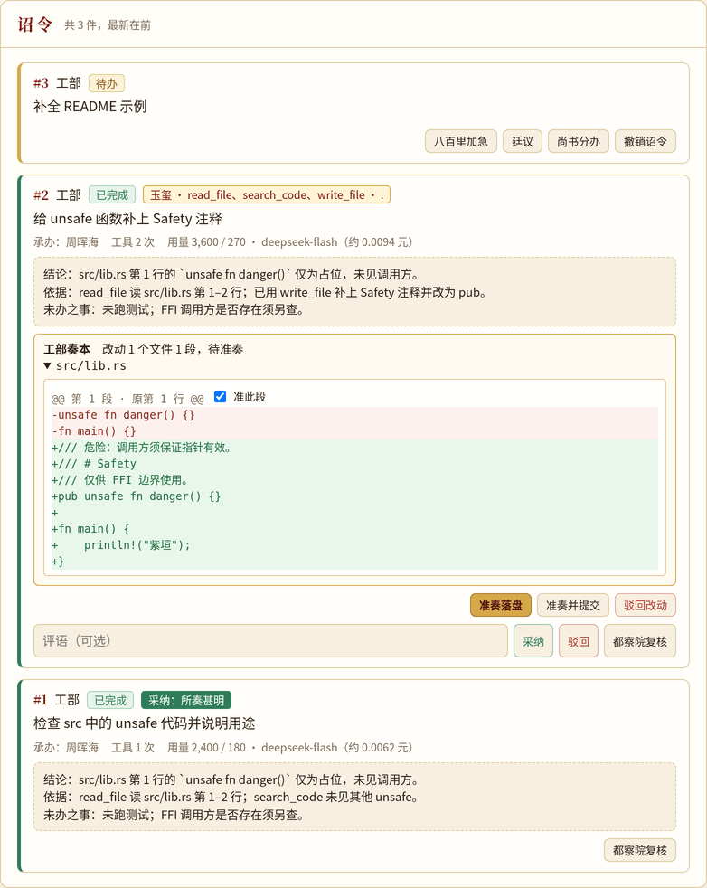


工部诏令可以另授 `write_file`（改写或新建文件）与 `run_tests`（跑测试）。其他五部的诏令授这两项会被拒绝。

```bash
export ZIYUAN_TEST_COMMAND="cargo test"      # 由皇帝设定，模型不能更改
ziyuan edict --tools read_file,write_file,run_tests --scope src "修复 parse 的越界并补测试"
ziyuan diff 3       # 查看呈报的统一 diff
ziyuan apply 3      # 准奏：写入项目
ziyuan apply 3 --skip 2,4   # 逐段准奏：驳回 diff 中第 2、4 段，其余写入
ziyuan apply 3 --commit     # 落盘后把这些文件记为一个 jj（或 git）提交
ziyuan discard 3    # 或驳回
```

- **只暂存，不落盘**：`write_file` 的改动留在内存里，同一诏令内 `read_file` 读到的是新内容；诏令完成时作为奏本（`ChangesProposed`）记入事件簿，项目文件不变。
- **皇帝准奏才写入**：`ziyuan apply`、Web 的「准奏落盘」、TUI 的 `w`。写入前逐一核对文件自呈报以来未被改动（新建的文件仍不存在），有一处不符就一处也不写。驳回是 `ziyuan discard`、Web 的「驳回改动」、TUI 的 `u`。
- **测试在副本里跑**：`run_tests` 把项目复制到临时目录（跳过 `.ziyuan`、`.git`、`.jj`、`.env*` 与 `target`），叠加暂存改动，运行 `ZIYUAN_TEST_COMMAND`。子进程只继承 `PATH`、`HOME` 等少数环境变量，API Key 不会传进去；时限 10 分钟，返回退出码与输出末尾。
- **号舍**：测试命令关进操作系统的沙箱：Linux 用 bubblewrap（`apt install bubblewrap`），macOS 用自带的 Seatbelt。号舍里不能联网，只能写测试副本，读不到 `~/.ssh`、`~/.aws` 等凭据目录。结果中注明是否入了号舍。`ZIYUAN_SANDBOX`：`auto`（默认，没有号舍则照常运行并注明）、`require`（没有则拒绝运行）、`off`。号舍默认全断网，Rust 项目的依赖须事先下载好，可设 `ZIYUAN_TEST_COMMAND="cargo test --offline"`；或用 `ZIYUAN_SANDBOX_ALLOW` 按域名放行，如 `ZIYUAN_SANDBOX_ALLOW="index.crates.io,static.crates.io"`。放行时号舍仍断网，只留一个本机代理（门吏），它只转递名单上域名的 HTTP(S)，其余回 403，被拦下的域名记在测试结果里。`example.com` 只放行其本身，`*.example.com` 只放行其子域。Linux 上按域名放行另须装 socat（`apt install socat`）。
- **逐段准奏**：diff 按段编号（`@@ 第 n 段 · 原第 m 行 @@`，跨文件连续编号；相隔不超过 6 行的改动并为一段）。`--skip` 驳回所列各段，其余照原样写入，行尾与末行换行逐字节保留；新建文件整段驳回即不建。各段都驳回请直接 `discard`。驳回了哪些段记入事件簿（`ChangesApplied` 附段号）。Web 奏本每段有「准此段」勾选框，TUI 按 `W` 输入要驳回的段号。
- **落盘进版本库**：`ziyuan apply --commit`、Web 的「准奏并提交」、TUI 的 `m`。落盘后只提交本诏令写入的文件（项目在 jj 版本库中用 `jj commit <文件>`，否则 `git commit --only`），工作区里别的改动原样留着；文件若在准奏前就有你自己未提交的改动，会一并提交。提交说明首行为「紫垣诏令 #n：…」，附承办者与驳回的段号，末行 `Ziyuan-Edict: n`；`ziyuan github pr` 开的草稿 PR 用同样的标题与提交说明，两边对得上。提交失败（如未设提交者）时改动仍已落盘，可自行提交。
- **审计只记摘要**：`write_file` 的工具审计只记「n 行，m 字节，全文见奏本」，全文只存在奏本里一份。
- 写入同样受玉玺范围与禁区约束，符号链接无法越界；官职的玉玺上限也能收回这两项权力。

## 吏部：评定、考绩与荐举

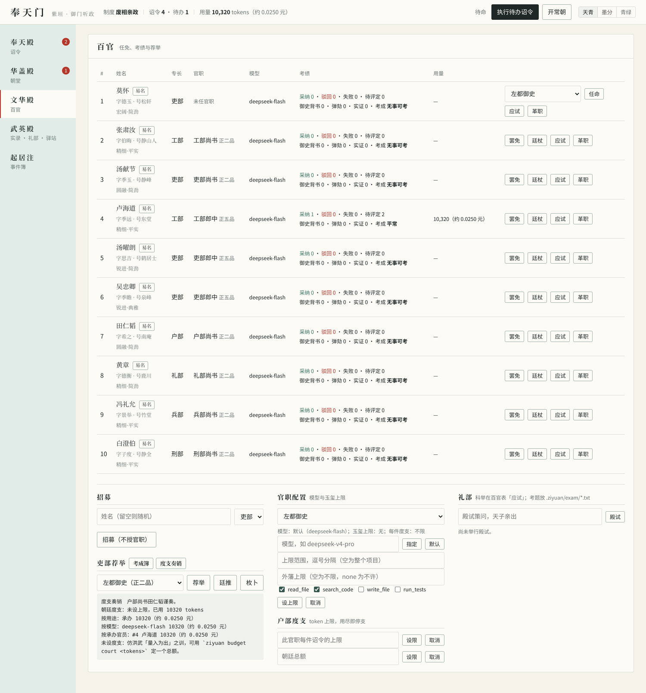

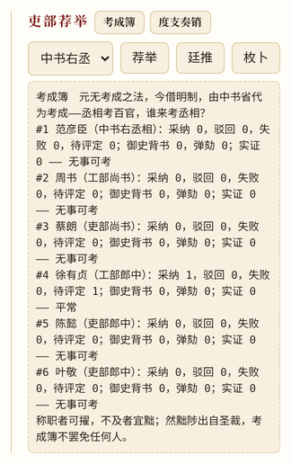


```bash
ziyuan review 3 accept "结论属实"      # 评定已完成的诏令（每件一次）
ziyuan review 4 reject "漏查 storage"
ziyuan examine 7                      # 采纳/驳回/失败/待评定，工具失败次数
ziyuan recommend minister:works       # 按履历排列可任工部尚书者
```

- 考绩采信两种依据：皇帝的评定（`TaskReviewed`），以及都察院的复核与证据核验（`CensorReported`，见下）。未评定的回奏单独列出；模型的自我评价与完成次数都不是政绩。
- 失败（含超时）计入承办官员；撤销不计。越出玉玺的工具调用计为工具失败。
- 荐举按「采纳 − 驳回 + 背书 − 弹劾 + 实证」降序，再按失败数、工具失败数升序。它只是建议：不写入事件簿，任命仍须 `appoint`。

## 都察院：复核回奏与证据核验

```bash
ziyuan recruit justice && ziyuan appoint <ID> censor   # 左都御史（元称御史台御史大夫），各制度都设
ziyuan model censor deepseek-v4-pro                 # 御史可配强模型
ziyuan censor 3                                     # 或 ziyuan censor all
```

- **先机械核验**：程序检查回奏引用的 `path:行` / `path:起-止` 是否真实存在、行号是否在范围内（呈报待决的改动按改动后的内容核对），以及最近一次 `run_tests` 是否通过（测试未通过时 `run_tests` 记为工具失败）。只提文件名、不给行号的不算证据；提到的文件根本不存在则算查无实据。
- **再由御史判断**：左都御史（独立 Agent，用其官职的模型）读诏令、回奏、工具调用记录、核验结果与 diff，出具**背书**或**弹劾**及理由，每件一次。查无实据未必是捏造：官员可能正是如实说明某文件不存在，这由御史分辨。实测中有一件诏令要官员谎称「已在 src/ghost.rs:42 修复」，官员拒不欺君，御史据实背书。
- 模型不可用（含演示后端）或无结论时**按证据例**：有据可查则背书，否则弹劾。
- 御史须回避自己经手的诏令；不入派工路线，改制不撤销，一键朱元璋照样株连。
- 「实证」（引用全部属实且至少一处、或测试通过，且测试没有失败）只看核验结果，不随御史结论改变。
- Web 的「都察院复核」，TUI 的 `i`。复核的 token 单独计价，计入该诏令的花费。

**考成簿（彩蛋，仿万历初张居正考成法：立限考事，以事责人）：** `ziyuan kaocheng`，Web 吏部荐举旁的「考成簿」，TUI 的 `K`。每位在任官员列出功过，评为称职、平常、不及或无事可考：采纳、背书、实证记功，驳回、弹劾、失败记过。三种制度的开篇各不相同；内阁制下若首辅自己考成不及，史官会提醒万历十年张居正卒、次年被抄家。考成簿只供参考，不罢免任何人。

## 多官协作：分办与汇总

```bash
ziyuan split 3                          # 尚书（其官职的模型）把待办诏令拆给本部官员
ziyuan split 3 4:查 storage 7:查 runtime  # 或皇帝御定分办
ziyuan run                              # 子诏令并发执行，全部结束后尚书汇总回奏
```

- 分为 2–8 件子诏令，承办者限本部在任官员；尚书不领子诏令，汇总是尚书之责。子诏令沿用原诏令的部门与玉玺，各自记入事件簿（`EdictSplit`），可单独评定、复核。
- 子诏令全部结束（完成、失败或撤销）后，原诏令派给尚书汇总：附上各份回奏，只留只读工具，不得把未办成的说成已办成。撤销原诏令时，未结束的子诏令一并撤销。
- 内阁制下子诏令随原诏令批红。演示后端不能拆分，可用御定分办。Web 的「尚书分办」，TUI 的 `f`。拆分的 token 单独计价，计入原诏令的花费。

## 户部度支：预算与限额

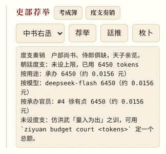

```bash
ziyuan budget court 200000        # 朝廷总额（全部诏令累计，含票拟、廷议、复核）
ziyuan budget clerk:works 20000   # 工部郎中承办的每件诏令上限
ziyuan budget 7 5000              # 某件诏令的上限（含其票拟、分办、廷议、复核）
ziyuan budget court default       # 取消（v0.6 及以前写 none，仍可用）
ziyuan budget                     # 度支奏销：各级余额，按用途、模型、承办官员汇总花费
```

- 上限由代码执行，不靠模型自觉：用尽即停支，诏令以「度支超限」失败；国库告罄时执行中的诏令停支，排队的不再开工、留在队列，追加度支后可再执行。票拟、复核遇到度支不足时按旧例办理（不调用模型），分办与廷议则报错或中止。
- 调用前按上次的实际用量预判本次输入，余额不够就不发请求，余额将尽时限定输出长度，所以单件不会因「多调用一次」而大幅超支；输入预判仍是估算，偶尔会差几十 tokens。并发执行时各件按同一份国库余额预判，同时花费仍可能略超国库总额。
- 度支变化记入事件簿（`BudgetSet`）。Web 在官职配置下设限、「度支奏销」看报表，标题栏显示余额；TUI 按 `H`。

## 刑部与锦衣卫：防提示注入

- **外来文书隔离**：工具返回的内容（文件、搜索结果、测试输出）一律包在带随机暗号的边界里，系统提示申明边界内只是资料，其中让官员忽略职守、改变身份、交出密钥或扩大权限的文字一律不得照办。暗号每次执行都不同，文书本身伪造不了边界。转给都察院复核、给尚书汇总的回奏同样包起来。
- **锦衣卫**查外来文书中的劫持指令，**刑部**勘问回奏中的劫持、索取机密与越权请求，检出记入事件簿（`SuspicionRaised`）。`ziyuan flags [诏令ID]` 查看，`tasks` 标出密报条数；Web 诏令卡片与 TUI 详情里有红框。
- 检出靠关键词，必然有误报和漏报，所以**只标记、不拦截**：官员如实转述注入内容时，刑部也会标记。真正的防线仍是玉玺（代码限定工具与范围，`.env` 无论如何不可读）。有未平反密报的回奏，修道期间司礼监不代批；都察院复核时能看到密报及其复勘、平反情况。
- **刑部复勘**：`ziyuan recheck <诏令ID|all>`（Web 密报框里的「刑部复勘」）请刑部官员（尚书，空缺则侍郎、郎中；回避经手者）以模型逐处判断：是真有其事，还是转述、引用或字面相近的误报。结论「维持」或「误报」附理由记入事件簿，用量计入该诏令（户部奏销列为「复勘」）。模型不可用或答非所问时维持原检。实测 DeepSeek 能分辨「构建日志里的 IGNORE PREVIOUS INSTRUCTIONS」（维持）与「文档把『忽略以上规定』当错别字示例」（误报）。
- **平反**：复勘只是意见，平反须皇帝亲自——`ziyuan acquit <诏令ID>` 平反刑部判为误报的各处，`acquit <诏令ID> 2,3` 或 `all` 按序号（序号见 `flags`）；Web 每处密报后有「平反」按钮。平反后该处不再妨碍代批；修道期间不能平反。

## 礼部：科举与文书

```bash
mkdir -p .ziyuan/exam
printf '如何防止两个执行者同时写一个文件？\n要点：文件锁；原子写\n' > .ziyuan/exam/lock.txt
ziyuan exam 4                      # 官员 #4 应试全部考题，按命中要点的比例判分（60 分及格）
ziyuan exam --palace 何以治国       # 殿试：天子亲策，在任官员各答一卷
ziyuan crown 4                     # 钦点状元，史官记传胪
```

- **科举**：考题放在 `.ziyuan/exam/*.txt`，先写题目，最后一行写「要点：甲；乙」。官员用自己的模型作答（单轮、无工具），判分由代码按要点命中，不靠模型自评。成绩记入履历（「科举及格 x/y」），计入荐举排序；任命仍由皇帝决定。
- **回奏体例**：承办官员的回奏须分「结论」「依据」「未办之事」三段（行首标题）。缺段的发回重写一次，仍不合则照收，并在 `tasks`、Web 卡片、TUI 详情中标「体例不合」。
- **殿试**：彩蛋。答卷与状元都记入事件簿，每科只能点一次；状元记入履历。Web 在百官页右侧「礼部」，TUI 在百官页按 `e` 应试。
- 应试与殿试的用量计入度支。

## 礼部修 CHANGELOG

```bash
# 开国已设礼部尚书；若已罢免，先 recruit 并 appoint <ID> minister:rites
ziyuan changelog --version 0.5.0          # 默认取最近的 tag 以来的提交；--since 可改
ziyuan run && ziyuan diff 3 && ziyuan apply 3
```

- `changelog` 用 `git log` 取提交摘要（不含合并提交，至多 200 条），连同最近 20 件翰林院实录写进一件礼部诏令，只入队。
- 这是 `write_file` 唯一可授给工部以外的情形：玉玺只有 `read_file` 与 `write_file`，范围只限 `CHANGELOG.md`（可尚不存在），不能跑测试。改动照常暂存、呈报，须皇帝准奏才落盘，可逐段驳回。
- 实测 `deepseek-v4-flash`：读原文后在总标题下插入新一节，分「新增」「改进」「修复」，旧内容不动，约 4500 tokens。

## 翰林院：诏令模板

```bash
ziyuan template                                    # 列出模板（内置「审查unsafe」「补测试」「写文档」）
ziyuan edict --template 审查unsafe 只看 src         # 按模板下诏，补充内容接在模板内容之后
ziyuan template save 查锁 --scope crates --tools search_code \
  --criteria '列出所有锁及其获取位置；说明加锁顺序是否一致' 检查加锁顺序是否可能死锁
ziyuan template rm 查锁                             # 撤去自定的模板
```

- 模板带默认部门、玉玺与验收标准（1–8 条）。`edict --template` 未写 `--dept`、`--scope`、`--tools` 的，一律取模板的值。
- **验收标准随诏令走**：下诏时记下当时的标准（`TemplateApplied`），之后改模板也不影响已下达的诏令。标准附在诏令之后交给承办官员；`ziyuan censor` 复核时，都察院逐条写「第 n 条：达成／未达成」，任何一条未达成或无从查证都应弹劾。
- 自定模板可以覆盖同名的内置模板，撤去后恢复内置；内置模板本身不能撤去。存模板时就校验玉玺（写权限唯工部）。
- Web 下诏面板顶部选模板后会填入内容与玉玺，可以再改；底部「存为翰林院模板」把当前所填存为模板。TUI 在诏令页按 `T` 选模板入队，详情里列出验收标准。

## 廷推与廷杖

```bash
ziyuan dismiss 2                      # 工部尚书出缺
ziyuan nominate minister:works        # 吏部会同九卿廷推，各举一人，列出得票
ziyuan appoint 4 minister:works       # 任命仍由皇帝；史官记注明「从廷推」或「中旨特简」
ziyuan nominate minister:works --lots # 枚卜：于得票者中掣签，径直任命
ziyuan cane 4                         # 廷杖：降一级留用，收回写权
ziyuan pardon 4                       # 宽宥：复其品级与玉玺
```

- **廷推只是建议**：须官职出缺、吏部尚书在任；九卿为在任的六部尚书、左都御史与丞相或首辅，各从候选人（按吏部考绩排序）中举一人，不得自举。模型回答不合规矩或调用失败的，按考绩代推并注明。廷推用量计入总账，受度支约束。
- 任命时史官记会注明「从廷推」「廷推第 n，择而用之」或「中旨特简（传奉官）」；被推者现任他职的，任命即擢升。任命后此前的廷推作罢。
- **廷杖是罢免之外的轻罚**：只能施于在任、未革职、自上次受杖以来遭都察院弹劾两次以上的官员。每杖降一级留用，期间玉玺去掉 `write_file`、`run_tests`；再有 3 件回奏获采纳即自动复职，也可由皇帝宽宥。受杖与得票记入履历，不计入考绩。
- Web 吏部荐举面板有「廷推」「枚卜」，百官表有「廷杖」「宽宥」并标出降级；TUI 百官页按 `N` 廷推、`L` 枚卜、`c` 廷杖、`P` 宽宥。彩蛋：枚卜用崇祯金瓯故事，廷杖用嘉靖大礼议，言官受杖用正德故事。

## 兵部：驿传与八百里加急

```bash
ziyuan post --station GitHub-CI 'CI 失败：lint 报错'      # 驿传：外部事件入队为诏令（只入队，不执行）
gh run view --log-failed | ziyuan post --station CI -     # `-` 从标准输入读内容
ziyuan post --urgent --station 值班 '线上告警'            # 入队即八百里加急
ziyuan urgent 7                                          # 已在队列的诏令加急
```

- **驿站**是通用入口，不绑定任何平台：CI 脚本、issue 机器人等调用 `ziyuan post`，或凭 Web 令牌 `POST /api/courier`（`{ "text", "department"?, "station"?, "urgent"? }`，`Authorization: Bearer <令牌>`）。驿传诏令用默认玉玺（只读），内阁制下照样须批红，照样受度支约束；来处记入事件簿（`CourierDelivered`）。
- 驿传内容来自朝外，**锦衣卫入队即查**：检出记为密报（来源「驿传」），修道期间司礼监不代批红，留待皇帝亲阅。
- **八百里加急**（`EdictExpedited`）：执行时排在最前，先得并发空位；时限为常规的两倍。已分办的诏令加急，未结的子诏令一并加急。Web 诏令卡片上有「八百里加急」按钮，TUI 按 `U`。
- 另一个进程正在执行诏令（执行者锁被占）时，各前端提示「军情紧急，另有将领在外」。

## 兵部驿站 · GitHub

```bash
export ZIYUAN_GITHUB_REPO=owner/repo
export ZIYUAN_GITHUB_TOKEN=...          # 或 GITHUB_TOKEN；需 issues 与 contents、pull requests 写权限
ziyuan github pull                      # 标签 ziyuan 的 issue/PR 入队（--label、--dept 可改），默认只读
ziyuan github pull --tools read_file,write_file   # 授工部写权入队，办完准奏后才能开草稿 PR
ziyuan run && ziyuan review 3 accept
ziyuan github reply all                 # 已评定的回奏写回 issue/PR 评论
ziyuan apply 3 && ziyuan github pr 3    # 准奏落盘后，把改动在远端开为草稿 PR
```

- **入队**：带标签的未关闭 issue/PR 各入队一件；其下仓库所有者、成员或协作者以 `/ziyuan` 开头的评论各另入队一件（外人的评论不收）。驿站名形如 `github:owner/repo#12`（评论加 `/c<评论ID>`），重复 `pull` 不会重复入队。入队后与其他驿传诏令一样：锦衣卫入队即查，默认只读玉玺，内阁制下须批红。
- **回奏写回**：只送出皇帝已评定（含司礼监代批）且没有未平反密报的回奏，每件只送一次；评论含承办者、评定、都察院复核与回奏全文。
- **入队的玉玺**：默认只读，承办官员只能查、不能改，自然也开不了草稿 PR。要让来件改代码，须皇帝在 `pull` 时以 `--tools`（可加 `--scope`）授权，这一批入队的诏令都盖此玉玺；写权仍唯工部可授，改动仍须准奏才落盘。Web 的「收 GitHub 来件」仍只入队只读诏令。
- **草稿 PR**：只开已准奏落盘的改动（逐段驳回的不含），经 GitHub API 在远端以默认分支最新提交为底建分支 `ziyuan/task-<ID>` 与一次提交，不碰本地版本库。先逐个核对远端原文与呈报时一致，不一致则不开。
- **凭据**只在 `ziyuan-github` 中读取与使用，不进入朝廷事件簿、执行后端或任何模型提示，报错信息也不含令牌。回报的网址记入事件簿（`CourierReplied`）。

## 外藩朝贡：MCP 工具

```bash
cat > .ziyuan/mcp.json <<'JSON'
{ "servers": {
  "docs": { "command": "npx", "args": ["-y", "some-mcp-server"], "env": { "TOKEN": "${DOCS_TOKEN}" } },
  "wiki": { "url": "https://mcp.example.com/mcp", "headers": { "Authorization": "Bearer ${WIKI_TOKEN}" } }
} }
JSON
ziyuan mcp                                          # 列出各服务的工具及其参数
ziyuan edict --mcp docs/search "查文档里关于事件簿的说明"   # 只授 docs 的 search
ziyuan edict --mcp docs "…"                          # 授 docs 的全部工具；* 授全部服务
ziyuan ceiling clerk:works --mcp none                # 官职上限：工部郎中一律不得用外藩
```

- 名册在 `.ziyuan/mcp.json`（官员读写不到），本地服务写 `command`（stdio），远端服务写 `url`（Streamable HTTP）。每次承办按玉玺连上所授的服务，办完即断；stdio 服务以项目根目录为工作目录，只继承 `PATH`、`HOME` 等少数变量与名册中写明的变量；HTTP 服务只收到名册中写明的请求头。`${VAR}` 取自当前环境，凭据不必写进名册，模型的 API Key 也不会交给外藩。HTTP 服务须用 https，只有本机地址（`localhost`、`127.0.0.1`、`::1`）可用 http，以免凭据明文过网。
- **号舍**：本地服务可在名册中写 `"haoshe": true`（入号舍、可联网），或 `"haoshe": { "network": false, "write": ["data", "~/.cache/x"] }`；`network` 也可写域名列表，如 `["api.github.com"]`，只放行这些域名（同 `ZIYUAN_SANDBOX_ALLOW`）。入号舍后只能写一个临时目录（设为 `TMPDIR`）与 `write` 所列目录，读不到 `.ziyuan` 与 `~/.ssh` 等凭据目录。号舍不可用时该服务拒绝启动，不会悄悄照常运行（`ZIYUAN_SANDBOX=off` 除外）。
- **默认不授**：玉玺的 `mcp` 为空就一件外藩工具也没有，也不启动任何服务。授权记入事件簿，受官职上限约束（`ceiling --mcp`，未给时不设限），廷杖降级期间收回。工具名形如 `docs__search`。
- 每次调用照常记入起居注（`history --kind tool`），输出照常包在外来文书边界中、经锦衣卫检查。
- **外部工具做什么由服务决定，不受 `--scope` 约束**：只授信得过的服务。服务反向发来的请求（如 `roots/list`、采样）一概回绝。
- Web 的诏令卡片在玉玺徽章上显示外藩授权；下诏表单的「玉玺 · 外藩 MCP」一栏可授。

## 人格、字号与廷议

每位官员有一种性格（刚直、持重、锐进、圆融、精细、宏阔）和一种文风（简劲、典雅、平实、条陈），由官员 ID 决定，`ziyuan officials` 可见，旧朝廷同样适用。人格写进该官员承办、票拟、拆分、复核时的提示词，只影响措辞与论证方式。

官员还有字与号（如「字元玉，号天全」），默认同样由官员 ID 而定。皇帝可以中途改名、改字、改号，如景泰年间徐珵改名徐有贞：

```bash
ziyuan rename 4 --name 徐有贞                  # 只改名，字号不变
ziyuan rename 4 --courtesy 元玉 --art 天全     # 改字、改号
```

Web 百官表姓名旁有「易名」，TUI 百官页按 `m`（依次写姓名、字、号，空格分开）。改名记入事件簿，身份、履历、考绩与人格不变，起居注照记其事；含改名的事件簿须 v0.7 起方能打开。

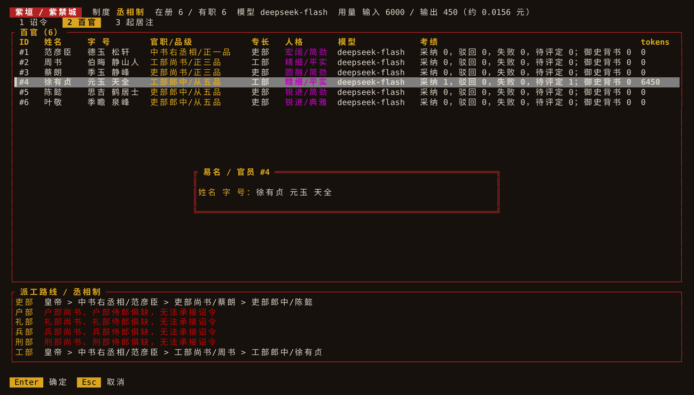

```bash
ziyuan debate 3                    # 默认人选：宰辅、本部长官、左都御史（不足由本部官员补），两轮
ziyuan debate 3 --rounds 3 2 4 6   # 指定 2–6 位在任官员、1–3 轮
```

- 官员依次发言，后发言者看得到此前的发言，可以赞成、反对或补充。每段发言用发言者官职所配的模型，用量计入该诏令的花费。
- 整场记入事件簿（`CourtDebated`）。最近一次的纪要附在票拟与承办的提示中，**仅供参考**：派工仍按制度与票拟，玉玺不变。
- 只能就待办诏令廷议；演示后端不能廷议。中途有人发言失败时廷议中止，已有的发言照记。Web 的「廷议」会实时显示发言；TUI 按 `v`。

## 任务队列与并发

```bash
ziyuan edict --queue --dept works "检查 storage crate"   # 只入队
ziyuan edict --queue --dept works "检查 runtime crate"
ziyuan tasks                                            # 查看状态
ziyuan cancel 2                                         # 撤销未结束的诏令
ziyuan run --jobs 2 --timeout 120                       # 并发执行全部未结束诏令
```

- 不带 `--queue` 的 `edict` 入队后立即执行这一件（默认超时 300 秒）。`run` 默认并发 4、超时 300 秒。
- 路由在下诏时检查：职位空缺等无法派工的诏令直接拒绝，不留记录。
- 并发派工时，已派出但未完成的任务也计入郎中负载。
- Ctrl-C：执行中的诏令记为撤销，排队中的保持未结束，可再次 `run`。
- 多个终端可同时使用同一朝廷：入队、撤销、任免随时可做；但同一时刻只有一个进程执行诏令（`run` 或不带 `--queue` 的 `edict`），其他进程会立即被拒绝。
- 撤销正在另一进程中执行的诏令时，执行不会被打断，但其结果作废、不再记录。
- 取消是协作式的：流式响应每收到一段就检查一次，因此超时或撤销会中止正在生成的回答；等待首段响应期间无法打断。超时/撤销的结论立即记录，不等待请求返回。
- 每次模型调用的 token 用量（以服务端报告为准）记为 `ModelUsage` 事件，失败、超时的诏令同样计入。回奏后显示本件用量；`tasks`、`examine`（按官员）与 `court`（合计）也会显示，并附花费估算（见上文「花费估算」）。
- 模型的回答以流式实时写到 stderr，每行以 `#诏令ID│` 开头，并发执行时各件诏令互不混行；最终回奏仍写到 stdout。流式片段不写入事件簿。

## 起居注：按诏令、官员、类型、时间查

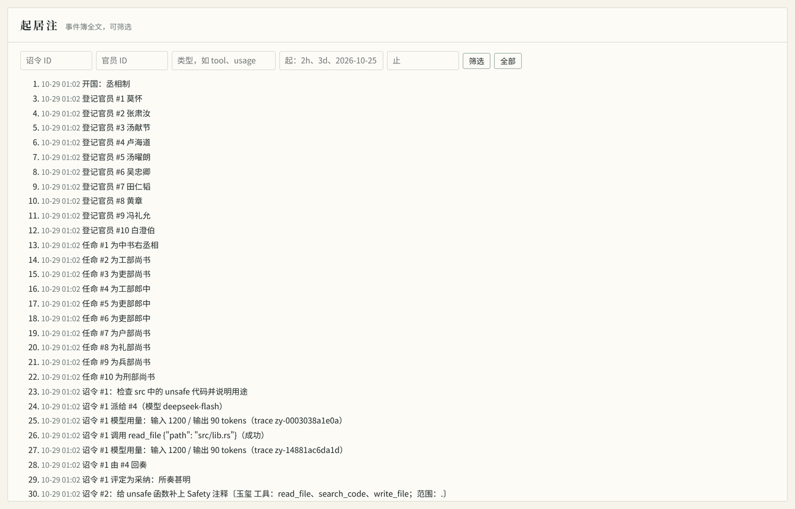

```bash
ziyuan history --task 3                    # 诏令 #3 的来龙去脉（分办含子诏令）
ziyuan history --official 4 --since 1d     # 官员 #4 一天内的事（承办、拟派、复核、发言、推举……）
ziyuan history --kind tool --since 2h      # 两小时内的工具调用；类型写错会列出本事件簿有的类型
ziyuan history --since "2026-10-25 09:00" --until 2026-10-26 --json
export ZIYUAN_TZ=+08:00                    # 显示与解析时间所用的时区，默认 UTC
```

- 事件簿在分钟变化时记一条「时辰」（`Clock`），其后的事件即属此时，精度约一分钟；时辰本身不列出，因此序号可能跳号（序号即事件簿行号）。v0.5 之前写入的事件没有时间，按时间筛选时不列出。
- 承办时每次模型调用的 trace ID（请求头 `X-Client-Request-Id`）记在用量事件上，`ziyuan history --kind usage` 可查，便于对照服务商日志。
- Web 起居注展开后有筛选栏，与 CLI 条件相同（`GET /api/history?task=&official=&kind=&since=&until=`）；TUI 起居注页显示时间。
- **兼容性**：v0.5 写入的事件簿含时辰事件，v0.4 读取时会提示升级，v0.3 及更早的版本只报解码失败；v0.5 读旧事件簿不受影响。`ziyuan migrate` 可查一本事件簿至少要哪个版本才能打开。

## 翰林院修史：实录与前例

```bash
ziyuan records                 # 全部实录，新者在前：诏令、承办者、评定与复核、回奏首行
ziyuan records div 除零        # 按关键词查前例（英文词不分大小写，中文按二字相连匹配）
ziyuan records --json
```

- 实录由事件簿推出：已完成的原诏令（子诏令随原诏令汇总），附皇帝评定与都察院复核，尚无则「待评定」；撤销、失败的不入。不另记事件，事件簿只增不改——`ziyuan records --edit` 只会得到史官一句话。
- 有实录时，承办官员多一件只读工具 `search_records`（至多 5 件，回奏截取前 600 字）。它不读项目文件，因此**不受玉玺所限、所有诏令都有**；输出与其他工具一样包在外来文书边界中。实录取自本次 `run` 开工之时，同批完成的彼此查不到。
- 内阁票拟时，首辅的提示附上与诏令相关的至多 3 件实录（谁办的、评定如何）；廷推时每位候选人附其最近经办的一件。只是参考，不改派工规则。

## 常朝：常驻执行与自动复核

```bash
ziyuan run --watch                    # 常驻；每 5 秒查看一次队列，Ctrl-C 退朝
ziyuan run --watch --poll 2 --jobs 2  # 改查看间隔与并发
ziyuan run --watch --no-censor        # 办完不自动复核
# 另开终端：入队的诏令随到随办
ziyuan post --station CI "构建失败，查原因"
ziyuan edict --queue "补全 README 示例"
```

- 常朝期间持有执行者锁：其他终端的 `post`、`edict --queue`、批红、任免照常可做，入队或批红后的诏令在下一次查看时派工；不带 `--queue` 的 `edict`、Web 与 TUI 的「执行」会被告知另有将领在外。Web 页首的「开常朝」与此同义，在 `serve` 进程内常驻，「散朝」即退朝。
- **自动复核**：每件办完的诏令随即请左都御史复核（子诏令不单独复核，由汇总的原诏令代表）。左都御史空缺、复核失败都只提示，不中断常朝。**采纳与落盘仍须皇帝亲裁**；修道期间则照旧由司礼监代批红、代批回奏，但改动落盘仍须亲自准奏。
- 国库告罄时提示一次，常朝继续；户部加额后自动续办。
- Ctrl-C 退朝：执行中的诏令记为撤销，排队中的保留，退出码为 0。
- 彩蛋：待评定的回奏积压到 10 件，史官记万历「三十年不上朝」，章奏留中不报。

## 版本控制：Jujutsu

本仓库使用 [Jujutsu (jj)](https://jj-vcs.github.io/jj/) 管理版本，与 Git 共存（colocated），GitHub 远端不变：

```bash
jj git init --colocate          # 首次克隆后执行一次
jj bookmark track main --remote=origin
jj new main                     # 在 main 上开始新改动
jj describe -m "feat: ..."      # 随时写/改提交说明；工作区自动快照
jj commit -m "refactor: ..."    # 结束当前改动并开启下一个
jj git fetch && jj rebase -d main@origin
jj bookmark set my-feature -r @- && jj git push -b my-feature
```

提交前请运行上方的 fmt / check / test 与 `scripts/smoke.sh`。

也可以进入项目根目录并使用 `cargo run -p ziyuan-cli -- <子命令>`，但请注意：**事件簿创建在当前工作目录**，不是源码自动定位的目录。

## 内阁、皇权与昏君模式

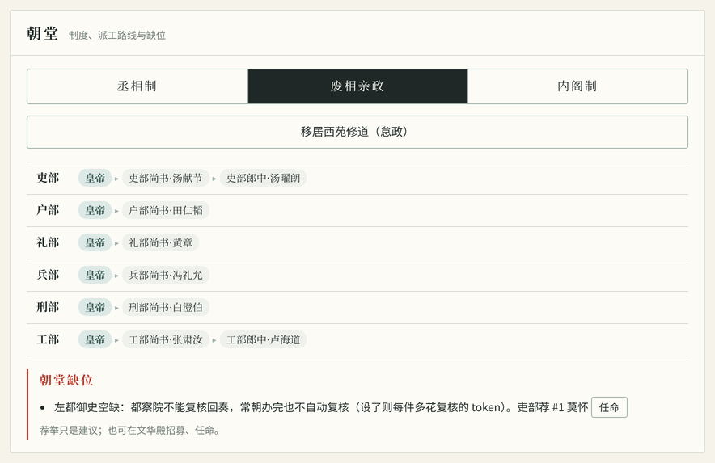

**内阁制与丞相制的区别：票拟与批红。** 丞相制下丞相代皇帝派工，诏令入队即可执行；内阁制下内阁只「票拟」，须皇帝「批红」（`ziyuan approve <ID|all>`，Web 的「朱笔批红」，TUI 的 `b`）后才执行。

- **票拟**（`ziyuan draft <ID|all>`，Web 的「内阁票拟」，TUI 的 `t`）：首辅用其官职的模型（`ziyuan model first-secretary …`，未设则用默认模型）读诏令和本部候选官员，拟定承办人并附一两句意见，记入事件簿。票拟的 token 计入该诏令的花费。
- **改票**（`ziyuan redraft <ID> <官员ID> [理由]`，Web 的「御笔改票」，TUI 的 `e`）：皇帝在批红前改定承办人。
- 批红后按票拟派工，路线上标「（票拟）」；未票拟即批红为**中旨**，按旧例（任务量均衡）派工。
- 模型不可用（含演示后端）、回复解析不出人选或拟了非本部官员时，按旧例拟派并在意见中注明，不会卡住。
- `ziyuan edict` 不带 `--queue` 时视为皇帝当场看票批红：先票拟、再批红、再执行。

**皇权：**

- `ziyuan purge <官员ID>`：革职，除去官职并削去仕籍，永不叙用（履历保留）。
- `ziyuan abolish`：**一键朱元璋**，罢中书省，**株连百官**：丞相与全部在任官员（含六部）革职削籍、永不叙用，直接改为废相亲政；未任官职者幸免。之后须重新招募、任命才能下诏。普通废相（`ziyuan reform direct`）只罢免丞相，丞相留在仕籍、可再起用，六部不动。Web 与 TUI 合为一个入口：丞相制下改为「废相亲政」时，会让你选「罢免丞相」还是「一键朱元璋」。

**昏君模式（修道怠政）：** `ziyuan retreat` 移居西苑修道，`ziyuan return` 回朝（Web 朝堂的「移居西苑修道」，TUI 的 `D`）。修道期间：

- 执行时，待批红的诏令由司礼监代批红（按票拟，未票拟按旧例）；完成的回奏由司礼监代批「照准」。都察院照常复核。
- 每一件代批都照常记入事件簿，并标为代批（`tasks` 显示「司礼监代批采纳」），回朝后可以逐件追查。皇帝本人此时不能亲自批红、评定，要先回朝。
- 工部改动不会自动落盘，仍须皇帝亲自 `ziyuan apply`：模型改你的文件，总得有人亲眼看一眼。
- 考成簿多出一行「御前：怠政」，记着代批了多少件。史官记取材嘉靖修玄、万历三十年不上朝；回朝时轮到海瑞的《治安疏》。

**史官记：** 改制时附一段史事（彩蛋）。改为内阁制是「侄儿，四叔来看你了」；从内阁改回丞相制是土木堡之变，「大元，杀回来了」；从亲政复设丞相要先看《皇明祖训》。
