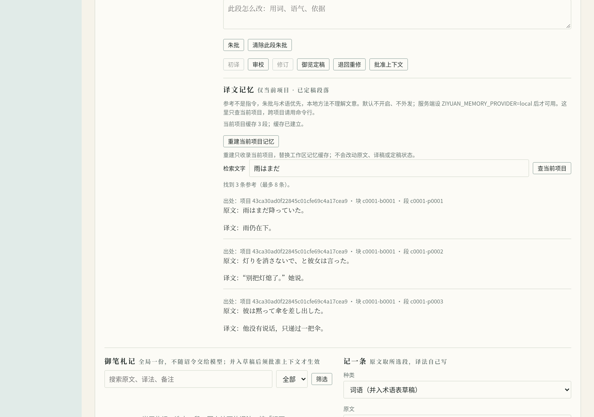
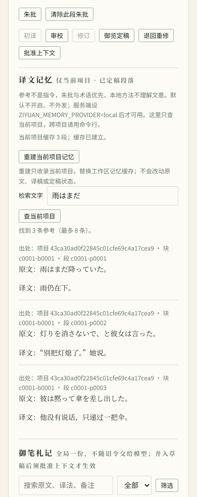

# 翻译记忆：查找已定稿的参考译法（1.3.0）

翻译记忆把**当前仍然有效的御览定稿**整理成可查询的原文与译文对，方便你找回以前认可的译法。它不是整本书自动翻译，也不会替你批准译稿。本版只提供本机方法，没有远程服务，不声称能提高文学质量或长篇一致性。

完整译书步骤见[小说翻译指南](novel-translation.md)。先用 `ziyuan init` 建朝，再有项目与有效定稿，才可建库；只是已准奏、待御览或模型声称完成，都不算定稿。文本项目的导入本身仍不要求建朝。

## 怎么建、怎么查

下文的 `<项目ID>`、`<其他项目ID>` 要换成实际编号，不要复制尖括号。命令均支持 `--json`；完整参数以 `ziyuan text help` 为准。

```text
ziyuan text memory status <项目ID> [--json]
ziyuan text memory build <项目ID> [--project <其他项目ID>]... [--json]
ziyuan text memory search <项目ID> --query <原文> [--project <其他项目ID>]... [--limit N] [--json]
```

默认没有启用记忆库计算。先显式选择本地方法，再建库与查询。以下是 Bash 示例：

```bash
export ZIYUAN_MEMORY_PROVIDER=local
ziyuan text memory status <项目ID>
ziyuan text memory build <项目ID>
ziyuan text memory search <项目ID> --query '以前出现过的原文' --limit 5
```

PowerShell 用 `$env:ZIYUAN_MEMORY_PROVIDER = 'local'` 设置同一个变量。未设置、空值或 `none` 表示没有可用提供方；建库与搜索会明确报不可用，不把它装成“没有相似内容”。查看状态不要求先建库；尚未建库不是运行失败。

- 默认只允许当前项目。跨项目建库或查询，都须逐个写 `--project <其他项目ID>`；没有 `--all`。建库时列过的项目，不等于以后查询也自动获准使用。
- `--query` 必填，不能只有空白。`--limit` 默认 5，只接受 1–50 的整数；少于这个数量的候选就只返回实际数量。
- 先限定同一工作目录、明确允许的项目、源语言与目标语言、内容种类，再计算候选的相似程度。其他语种或未允许的项目不会靠高分混进来。
- 结果有项目、章、块、段及定稿版本等出处，可回到原文核对。分数只帮助排序，不是可信度、正确率或文学评分；本版没有“达到多少分就适用”的门槛。
- CLI 查询是你主动发起的操作。命中只是**参考译法**，不表示已经用于初译或修订，更不会自动采纳、改术语表、改朱批、准奏或发布。是否适用仍由你结合上下文判断。

`search --json` 另有 `reference_prompt`，是供你主动选用的「参考译法」文本。它保留出处，把原译文作为 JSON 引用放在带随机标记的外来文书边界内，并说明朱批与术语优先、没有额外工具或写入权限。没有命中时该字段为空。工具不会替你把它送给模型；若要交给其他翻译流程，须在实际使用前重新查询并核对，导出的文本不是一直有效的批准凭证，也不能保证模型一定不受误导。

## 在网页里用

启动 Web 服务前设置 `ZIYUAN_MEMORY_PROVIDER=local`，再运行 `ziyuan serve`。在武英殿的译书卡片选定项目，点击「重建当前项目记忆」，输入原文后点「查当前项目」。网页最多显示 8 条，只查当前项目；跨项目仍须用命令行明确指定。

重建会**替换工作区整份记忆缓存**，不是追加项目；不会修改原文、译稿或定稿记录。未启用时操作不可用；缓存坏了会报错，仍可点击重建。没有定稿时可建空库，但不会把未获准的译文塞进去。

下面用本次原创短句与固定译文演示流程，定稿由公开应用接口准备，建库和查询由真实网页执行；未调用翻译模型，不是文学质量评测。截图为 Chromium 桌面与 390 CSS 像素窄屏布局，不代表真机测试。





## 收哪些内容，什么时候不再提供

每段必须来自当前有效的御览定稿，原文、磁盘译稿、已批准上下文及朱批版本都要核对。段落编号缺失、重复、乱序、混入陌生编号或空译文时，整块不收，不从坏块里挑几段凑数。

退回重修、原文或上下文改变、译稿被手改或丢失，以及状态不确定时，都不能继续当作有效参考。**读取时会重新核对资格，不是建过库就一直有效。** 遇到“资料有变、需重建”等提示，先核对译书状态，再重新执行 `build`；不能靠旧缓存证明译稿仍然获准。

记忆库在 `.ziyuan/memory/`，只是可以丢弃并重建的查询缓存；事实仍以原始资料、事件记录和当前译稿状态为准。不要把它作为唯一备份，也不要手改缓存来“批准”译法。只移除这份缓存不会移除原文、译稿或批准记录，下一次使用须重新建库；不要误删整个 `.ziyuan/`。

损坏、格式不支持、计算方法或维度不符时，不会勉强使用部分记录，须按提示重建。构建期间资料发生变化时，不发布这次结果；有未收尾写入时先按[恢复说明](novel-translation.md#准奏中途崩溃了怎么办)处理。换工作目录位置后也应重建，不能直接把旧库认作新目录的资料。

## 本地方法能做什么，不能做什么

`local` 使用 `char-hash-v1`，按字符和位置算出固定的数字表示，再结合相邻字符的重合程度排序。**它不理解文意，不是语义模型**：同义改写可能找不到，字面相似但意思相反的句子也可能排在前面。人名相似不表示是同一个人，旧译法也不一定适合当前对白。

记忆库计算默认不联网；显式启用 `local` 后仍不联网。配置独立于 `ZIYUAN_LLM_*`，不会继承聊天模型的地址或密钥；本版没有远程嵌入提供方。以后是否引入远程服务，仍须单独设计和授权，不能把规划当作已实现功能。正常翻译时调用聊天模型是另一件事，仍受原有配置、费用与授权约束。

查询结果本身会展示原译文，请留意终端、重定向文件和分享的 JSON 中可能含有作品内容。公开阅读不等于获准翻译、上传或再分发；跨项目查询也不会扩大任何作品授权。来源与权利的具体限制继续适用，见[权利、来源与再分发](novel-translation.md#权利来源与再分发)。

## 文学效果要怎样另行评估

本版完成可核对的收录、失效、范围限制和查询机制，**没有给出文学收益结论**。选定后续方法之前，须由懂两种语言的人分阶段评估：

1. 先用少量有权使用的日文、英文材料，分别覆盖同义改写、人名、术语、对白、字面近似但不适用、确实没有匹配的查询。人工标出哪些参考可用、哪些会误导，保留判断理由和出处。
2. 运行前登记样本、对照方式、候选条数、相关结果找回比例、错误参考比例、无匹配时的表现，以及各项通过与停止标准。另行登记延迟、磁盘、输入输出用量、费用、重试额度和人工修订时间的预算；先写标准再看结果，不事后挑门槛。本页不编造数值。
3. 小样本通过后，再逐步扩到每种源语言连续三章。在相同模型、原文、术语、审批与预算规则下，对比不使用参考和人工选用参考的流程；由双语人员不知道组别地审阅，记录严重错译、漏译、术语与人物口吻、跨章一致性及人修分钟数。模型互评不能替代这一步。
4. 质量改善与时间、费用一起判断；未达到预先登记的门槛就停止扩建。工程测试、本地相似分数和历史短篇试点都不能代替此评估，也不能作为出版质量证明。

## 给维护者：不是对外固定的库接口

`ziyuan-memory` 是命令行的内部 Rust 库，不按独立语义版本承诺接口不变。当前有记录与按编号配对、`EmbeddingProvider`、`LocalProvider`、`MemoryIndex` 和独立检索接口；它们不替代应用层对定稿资格的判定。缓存格式同样不冻结，见[稳定性约定](stability.md#130-新增)。

记录自带原译文的摘要可由 `verify_digests()` 重算；原块文件、定稿文件与计算输入等外部摘要，须由调用者拿真实资料核对，不能把记录自身校验说成完整来源验证。

本地算法修订为 `1`，256 维，使用余弦比较。字符下标从 0 起，对 UTF-8 的 `下标:字符` 算 SHA-256；前四字节按大端整数对 256 取余决定位置，第五字节偶数加一、奇数减一，最后归一化。不做字符规范化或首尾裁剪，空白输入拒绝；算法变化必须换修订标识并重建，不能混用旧结果。这些细节用于复核本地计算，不构成质量承诺。
