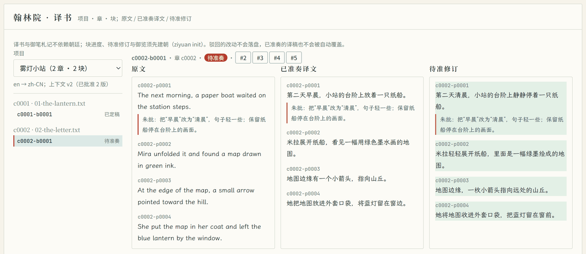
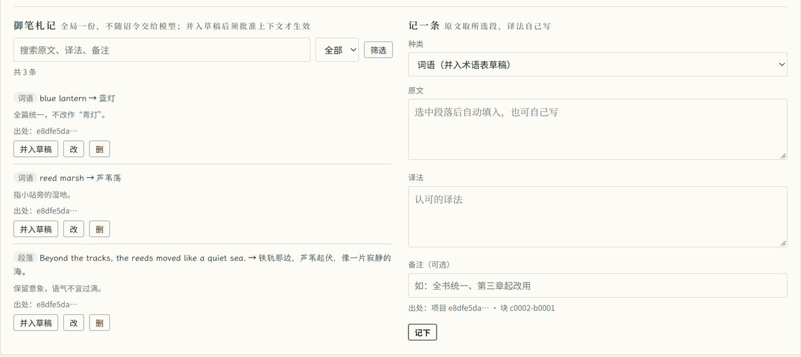

# 小说翻译：逐块初译、审校、朱批与御览

本页对应当前版本（1.2.0）的译书流程（`ziyuan text`）与御笔札记（`ziyuan note`）。1.0.0 没有这些命令；1.1.0 只有本地整理、分块与候选译稿检查。整理原文、导入分块和检查候选译稿见[整理原文与检查译稿](text-projects.md)；作品更新提醒见[关注 syosetu 作品更新](subscriptions.md)。

完整参数以 `ziyuan text help`、`ziyuan note help` 和 `ziyuan follow help` 为准，本文说明顺序与容易出错的地方。

下文尖括号表示要替换的实际编号或文字，方括号表示可选参数，`word|passage` 表示二选一；不要原样复制这些符号。带 `bash` 标记的示例使用 Bash 语法；PowerShell 变量与可直接执行的导入示例见[文本工具](text-projects.md#2-建立项目并导入)。

## 先看结论

- **现在能做**：从有权使用的日文或英文 UTF-8 原文出发，建立文本项目，逐块下诏初译，请礼部只读审校，按审校意见或逐段朱批修订，最后御览定稿；中断后可按状态续做。模型提出的文件改动仍须你准奏。
- **需要你亲自做的**：编辑并批准上下文草稿，审阅每件改动，写下朱批，以及做最后的文学把关。结构检查只核对段落编号，不评判译文好坏。
- **还不保证**：没有连续多章的真实模型长跑，没有长篇一致性的证据，也没有达到出版质量的依据。详见[还没验证](#还没验证)。

## 工作流

```text
text init / text import（1.1.0）
  → 编辑 translations/<项目>/context/ 草稿
  → text context approve <项目>（生成不可变快照 v<N>）
  → text translate <项目> <块> → ziyuan run → ziyuan apply
  → text review <项目> <块> → ziyuan run
  → （可选）text zhupi ... → text revise <项目> <块> → ziyuan run → ziyuan apply
  → text finalize <项目> <块>（御览）
  → 需要重修时 text reopen <项目> <块> --reason <理由>
```

初译与修订的诏令只入队，不调用模型；执行用 `ziyuan run`，落盘用 `ziyuan apply`。审校是两件只读礼部诏令，只有回奏、没有改动，执行完即完成，不必准奏。

真正翻译前，先按[接入真实模型](guide.md#接入真实模型)配置模型；未配置时 `run` 只演示派工，不会产生译稿。在同一工作目录执行一次 `ziyuan init`（已有朝廷则跳过）。若使用内阁制，入队后还须 `ziyuan approve <诏令ID>` 批红，再 `run`；这与译稿完成后的 `apply` 准奏是两步不同的批准。

`text context approve` 与 `text zhupi` 不需要朝廷；初译、审校、修订、御览、状态与续做需要先 `ziyuan init`。所有 `text` 子命令都支持 `--json`，普通输出给人看，脚本请用 `--json` 并检查退出码。

## 1. 项目与材料

先按[整理原文与检查译稿](text-projects.md)建立项目并导入章节：

```bash
ziyuan text init --title '日文练习' --language ja --source '自写短文' --rights '本人创作，仅本地练习'
ziyuan text import <项目ID> chapter1.txt
ziyuan text show <项目ID>
```

- 章、块、段各有固定编号，例如章 `c0001`、块 `c0001-b0001`、段 `c0001-p0001`。本文示例的编号都要换成自己项目的实际编号，不要照抄。
- 分块在导入时确定，每块最多 48 KiB，没有调整分块大小的选项；想换原文或改分块，请建立新项目。`text show` 列出章节、段落数、块编号与文件路径，不预览字节数。
- 项目记录在 `.ziyuan/text-projects/<项目>/`，属于内部状态；`translations/<项目>/` 是给你看的材料，可以阅读、备份，但不要改程序导出的只读文件。

## 2. 上下文：草稿与批准

模型不会自己总结全书，它每块只读你批准过的上下文。上下文草稿放在 `translations/<项目>/context/`：

- `glossary.json`：术语表，数组，每条写原文、允许译法（1–16 种）与可选作用范围、备注。例如：

```json
[
  {"source": "羅生門", "allowed": ["罗生门"], "scope": "篇名", "note": "不写作“罗城门”"}
]
```

- `style.md`：文体要求，写语气、人称、用字等。
- `summaries/<章ID>.md`：该章的摘要，如 `summaries/c0001.md`；下诏时只导出当前块所属章之前各章的摘要，当前章及后章不会带入。只写已经发生的事实，不提前泄露后章。

第一次执行 `ziyuan text context approve <项目>` 会补齐缺少的草稿文件（空术语表、文体模板、`summaries/`），校验通过后批准为快照 v1；已有的草稿文件不会被覆盖。也可先自行创建并编辑这些文件再批准。草稿内容改变后再批准，得到 v2、v3 等；内容与现行快照完全相同时沿用原版本，不新建快照。

```bash
ziyuan text context approve <项目ID>
```

- 每个快照带版本与文件哈希，存于 `.ziyuan/text-projects/<项目>/context/v<N>/`，不覆盖旧版本。
- 下诏只用**最新已批准**的快照；改了草稿但没有批准，翻译不会采用。
- 批准之后修改草稿不会改变已下诏的版本；上下文有了新版本，旧译文可能被列为版本失效，见[状态与续做](#6-状态与续做)。
- 不写上下文也能初译（按 v0 空上下文），但术语与前情就得靠模型自己猜，正式流程不建议。

## 3. 初译、审校与修订

### 初译

```bash
ziyuan text translate <项目ID> <块ID>     # 默认交工部，只入队
ziyuan run
ziyuan diff <诏令ID>                      # 审阅实际改动
ziyuan apply <诏令ID>
```

`text translate` 会把本块材料导出到 `translations/<项目>/<块>/`，再下工部诏令。玉玺只有 `read_file` 与 `write_file`，范围限在该块目录。块上已有未结诏令或待准奏译稿时，命令会拒绝，免得重复付费或互相覆盖。

执行完先看改动，再决定准奏或驳回：

```bash
ziyuan diff <诏令ID>
ziyuan apply <诏令ID>     # 或 ziyuan discard <诏令ID>
```

### 审校

```bash
ziyuan text review <项目ID> <块ID>   # 两件礼部只读诏令：忠实度、文风
ziyuan run
```

- 审校要求已有已准奏的初译或修订，且磁盘上的 `zh.json` 与它一致。
- 两件诏令在同一批次写入，可并行执行；玉玺只有 `read_file`，范围限块目录。
- 审校意见须指向段落编号并给证据，只留在回奏里，不改文件，因此没有可准奏的改动。

### 修订

```bash
ziyuan text zhupi <项目ID> <块ID> <段号> <意见>   # 可选：先写逐段朱批
ziyuan text revise <项目ID> <块ID>               # 工部统稿，只入队
ziyuan run
ziyuan diff <诏令ID>                             # 审阅后再准奏
ziyuan apply <诏令ID>
```

- 修订需要已有已准奏的初译或修订，且 `zh.json` 在。
- 修订与初译一样，都会导出 `zhupi.json`（本块朱批）。修订另会导出 `reviews.json`：只从上一次准奏之后下的审校中，分别取忠实度、文风两路最近一件已完成的回奏；某路没有已完成回奏时不列该路，两路都没有时为空。程序不强制先做完两路审校，但推荐按上述顺序操作。提示要求朱批优先于审校意见；冲突时按朱批改，并在回奏里列出未采纳的审校意见。程序不自动判断模型是否照办，仍须你核对。
- 修订可以不改 `zh.json`，只写 `proposals/` 下的新术语或摘要建议。这种情形允许准奏：已准奏译文保留，块进入待御览。
- 修订失败、撤销或改动被驳回，不阻塞该块：最近一件**已准奏**的译文仍是现行稿，可以继续审校、修订或御览。

## 4. 朱批

朱批是皇帝逐段的修改要求，按段落写，存于 `.ziyuan/text-projects/<项目>/zhupi.json`，每次变更版本加一。

```bash
ziyuan text zhupi <项目ID> <块ID> <段号> <意见>
ziyuan text zhupi <项目ID> <块ID> <段号> --clear   # 清除该段朱批
ziyuan text zhupi <项目ID> <块ID> <段号> --show    # 查看该段朱批
ziyuan text zhupi <项目ID> <块ID> [--show]         # 查看全块朱批
```

时机很重要：

- 朱批每次下诏（初译与修订）都会导出；初译也能看到你事先写好的朱批。
- 朱批在下诏那一刻定稿：诏令下发之后新增或修改的朱批不会被悄悄忽略，`text finalize` 会拒绝，并要求先按新朱批再下一次修订。御览前请核对一遍朱批是否都已并入。
- 块上有未结诏令时不要指望靠改朱批“补进去”，那只会让御览失败；应当等这一轮结束，再写朱批、下修订。

## 5. 御览与退回

```bash
ziyuan text finalize <项目ID> <块ID>
ziyuan text reopen <项目ID> <块ID> --reason <理由>
```

御览定稿会再次核对：

- 块上没有未结诏令，也没有待准奏的修订稿；
- 磁盘上的 `zh.json` 在，结构检查通过，且正是最近一件已准奏初译或修订所写；
- 原文哈希与上下文版本仍是下诏时的版本；
- 朱批自下诏后没有再变。

任何一项不符都拒绝定稿并说明原因。定稿记入事件簿（译稿哈希、上下文版本、朱批版本）；需要重修时用 `text reopen` 记录退回理由，再下修订。已定稿的块不再接受初译或修订诏令（审校仍可下），须先 `text reopen` 退回；`text resume --yes` 遇到已定稿的块也会逐块报错跳过。定稿不锁文件，请不要手改译稿来替代修订。上下文更新、译稿改动或丢失仍可能让已定稿块显示为版本失效。

## 6. 状态与续做

```bash
ziyuan text status <项目ID>
ziyuan text resume <项目ID>          # 只为“未开始”的块下初译
ziyuan text resume <项目ID> --yes    # 同时重试“失败”与“已撤销”的块
```

`text status` 由事件回放与磁盘实际译稿得出每块状态、原因与提示。状态标签与处理：

| 标签 | 含义 | 下一步 |
| --- | --- | --- |
| 未开始 | 还没下过初译 | `text translate` 或 `text resume` |
| 执行中 | 有关联诏令未结 | `ziyuan run`；不要重复下诏 |
| 待准奏 | 初译或修订已完成，改动待决 | 审阅后 `ziyuan apply` 或 `ziyuan discard` |
| 已准奏（待审校） | 已准奏初译，尚未审校 | `text review` |
| 已准奏（待修订） | 审校已完成或已退回，待按意见修订 | 写朱批后 `text revise` |
| 待御览 | 已准奏修订稿，尚未定稿 | `text finalize`，或再修订 |
| 已定稿 | 御览通过，当前磁盘与版本仍一致 | 需要重修时先 `text reopen` |
| 失败 | 含改动被驳回、未呈报译稿，且尚无已准奏译稿 | 确认原因后 `text resume --yes`，或重新下诏 |
| 已撤销 | 同上，诏令被撤销 | 同上 |
| 版本失效 | 原文或上下文已变，或已准奏译稿被手改、丢失 | 人工核对，重新修订；必要时建立新项目 |
| 不确定 | 如磁盘有 `zh.json` 却无准奏记录，或准奏记录中找不到译稿 | 先核对事件记录与磁盘文件，程序不猜成功，也不自动覆盖 |

续做规则：

- 只为“未开始”的块新下初译；执行中、待准奏、有效已完成的块跳过。
- `--yes` 才重试“失败”与“已撤销”的块。
- “版本失效”与“不确定”总是自动跳过，须人工核对。已人修译稿不会被自动覆盖。

## 模型看得见什么、能写什么

每次下诏前，程序把该块材料导出到 `translations/<项目>/<块>/`：

- `source.json`：本块原文。
- `context.json`：本次使用的已批准上下文（术语表、文体、前情摘要）及其版本。
- `neighbors.json`：前后衔接段，只读，不得翻译或写入译稿。
- `zhupi.json`：本块朱批（可能为空），每次下诏都导出。
- 修订时另有 `reviews.json`（上一轮准奏之后，忠实度与文风各取最近一件已完成的审校回奏，没有则为空）。
- `zh.json`：现行的已准奏译稿（或本次要写的候选稿），格式与 `text check` 的候选译稿相同。

模型读不到 `.ziyuan`：玉玺范围就是块目录，可以读取该目录中获准的普通文件（也包括已有的 `proposals/`）；提示要求只写 `zh.json` 和 `proposals/` 下的新术语或摘要建议，准奏门控会拒绝其他写入路径。导出不碰 `zh.json` 与 `proposals/`，但会重写 `source.json`、`context.json`、`neighbors.json`、`zhupi.json`，非修订下诏还会删除旧 `reviews.json`，不要在这些导出文件里保存手改内容。`proposals/` 永不自动生效，须你并入草稿并重新批准上下文。

## 准奏前检查什么

带初译或修订关联的诏令，准奏时按逐段取舍后的最终内容再查一遍，任何一项不过都**拒绝落盘，一个文件也不写**：

- 只写了 `zh.json` 与 `proposals/` 下的文件，没有碰别的路径；
- `zh.json` 结构检查通过：段落编号不缺、不重、不乱序、无陌生编号、译文不为空，且块声明与项目分块一致；
- 原文哈希与下诏时相同；
- 上下文版本仍是下诏时的已批准版本。

检查失败时，本次准奏直接拒绝，不自动修稿或创建修订任务。先核对报错原因；仍需重做时，`ziyuan discard <诏令ID>` 驳回待准奏改动，再重新下初译（尚无已准奏译稿）或修订（已有已准奏译稿）。原文已变时须用原件重建项目；不要靠删掉段落编号“消除”报告。审校没有改动，因此不以准奏放行。

## 御笔札记

札记是你亲手记下的认可译法，和模型的建议分开保存，不写事件簿，也不会自动发给模型。

```bash
ziyuan note add --source <原文> --zh <译法> [--kind word|passage] [--remark <备注>] \
                [--project <项目ID> [--block <块ID> [--para <段号>]]]
ziyuan note list [--project <项目ID>] [--search <检索词>] [--kind word|passage]
ziyuan note show <札记ID>
ziyuan note edit <札记ID> [--source …] [--zh …] [--kind …] [--remark …]
ziyuan note remove <札记ID>
ziyuan note promote <札记ID> --project <项目ID>
```

- 札记存于 `.ziyuan/notes.json`，不需要 `ziyuan init`。
- `--kind` 默认 `word`（词语），也可选 `passage`（段落）。`note promote` 只把札记并入项目的上下文**草稿**：词语进 `glossary.json`，段落进 `style.md` 的范例部分；重复并入不会重复写。
- 并入之后必须再执行 `ziyuan text context approve <项目ID>` 才会生效。这一步也影响版本失效判断：批准新上下文后，用旧版本译好的块可能被列出来。
- 札记可以是全局的，也可以指定项目、块、段；它只是记录，不会改变任何译稿。Web 的札记面板说明同样要求上下文批准。

## Web：翰林院 · 译书

在武英殿的「翰林院 · 译书」卡片选择项目、章与块，可对照原文、已准奏译文和待准修订；逐段朱批显示在对应段落下方。待准修订仍须到奉天殿审阅并准奏，不会自动覆盖已准奏译文。



同一卡片下方的「御笔札记」可搜索、记录译法并并入上下文草稿；并入后仍须批准上下文才生效。



这两张截图拍于 2026-10-31，使用自写虚构短篇《雾灯小站》和本地模拟模型，待准修订由真实 CLI 初译、准奏、朱批与修订流程产生，不是直接填入页面的数据，也不证明模型翻译能力。字体与拍摄条件见[截图来源与验证范围](guide.md#截图来源与验证范围)；下文 rc.4 试点截图保留为历史记录。

## 还没验证

本页描述的流程有工程验收，但以下都没有证明，不能据此对外承诺：

- **没有连续多章的真实模型长跑**。1.0.0 只有日文、英文各三段的一次性试点（见下文历史部分），样本很短，也没测失败恢复、不同模型或批量并发。
- **没有长篇一致性的证据**。术语、文体和前情摘要都靠人维护；上下文越长输入费越高，也不能保证前后用字一致。
- **真实模型的费用与耗时没有在 1.2.0 重新测量**。1.0.0 试点记录见下文，不能当作本版单块成本。
- **浏览器与界面验收**记录在 [1.2.0 验收记录](acceptance/1.2.0.md)，以该记录的实际结果为准；本文不预写结论。
- **不声称达到出版质量**。自动检查只核对结构与版本，文学质量、专有名词取舍、跨章伏笔仍需懂双语的人终审。

## 1.1.0 与 1.2.0 已实现的范围

早期文档把完整翻译流程写作“下一阶段计划”，现按实现情况说明：

- **交付一（1.1.0 已实现）**：`text init` / `import` / `show` / `check`。建立项目时记录作者、版本、来源、取得日期与你的权利声明（只记录声明，不判定授权）；按章导入 UTF-8 TXT，保留原文件与哈希，按完整段落分块，每段固定编号。改原文或改分块要建新项目，1.1.0 起就不支持原地更新。`text check` 只检查候选译稿的结构，不调用模型、不修改任何文件。
- **交付二（1.2.0 已实现）**：单块初译、两路只读审校、朱批与修订、准奏门控。上下文使用显式版本；写入只准 `zh.json` 与 `proposals/`；不符即整件拒绝。
- **交付三（1.2.0 已实现）**：`text status` 按事件与磁盘状态列出每块进度、失效原因与对账提示；`text resume` 只为未开始块下诏，重试失败/撤销须 `--yes`，版本失效与不确定不猜。中断后同一块不会被无声跳过，也不会无提示地重复付费。
- **交付四（1.2.0 已实现）**：Web 武英殿的「翰林院 · 译书」卡片提供项目→章→块导航、三栏对照、检查问题与操作按钮；TUI 诏令详情显示只读的译书关联。

仍属暂缓：自动抓书、自动出版、EPUB / DOCX / OCR 导入导出、向量翻译记忆库、无审批批量写入、运行中改 DAG、并行写安全承诺、Windows 原生号舍。

## 历史：1.0.0 试点

以下内容记录 1.0.0 候选期的一次性试点，不是 1.2.0 的验收，也不能代表当前译本质量。旧试点自编的 JA-001—003、EN-001—003 只是那次试点的临时标签，与现在文本项目的 `c0001-p0001` 编号无关。

### 试点做法与来源

本次用真实 `target/debug/ziyuan`、DeepSeek `deepseek-flash`、工具读写和准奏工作流完成两个各三段的中译样本；不是直接调用模型接口。仅在临时本地 Git 工作区执行，没有提交、推送或访问 GitHub。准奏由执行本次试点的代理审阅 diff 后执行，不代表用户已批准出版。翻译执行通过 CLI，未做 UI 端到端翻译测试；下文截图另用 Web 回放既有记录，也不证明长篇翻译可靠性。

- **日文**：芥川龙之介（1892-03-01—1927-07-24）《羅生門》，初刊《帝国文学》1915 年 11 月号，开篇前三段，起于「ある日の暮方の事である」，止于「しまったのである」。[图书卡及作者年代](https://www.aozora.gr.jp/cards/000879/card127.html)；[精确正文](https://www.aozora.gr.jp/cards/000879/files/127_15260.html)。青空底本为筑摩书房《芥川龍之介全集1》（1986），输入用 1997 年第14刷，电子文本修订于 2022-07-16。去掉 HTML、振假名和段首缩进，保留正文；试点编号 JA-001—003。
- **英文**：Lewis Carroll（1832—1898）《Alice's Adventures in Wonderland》（1865），第一章 *Down the Rabbit-Hole* 前三段，起于 “Alice was beginning”，止于 “under the hedge.”。[书目及美国公版声明](https://www.gutenberg.org/ebooks/11)；[精确纯文本](https://www.gutenberg.org/ebooks/11.txt.utf-8)。仅合并段内换行，保留段落与原文斜体下划线；试点编号 EN-001—003。

版权判断基于作者年代、原作发表年代及上述书库资料，不使用现代中文译本。芥川于日本旧有死后50年期限下已过保护期；青空的[收录与利用说明](https://www.aozora.gr.jp/guide/aozora_bunko_hayawakari.html)区分权利消灭与获准公开。英文书目明确标注“Public domain in the USA”。**公版不等于全球无条件许可**：发行前应核对所在地、书库[利用规准](https://www.aozora.gr.jp/guide/kijyunn.html)、Gutenberg 页尾条款，以及版式、插图、注释和译者的独立权利。本次只翻译原作短节选，无插图、无现代注释。

### 试点实测结果

证据在仓库根目录 `.amp/in/artifacts/novel-translation/`（本地审阅材料，不随发行包保证分发）：

- `ja-source.txt`、`en-source.txt`：可审阅输入；对应 `*-context.txt` 是前情和短术语表。
- `ja-zh-draft.txt`、`en-zh-draft.txt`：初稿；`ja-zh.txt`、`en-zh.txt`：准奏后的独立译文；`*-review.txt`：后续模型校对原始输出。
- `commands.json`、`*-proposed.json`、`*-review-proposed.json`、`final.json`、`court.log`：真实命令、状态与工具轨迹；`binary-sha256.txt` 标识被测二进制。
- `result.json`：自动核验。两组均为三个 ID、顺序一致、无重复，术语出现检查通过，原文不变；四件诏令均 `applied`，26 次工具调用、0 次工具失败。输入术语表也含未必在当前块出现的词，不能要求每个词每块都出现。

每项依次为模型统计输入/输出 tokens，以及整次 `run` 墙钟秒数（不是单次 API 延迟）：日译初稿 9,123/2,299、18.05秒；英译初稿 6,556/1,672、14.36秒；日文校对 29,985/10,098、66.05秒；英文校对 52,876/9,248、62.32秒。合计 **98,540/23,317 tokens、160.78秒**。CLI 的费用字段为 `null`，没有账单金额；不可把未知费用写成免费。token 含多步提示、工具往返与回奏，远大于原文字数。

对照审阅发现：日文初稿把「狐狸」合并成中文“狐狸”，未显出“狸”，校对改为“狐与狸”；“红漆”改为“丹涂／涂着丹”，避免无依据的材料属性。英文“好奇心起，烧得难耐”改为“好奇心大盛，按捺不住”。但日文“丹涂”生硬、“狐与狸”的读者理解、英文斜体强调丢失和“偷偷”的语气，都仍需人工统稿。校对报告本身也不是事实依据：日文报告提及“鲁迅旧译”未经查证；英文报告引述的“既无……也无……”并非译文原句。保留这些原始报告以暴露局限，不能照单全收。

### 试点 Web 截图

以下截图拍于 2026-10-30，使用当时的 rc.4 官方二进制，在真实 CLI 翻译试点事件簿的隔离副本上展示既有记录；不是设计稿、模拟模型输出或新一轮翻译。保留默认「天青」主题与 2× 像素密度。截图中的局部文本来自上述样本及本次模型输出，不是书库或译者背书，模型回奏也不构成质量认证。

**任务总览**：#1、#2 为日英初译，#3、#4 为后续独立校对；右侧展示日译初稿的完成状态、实际工具调用和 token 用量。左侧「待评定」表示尚未作业务评定，不是模型仍在执行。


**校对审阅**：选中 #3 日译校对，展开 `ja-zh.txt`，以 git-delta 统一视图展示词级增删；「此段已准／已落盘」是该本地试点的准奏状态，不代表出版批准。长段落在容器内滚动，截图并未展示完整译文或报告，仍须文学编辑终审。


### 试点的复现步骤

在隔离工作区先初始化本地 Git 和 ZiYuan。密钥从环境注入，不写进提示、配置样本或日志。设置 `ZIYUAN_LLM_MODEL=deepseek-flash`、`ZIYUAN_LLM_BASE_URL=https://api.deepseek.com/v1`、`ZIYUAN_MAX_STEPS=10`；不要使用生产仓库或 GitHub 授权。本次程序清除了子进程的 GitHub 环境授权。

1. 准备 `ja-source.txt` 与 `ja-context.txt`；前情只记录已知事实，不提前泄露后章。术语表应包含人名、地名、称谓及借代解释。
2. 执行 `ziyuan edict --queue --dept works --tools read_file,write_file --scope . "读取 ja-source.txt 和 ja-context.txt；逐段保留ID，中译后 write_file 暂存 ja-zh.txt；不要修改其他文件"`。
3. `ziyuan run --timeout 240`，随后 `ziyuan court --json`、`ziyuan diff 1 --plain`。确认输出尚未落盘、只涉及预期文件，再由人审阅原文与 diff 后 `ziyuan apply 1`，不加 `--commit`。诏令 ID 必须取实际状态，不能照抄示例。
4. 新诏令读取原文、上下文、已准奏译文，暂存独立校对报告及必要修订；再次检查 diff、准奏。英语替换文件前缀，流程相同。

实际复现分三阶段脚本：`reproduce.py` → **审阅初稿 diff** → `approve-and-review.py` → **审阅校对 diff** → `finalize.py`，均位于证据目录。不要无人审阅地串行执行：后两步会准奏前一阶段改动。重新实测会产生新的隔离目录、覆盖证据并消费额度，先复制证据。

### 长篇场景的操作约束

这些约束对 1.2.0 流程仍然适用，只是当时用旧命令验证：

- **分块与上下文**：按场景和完整段落拆块，先试数段，测得 token 后逐渐扩大，不在对白中途截断。每块独立文件、稳定 ID；只带已批准术语、人物状态、叙述视角、前章摘要及必要衔接段；衔接段标为只读，不重复输出。每章结束由人审订摘要，防止错误滚雪球。
- **容量与配置**：`ZIYUAN_CONTEXT_TOKENS` 是较早工具输出的**节略触发阈值**（正整数，默认 48000），不是模型窗口、度支预算或硬性输入上限；最近四份工具输出不会被节略，旧输出只留开头 200 字，因此节略后也可能超过阈值。`budget` 限 token 用量，`ZIYUAN_MAX_STEPS` 限调用步数，`read_file` 单次另有 64 KiB 上限；累计账单输入可超过阈值。必须给所选模型实际窗口留出系统提示、工具 schema 和输出余量，不能凭参数扩展服务商的硬上限。本次文学试点用默认值，未证明长篇节略无损。
- **质量分层**：自动核验负责 ID 数量、顺序、原文哈希、术语候选和可疑漏段；字符串通过不代表译得对。文学编辑负责指代、否定、文化词、人物口吻、隐喻、节奏与跨章伏笔；模型校对不能替代人审与版权审查。
- **预算与人工准奏**：先设单块步数与超时、核算服务商输入/缓存/输出价及重试额度；保留费用未知标记，逐块看 usage，校对通常更贵。只授权必要工具和小范围路径，原文与译文分离；模型回奏“完成”也必须查差异，不自动准奏、提交或发布。
- **失败恢复**：超时或进程中断后先看 `text status`、`tasks`、`court --json` 和 `diff`，确认是否已有暂存或已应用改动，避免重复付费与覆盖。冲突时保留人工修改、重新比对当前内容与基线，不强制覆盖；修订分新诏令。保存原文、术语版本、已批准摘要和命令记录后再续做。两个短样本各一遍，未测失败恢复、长篇一致性、不同模型或批量并发，不能据此给出成功率承诺。

## 权利、来源与再分发

### 关注作品只是提醒，不是翻译许可

[作品更新提醒](subscriptions.md)只查询官方作品信息接口的章节数与作品信息，**不下载正文**，也不包含任何翻译授权。能公开阅读不等于获准下载、上传模型、翻译或出版；`follow queue` 自动入队也只是把“有新章节”的提醒交给工部，不代表程序已核对权利，更不代表会去翻译那一章。

### 把原文发给模型是另一道审查

使用商业模型前，先确认自己有权把该文本传输给第三方，并核对服务商的留存、训练使用与合同条款；未公开稿件还需保密许可。翻译授权、改编授权和模型服务条款是不同的事，一项通过不代表另一项也通过。本程序只在本地收发文件，上传与否由你在下诏与执行时决定。

### 发布前版权核对（2026-10-30）

本节记录 1.0.0 试点时的核对，不是全球零风险保证或法律意见；当前仓库状态若有变化，应以新的核对为准。

当前仓库提交本指南的来源链接、短定位引文、操作说明及流程截图；截图可见局部译文、模型回奏与差异，文本来源及署名见本节的书目与署名说明。独立原文文件、完整译文和完整模型校对报告留在被 Git 忽略的本地证据目录，不随发行包分发。在这一范围内，结合上述书目和以下条款核对，**未发现明显的第三方现代译本侵权问题**。仓库的软件许可证不替第三方文本授权，也不保证生成译文在各地取得著作权。

- **青空文本与署名**：[利用规准](https://www.aozora.gr.jp/guide/kijyunn.html)允许利用权利已消灭的作品，同时要求尊重作者人格利益，并请求保留出处、底本、输入／校对者和修改记录。本次底本信息见上；输入为野口英司、平山誠，校对为もりみつじゅんじ。处理仅为上述正文提取、编号及另行中译，不表示青空认可译文。图书卡元数据与帮助文档另有各自的 CC 条款，不能把它们的许可直接套到作品或反过来套用。
- **Gutenberg 原作与品牌条款分开**：核对的 #11 纯文本更新于 2025-06-26，署名 Arthur DiBianca、David Widger；文件自带的完整许可与[现行许可说明](https://www.gutenberg.org/policy/license.html)均要求美国以外使用者自行核对当地法律。若再分发与 Project Gutenberg 名称关联的电子书或节选，应按完整条款处理许可告示、许可文本和商业分发要求；不要只删掉文件头就认为手续齐备。指南中的书目链接是来源引用，不是书库背书或对外分发电子书的许可。
- **不要沿用现代附加内容**：当代译本、插图、校注、封面与版本编排须分别核权，不能因原作年代久远一并复制。模型提及“鲁迅旧译”等不构成授权或查证；本次未把这些说法作为事实或采用既有中文译本。
- **上传和出版是另一道审查**：若要公开本地样本、收费出版或处理仍受保护的小说，应先完成目标地区、具体版本、来源条款及翻译／改编授权审查；本次短样本技术试点没有替这些场景作批准。
