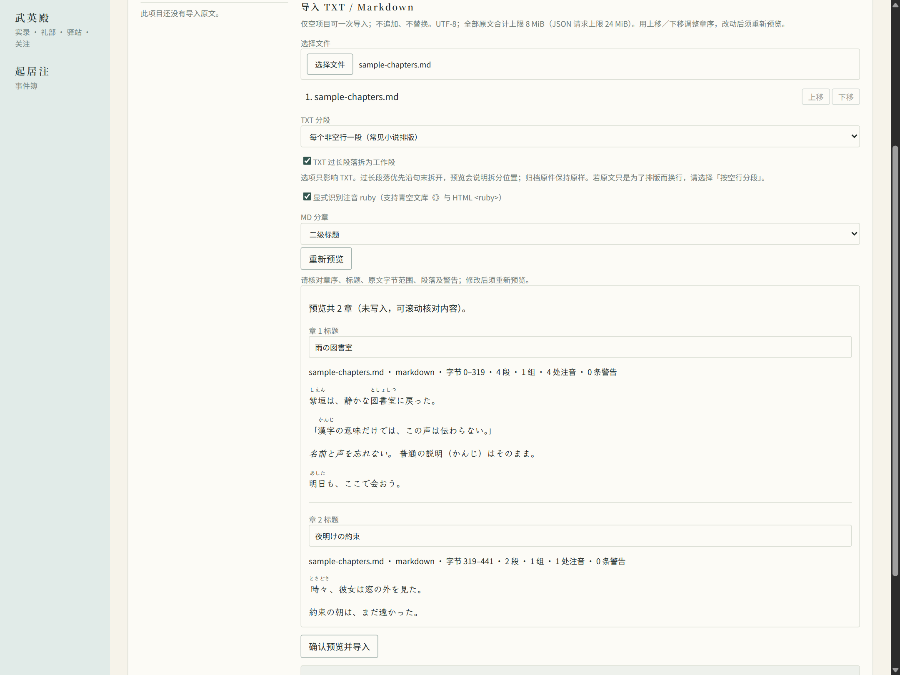
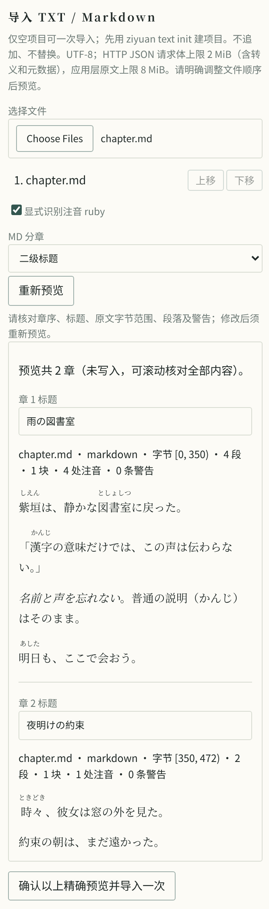
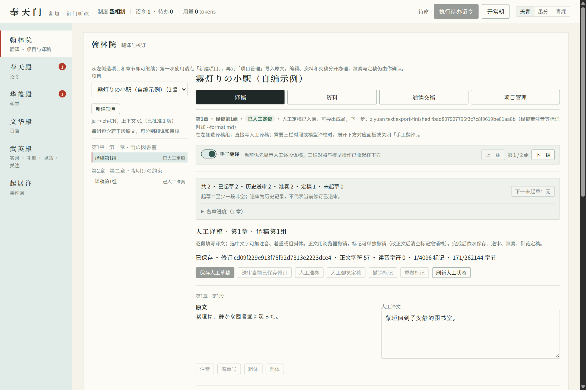
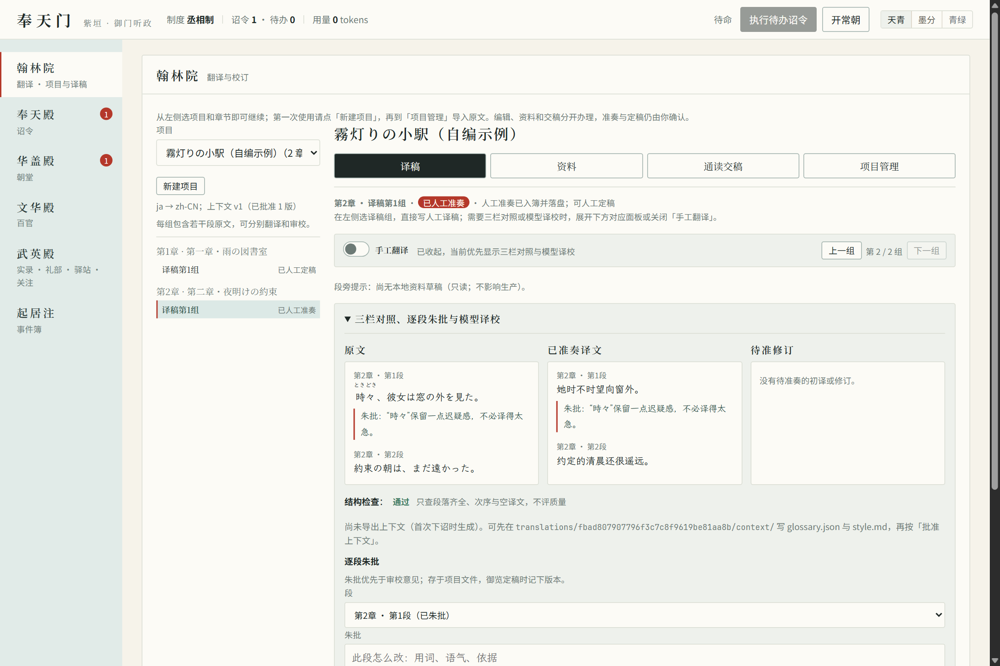
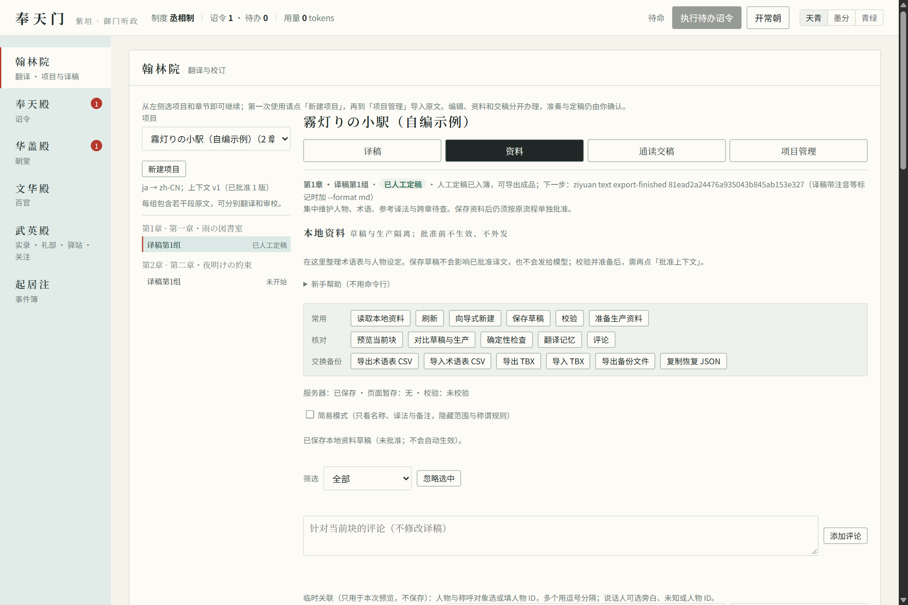
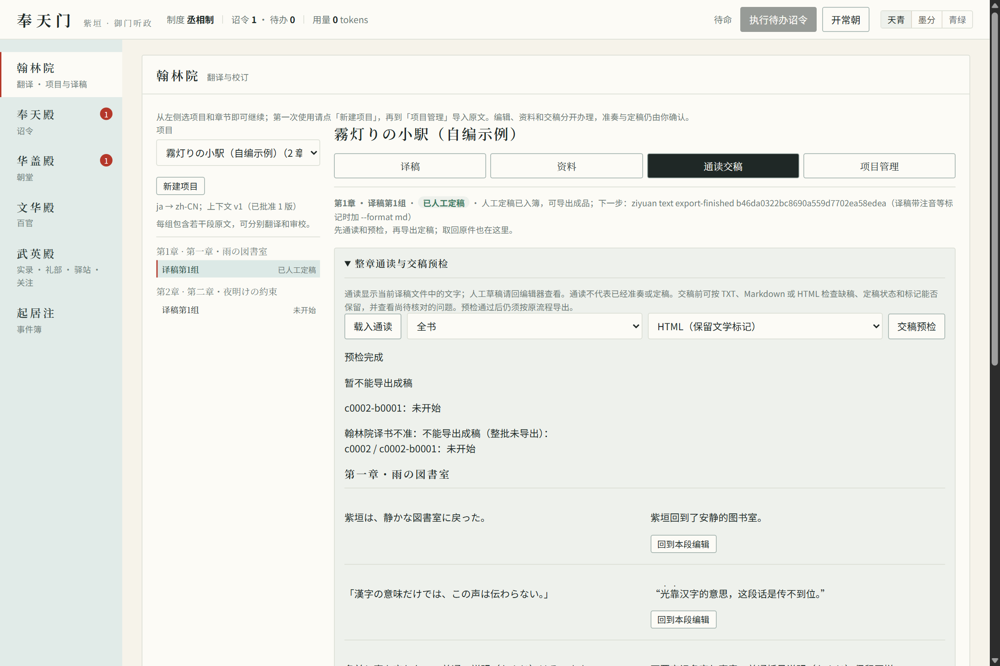

# 翰林院译书指南：导入、译校与交付

本页整合了紫垣的文本项目整理、小说翻译、连续翻译与交稿交付全部操作。从网页主导航第一项「**翰林院**」（`/#translation`）或发行包里的 `start-translation.bat` / `./start-translation.sh` 即可进入工作台，也可通过命令行 `ziyuan text`、`ziyuan note` 与终端界面 `ziyuan tui` 办理。

工作台分为四个页签，切换页签不会丢弃未保存的草稿：

- **译稿**：默认优先开启「**手工翻译**」逐段编修与标记；收起后自动展开「三栏对照、逐段朱批与模型译校」，下方附带「全文检索与草稿替换」及「逐段勘校（六事核对、审校参考与词证登记）」。
- **资料**：集中维护人物、术语与称谓规则草稿、确定性检查、翻译记忆条目、审校评论、TMX 交换、译文记忆检索，以及跨章待查与御笔札记。
- **通读交稿**：整章／全书双语通读、交稿预检，以及原件／成稿 TAR 打包与 DOCX／EPUB／SRT 回填导出。
- **项目管理**：新建空项目、预览与确认导入原文（TXT／Markdown／DOCX／EPUB／SRT）、译稿版本快照与清理、原文追加与单章修订，以及完整备份恢复。

译文记忆（`ZIYUAN_MEMORY_PROVIDER`）建库与显式选用参考见[译文记忆与参考选用](memory.md)；关注 syosetu 作品更新与新章节自动入队见[作品更新提醒](subscriptions.md)。

下文示例中的 `<项目ID>`、`c0001-b0001` 等均为格式示例，实际操作时请换成你项目中的编号（网页界面统一显示为「第 1 章 · 第 1 段」「译稿第 1 组」等可读位置，内部编号不变）。

---

## 一、新建项目与原文导入

### 新建项目

- **网页（推荐）**：在「翰林院」左侧点「新建项目」，填写标题、原文语言（目前支持日文 `ja`、英文 `en`，译文为简体中文）、来源与权利声明（作者、版本、日期与使用范围可选）。来源与权利只是本地自述记录，软件不作版权核验。建立后会自动进入「项目管理」页签。
- **命令行**：可在 PowerShell 或 Bash 中建立空项目（基础导入整理不需要先运行 `ziyuan init`）：

```bash
id=$(ziyuan text init --title '日文练习' --language ja --source '自写短文' --rights '本人创作，仅本地练习' --json | jq -r .id)
ziyuan text import "$id" chapter1.txt
ziyuan text show "$id"
```

```powershell
$project = ziyuan text init --title '日文练习' --language ja --source '自写短文' --rights '本人创作，仅本地练习' --json | ConvertFrom-Json
$id = $project.id
ziyuan text import $id chapter1.txt
ziyuan text show $id
```

一个项目只能导入一次原文（想重新切分或更换底本请新建项目；若需在已有项目追加新章或修订单章，见下文[原文追加与修订](#原文追加与修订)）。分块在导入时确定，每块最大 48 KiB 编码载荷，项目清单最大 32 MiB；更长篇幅请按卷或章节范围拆成多个项目。

### 预览与确认导入

网页「项目管理 → 导入 TXT / Markdown」和命令行 `text preview` / `text import --confirm` 都会**先预览、核对指纹，再确认写入**：





1. **文件编码与上限**：只接受 UTF-8 `.txt`、`.md`、`.markdown`（网页检测到青空文库常用的 Shift_JIS 旧编码时会明确提示先转 UTF-8）。全部原文合计上限 **8 MiB**；网页 JSON 请求体上限 **24 MiB**（含结构包装与转义开销）。
2. **TXT 分段与长段拆分**：
   - 网页「TXT 分段」默认选用「**每个非空行一段（常见小说排版）**」；若原文件为了排版把同一自然段折成多行，请改选「**按空行分段（段内换行保留）**」。命令行对应 `--text-paragraphs lines|blank_lines`（不带任何选项的旧 `ziyuan text import` 仍按空行分段，保持向后兼容）。
   - 勾选「**TXT 过长段落拆为工作段**」（命令行 `--split-long-paragraphs`）后，只有放不进 48 KiB 译稿组上限的超长 TXT 自然段才会被拆开，优先沿句末切分，必要时按完整字形切分，注音与强调标记保持完整；成稿导出（TXT／Markdown／HTML）时同一自然段内的工作段会自动接回原段。
3. **Markdown 分章与安全注音（`--ruby`）**：
   - 默认每文件一章；可按一级标题（`#`）或二级标题（`##`）分章（标题前正文独立成章；列表或引用中的标题不触发分章）。
   - 勾选「显式识别注音 ruby」（命令行 `--ruby`）后，识别 `｜東京《とうきょう》`、`東京《とうきょう》`、《《強調》》与简单单行无属性 `<ruby>東京<rt>とうきょう</rt></ruby>`；普通圆括号 `東京（とうきょう）` **永远不会**被猜成注音。未识别或破损 HTML 按字面显示并报警告，绝不执行脚本。
4. **长预览折叠与确认写入**：在「项目管理」点「重新预览」核对章名（可改）、原文字节范围、段落、注音与警告。超过 200 段的章节默认先展示前 120 段并可点击展开全文，超过 50 条的警告折叠显示；全部内容仍完整参与指纹校验。确认无误后点击「确认预览并导入」。

```bash
# 命令行预览与确认导入示例
ziyuan text preview "$id" novel.txt --text-paragraphs lines --split-long-paragraphs --ruby
fingerprint='替换为预览输出中的完整指纹'
ziyuan text import "$id" novel.txt --text-paragraphs lines --split-long-paragraphs --ruby --confirm "$fingerprint"
```

### DOCX、EPUB 与 SRT 文档导入

在「项目管理 → 导入文档或字幕」中，可向空项目导入 `.docx`、`.epub`（上限 **16 MiB**，压缩包内最多 4096 个文件、单文件解压不超过 32 MiB）或 `.srt` 字幕（同样单次导入，原件与时间轴归档在 `.ziyuan/text-projects/<项目>/`，定稿后可回填导出）：

- 命令行对应 `ziyuan text import-docx <项目ID> <文件.docx>`、`import-epub`、`import-srt`。
- `ziyuan text show <项目ID> [--json]` 可查看分块与文件路径；不要手动修改 `.ziyuan/text-projects/` 中的内部文件。

### 原文追加与修订

在「项目管理 → 追加与修订原文」选择 `.txt`、`.md`、`.docx` 或 `.epub`：默认追加新章；勾选「修订当前章」则修订当前块所属章节。务必先点「预览原文变化」看差异，无阻塞项再确认。

```text
ziyuan text source-update <项目ID> next.txt --confirm <预览指纹>
ziyuan text source-update <项目ID> revised.docx --chapter c0001 --confirm <预览指纹>
```

- 修订时段落数与所属块必须与原来一致，**拆段、合段或重排会被拒绝**。
- 原文实质变化的块，已有的模型/人工批准和定稿会标为「版本失效」，须重新送审、勘校和定稿；只改空白且正文未变的块不作废。更新前的原件与清单自动归档在 `source-history/`。
- 按 TXT／Markdown 预览路径导入并带解析记录的项目，不能改用 DOCX／EPUB 追加修订；已有 `source.docx` 的单章修订只接受 DOCX（EPUB 同理）。

---

## 二、译稿工作台：手工翻译优先

进入「翰林院 → 译稿」，主区域上方配有独立的「**手工翻译**」开关以及「**上一组** / **下一组**」切换条：



- **默认手工优先**：打开项目时「手工翻译」开关默认开启，优先展示逐段「原文 / 人工译文」并排编辑器、各章进度统计与「下一未起草」跳转；「三栏对照、逐段朱批与模型译校」「全文检索与草稿替换」「逐段勘校」默认折叠在下方，不干扰视线。
- **收起／切页不丢稿**：关闭「手工翻译」开关或切换到「资料」「通读交稿」「项目管理」时，未保存的草稿会完整保留，并在开关旁提示有未保存改动；重新开启即可继续编辑。

<a id="人工译稿"></a>

### 人工译稿（网页、终端与命令行）

人工译稿流程独立于模型调用：**草稿保存 → 送审 → 人工准奏（准奏即落盘 `zh.json`）→ 人工御览定稿**，四步状态分开记录，均需人工确认，兼容边界见[稳定性约定](stability.md#人工译稿流程)。

#### 1. 网页标记编辑器

1. 在左侧目录或「上一组 / 下一组」选好译稿组，在各段右栏输入译文（正文字数与读音字数分别实时统计；正文编辑支持浏览器原生撤销）。
2. **添加译文标记**：用鼠标选中译文中的文字，点下方「**注音**」（填读音）、「**着重号**」、「**粗体**」或「**斜体**」。标记预览即时显示在段下，标记表可逐条删除；标记撤销/重做单独计数，改动正文文字会清空标记撤销栈。
3. 点击「**保存人工草稿**」（仅写本地草稿，不修改已准奏 `zh.json`）；全部译妥并确认保存后，依次点击「**送审当前已保存修订**」「**人工准奏**」「**人工御览定稿**」。
4. **冲突与浏览器暂存**：若另一页面或命令行先保存了新版本，或原文/上下文/朱批变化，本页未保存内容不会被覆盖，可选择「加载磁盘（替换本地）」或「确认保留本地，取最新基准」后再存。未保存编辑也会暂存在当前浏览器会话中，刷新页面后可选择恢复或忽略；关闭浏览器会话前请务必点击「保存人工草稿」。

#### 2. 终端（TUI）人工译稿

在 `ziyuan tui` 中按 `4`（或 Tab）切到「人工译稿」：`[` / `]` 换项目，`,` / `.` 换块，回车改当前段，`s` 保存草稿，`u` 送审、`a` 准奏、`f` 定稿（均须按 `y` 确认），`p` 核对正式译稿。注意在终端编辑一段文字会清除该段已有的注音/着重/粗斜体标记，带标记的段落请回网页处理。

#### 3. 命令行人工译稿

```text
ziyuan text human show <项目ID> <块ID> [--json]
ziyuan text human save <项目ID> <块ID> --file <草稿.json> [--json]
ziyuan text human submit <项目ID> <块ID> [--json]
ziyuan text human approve <项目ID> <块ID> [--json]
ziyuan text human finalize <项目ID> <块ID> [--json]
ziyuan text human apply <项目ID> <块ID> [--json]   # 只读核对，准奏时已自动落盘
```

`DraftSave` JSON 须包含 `request_id`、`expected_revision`（首次 `null`，后续取 `show --json` 中的当前修订号）、`basis`（直接取自 `show --json`）与 `paragraphs`（含 `id`、`text` 与可选字节区间 `marks`：`ruby`/`strong`/`emphasis`/`emphasis_dots`）。`submit`/`approve`/`finalize` 需要当前目录已建立朝廷（`ziyuan init`）。

---

## 三、模型译校流程

需要借助大模型辅助初译、审校与修订时，可关闭「**手工翻译**」开关（展开「三栏对照、逐段朱批与模型译校」并自动隐藏人工编辑器）或直接点击展开下方抽屉：



> **核心原则**：下诏「初译」与「修订」只是把任务入队；执行须点击页首「执行待办诏令」（或命令行 `ziyuan run`），写入正式译稿须由你审阅差异后准奏（Web 奉天殿「准奏落盘」或 `ziyuan apply`）。审校是只读礼部任务，只有回奏不改文件。若朝廷使用**内阁制**，入队后还须先批红（`ziyuan approve`）才执行。

```text
准备并批准上下文（资料页签 / text context approve）
  → 初译（text translate）→ run → 审阅并准奏（apply）
  → 审校（text review：忠实度 + 文风两路只读礼部诏令）→ run
  → （可选）逐段朱批（text zhupi）→ 修订（text revise）→ run → apply
  → 御览定稿（text finalize）；需重修时退回（text reopen --reason ...）
```

### 上下文与本地资料

模型不会自动读懂全书，每块只能看到你**明确批准**的上下文快照。请切换到「**资料**」页签维护术语、人物与称谓规则：



1. **网页操作**：在「资料」页签点「读取本地资料」，用「向导式新建」或直接添加术语、人物、称谓规则（勾选「简易模式」可隐藏范围与复杂规则字段）→ 点「保存草稿」（仅写本地草稿，不生效、不外发）→ 点「校验」→ 点「准备生产资料」写入 `translations/<项目>/context/` → 回到「译稿」页签展开操作区点「**批准上下文**」。
2. **文件位置与结构**：
   - `translations/<项目>/context/glossary.json`：术语数组，每条含 `source`、`allowed`（1–16 个允许译法）及可选 `scope`、`note`。
   - `translations/<项目>/context/style.md`：文体要求（语气、人称、用字）。
   - `translations/<项目>/context/summaries/<章ID>.md`：各章前情摘要（下诏时只导出当前块**之前**各章摘要，避免剧透后续章节）。
3. **检查、交换与段旁提示**：
   - 「资料」工具栏提供「**对比草稿与生产**」「**预览当前块**」「**确定性检查**」（`ziyuan text qa <项目ID>`，核对空译、段号、数字、重复与适用术语）、「**导出／导入术语表 CSV／TBX**」（只合入本地草稿，不会自动批准）以及「**导出备份文件／复制恢复 JSON**」。
   - 在「临时关联」填写本段人物、称呼对象与说话人并点「刷新段旁提示」，可在「译稿」页上方只读预览本段适用词条与规则（未过块首可见门槛的条目会标明「仅供本地回顾」，不表示已外发）。
4. **快照版本**：每次 `ziyuan text context approve <项目ID>` 生成不可变快照 `v1`、`v2`…；改动草稿未批准前不会带入新任务。更新上下文后，先前用旧版翻译的块会提示「版本失效」。

### 御笔札记

「御笔札记」位于「资料」页签底部（也可在命令行使用 `ziyuan note`），全朝廷共用一份（`.ziyuan/notes.json`），**不会自动发给模型，也不会直接改写译稿**。选中段落后记下认可的词语（`word`）或段落范例（`passage`），点击「并入草稿」（命令行 `ziyuan note promote <札记ID> --project <项目ID>`）将其写入项目上下文草稿后，仍须再批准一次上下文才会生效。

```bash
ziyuan note add --source '図書室' --zh '图书室' --kind word --remark '全书统一'
ziyuan note list --search '图书室'
ziyuan note promote <札记ID> --project <项目ID>
ziyuan text context approve <项目ID>
```

### 逐块初译、审校、朱批与修订

- **初译**（`ziyuan text translate <项目ID> <块ID>`）：把本块材料导出到 `translations/<项目>/<块>/`，向工部下诏（玉玺限定本块目录 `read_file` / `write_file`）。块上已有未结诏令或待准奏译稿时拒绝重复下诏。
- **审校**（`ziyuan text review <项目ID> <块ID>`）：需要已有已准奏译稿且磁盘 `zh.json` 一致。并行下达**忠实度**、**文风**两件只读礼部诏令，逐段给出证据与意见；审校不修改文件，执行完即结案。
- **逐段朱批**（`ziyuan text zhupi <项目ID> <块ID> <段号> <意见>`，或 `--clear` / `--show`）：你在网页或命令行逐段写下的修改要求，版本随变更递增，且**优先级高于模型审校意见**。注意：朱批在下诏那一刻定稿，下诏之后修改的朱批会导致御览拒绝并要求按新朱批再修订一次。
- **修订**（`ziyuan text revise <项目ID> <块ID>`）：导出本块原文、`zh.json`、`zhupi.json` 与上一轮准奏之后两路审校各自最近一条已完成回奏（`reviews.json`）。修订可以只改 `proposals/` 下的新术语或摘要建议而不改 `zh.json`；`proposals/` 永不自动生效，须你并入草稿并重新批准上下文。

**模型可见边界与准奏门控**：每次下诏会导出 `source.json`（原文）、`context.json`（已批准上下文）、`neighbors.json`（前后只读衔接段，不得译入译稿）、`zhupi.json`、`reviews.json`、`zh.json`。模型玉玺看不到 `.ziyuan/`。准奏落盘前程序再次校验：只动了 `zh.json` 与 `proposals/`、段落编号齐整无缺重乱序、译文非空、原文哈希与上下文版本未变；任意一项不符即整次拒绝、一字不写。

### 御览定稿、退回与续做

```bash
ziyuan text finalize <项目ID> <块ID>                 # 御览定稿
ziyuan text reopen <项目ID> <块ID> --reason <理由>   # 退回重修
ziyuan text status <项目ID>                          # 查看全部块状态
ziyuan text resume <项目ID> [--yes]                  # 为未开始（加 --yes 含失败/已撤销）的块批量入队初译
```

| 状态标签 | 含义 | 下一步 |
| --- | --- | --- |
| 未开始 | 尚未下过初译或起草 | 「手工翻译」起草，或 `text translate` / `text resume` |
| 执行中 | 有关联诏令尚未结束 | 等待或执行 `ziyuan run`，勿重复下诏 |
| 待准奏 | 初译或修订已完成，待批 | 去「奉天殿」审阅 diff 后准奏或驳回 |
| 已准奏（待审校） | 初译已准奏，尚未审校 | 可直接人工复核、审校或转手工微调 |
| 已准奏（待修订） | 审校完成或已退回 | 写朱批后 `text revise` |
| 待御览 | 已准奏修订稿，尚未定稿 | `text finalize` 或再修订 |
| 已定稿 | 御览通过，文件与记录一致 | 需修改时先 `text reopen`（或人工路径退回） |
| 失败 / 已撤销 | 改稿未成且尚无已准奏译稿 | 查明原因后 `text resume --yes` 或重新下诏 |
| 版本失效 | 原文、上下文、朱批已变，或磁盘被手改/丢失 | 人工核对后重新保存送审或修订 |
| 不确定 | 磁盘与事件簿记录对不上 | 核对磁盘 `zh.json` 与事件历史，程序不猜测也不覆盖 |

---

## 四、勘校、检索、版本与交付

<a id="词证与逐段勘校"></a>

### 词证与逐段勘校

网页「译稿」最下方折叠区「**逐段勘校（六事核对、审校参考与词证登记）**」与命令行共用同一套核对记录（存于 `.ziyuan/text-projects/<项目>/verification.json`，只追加不原地删改；词证和复核历史也是项目资产，请随项目一并备份）：

```bash
ziyuan text evidence add "$project" "$block" --file evidence.json --json
ziyuan text verification show "$project" "$block" --json
ziyuan text verification record "$project" "$block" --file checks.json --json
```

<a id="逐段勘校六事意见处理与问题状态分开记录"></a>

#### 逐段勘校六事：意见处理与问题状态分开记录

六项标题只在说明与界面提示人工核对重点，不替代人工判断，不自动改写或准奏译稿：

| 标题 | 内部 JSON 键 | 直白说明 | 短例 |
| --- | --- | --- | --- |
| 言行归属 | `subject_speaker` | 核对谁说话、谁做事，勿张冠李戴。 | “清替我换钱”不是“我替清换钱”。 |
| 事理正反 | `agency_negation` | 核对动作方向与肯否。 | “借给他”不是“向他借”；“并非主任”不能漏“并非”。 |
| 数目分寸 | `quantity` | 核对金额、人数、约数与倍数。 | “约三圆”不是“恰好三圆”。 |
| 前后次第 | `timeline` | 核对时间先后和是否已发生。 | “来年暑假回去”不是“今年暑假回过”。 |
| 称谓名分 | `names_relations` | 核对人名、职务、昵称与人物关系。 | “副校长”不是“数学主任”。 |
| 谐趣留白 | `humor_additions` | 核对笑点、反话与含蓄，勿把解释写成原文。 | 人物原本不懂绰号，不替他补词典释义。 |

- **词证输入**：单份 JSON 须含 `paragraph`、`quote`（原段真实连续短引，≤1000 字）、`source`、`locator`、`explanation`、`context`、`status`（`tentative|confirmed`）。新增词证会更新项目指纹，保存复核前须重新 `verification show` 取得最新 `fingerprint`。
- **勘校意见处理与问题状态分开记**：`disposition`（`accepted|rejected|pending|not_applicable`）与 `resolution`（`unchecked|resolved|unresolved|not_applicable`）独立记录；禁止自相矛盾的组合（如 `accepted + not_applicable`、`pending + resolved`、`rejected/not_applicable + resolved/unresolved`）。非 `pending` 时须写非空 `note`。可关联本块已完成审校的任务号与真实短引 `advice`（最多 8 条）及本段词证数字 ID `evidence`（最多 16 条）。
- **四种事实分开展示**：结构通过（`structure.valid`）、关联意见已处置（`opinions_handled`）、六事齐全且无待查/未解决（`operator_reviewed` 人工复核）、有效御览定稿各自独立，不新增定稿门槛；材料变化后旧复核会标为过期，网页须点击「已读最新材料，继续核对」后再保存。

### 翻译记忆、审校评论与跨章待查

<a id="翻译记忆管理与评论"></a>

三者均为本地辅助工作记录，不联网、不调用模型，也不会改写译稿或批准状态：

- **本地翻译记忆条目（`tm.json`）与 TMX 交换**：在「资料」工具栏点「翻译记忆」（命令行 `ziyuan text tm list|add|update|delete|adopt|build <项目ID>`）可维护项目内原译文对并记录采纳次数；底部「翻译记忆交换」与命令行 `ziyuan text tmx export/preview/import` 支持纯文本 TMX 预览后合并导入（遇复杂行内标记或 DTD 会拒绝）。注意：**这是局部条目管理**；使用局部/远程向量索引从定稿检索并向模型显式选用参考见[译文记忆与参考选用](memory.md)。
- **审校评论（`comments.json`）**：在「资料」页签对当前块与段落添加、回复、指派、解决或重新打开评论（命令行 `ziyuan text comment ...`）。
- **跨章待查**：在「资料 → 跨章待查」（命令行 `ziyuan text issue list|add|review`）登记跨章节一致性存疑（最多关联 16 段），支持从问题跳回对应编辑段，状态为 `pending` / `confirmed` / `intentional` / `resolved`。原文、译稿或已批准资料变化后旧结果标为过期，须重新核对再处理。

### 全文检索与草稿替换

展开「译稿」下方的「**全文检索与草稿替换**」（命令行 `ziyuan text search <项目ID> <片段> --scope all|source|translation|draft|history`，最多 200 处；`text draft-replace <项目ID> <request.json>`）：

- 可按原文、现行译文、人工草稿或历史译稿检索字面片段（覆盖尚未翻译的原段），点击结果直接跳回对应段落（跳往历史/现行译文时自动展开对照抽屉，跳往草稿时自动开启「手工翻译」）。
- **只允许在人工草稿内替换**：替换前预览替换前后全文并确认指纹；与注音／着重／粗斜体标记相交的替换会被拒绝，未相交标记按字符偏移自动调整位置；不会修改已准奏译稿或自动送审。

<a id="译稿版本与格式回填"></a>

### 译稿版本与格式回填

- **三态自动快照**：每次保存人工草稿（`draft`）、准奏（`approved`）与定稿（`finalized`）都会在 `.ziyuan/text-projects/<项目>/versions/<块>/` 写入快照，每种自动状态默认保留最新 3 份；手工点击「保存当前快照」（`text version save`）保存的快照不会自动清理。在「项目管理 → 译稿版本」（命令行 `text version list|compare|compare-draft|prune`）可逐段对比译文与标记差异，或清理旧快照（默认只预览，确认/`--yes` 才删）。
- **DOCX／EPUB／SRT 定稿回填**：确认全部块有效定稿且段落数／段号与原件完全一致时，通过「通读交稿 → 导出文档或字幕」或 `ziyuan text export-docx`、`export-epub`、`export-srt` 将定稿写回新文件（目标文件不可已存在，父目录须存在）。DOCX／EPUB 保留表格、图片与 spine 结构并按原文字节点长度比例分配译文，粗斜体边界为近似映射；遇嵌套段落或无法无损保留的译文标记时整批拒绝，不猜对应关系。需完整保留译文注音、着重号与叠加粗斜体时请导出 HTML。

<a id="原件与成稿导出"></a>

### 通读、交稿预检与成稿导出



1. **双语通读与交稿预检**：在「通读交稿 → 整章通读与交稿预检」（命令行 `ziyuan text read`、`ziyuan text preflight --format txt|md|html`）按全书或单章连续查看当前已落盘译稿（渲染注音、着重号与粗斜体），并检查缺稿、版本失效、未定稿、未处理待查与格式兼容问题。每段可点「回到本段编辑」直接定位。
2. **成稿与原件 TAR 导出**：在「通读交稿 → 章节导出」选择章节、格式与编排，先预览文件清单、校验清单与警告，再确认下载。命令行对应：

```bash
ziyuan text export-originals <项目ID> [--chapter <章ID>]... [--output originals.tar] [--json]
ziyuan text export-finished <项目ID> [--chapter <章ID>]... [--format txt|md|html] [--layout chapters|book] [--output finished.tar] [--json]
```

- **格式选择**：
  - `txt`：纯文本；若有效定稿含注音、着重号或粗斜体则整批拒绝并提示改用兼容格式。
  - `md`：以原件字节为模板保留非翻译代码块与分隔线，支持单层互不重叠的注音/粗体/斜体；遇**原段含行内代码**、**着重号**或**同范围叠加标记**时整批拒绝。
  - `html`：生成可离线打开的正文 HTML，完整保留译文注音、着重号、粗斜体与同一范围叠加样式。
- **资格与原子发布**：`export-finished` 只导出当前仍有效的 `Finalized` 定稿；缺块、失效、结构错误或有未收尾写入时整批拒绝。命令行省略 `--output` 只读预览；指定 `--output` 时父目录须存在、不得包含 `..` 或指向工作区控制目录及已有文件，并以硬链接原子发布。另外 `export-originals` 若选择了多章合一的 Markdown 源文件，会取回该完整归档原件。

### 完整备份与迁机恢复

在「项目管理 → 备份与恢复」（命令行 `ziyuan text backup` / `ziyuan text restore`）可打包当前工作区的全部文本项目与共用朝廷事件簿（便于迁机）：

```bash
ziyuan text backup --output D:/backups/books.tar
ziyuan text restore D:/backups/books.tar D:/books-restored --yes
```

- 备份包含原件、译稿、草稿、上下文、资料与待查记录，**不包含**登录令牌、模型凭据配置文件、缓存或锁文件；由于共用事件簿，可能含同一工作区下的代码任务正文，勿直接作为单本书对外分享。
- 网页上传恢复限制为 **256 MiB**、**20000 个数据文件**；恢复目标必须是尚不存在的新目录，先校验完整后才改名落盘。观政只读令牌不能导出完整备份或恢复。

---

## 五、用量账本、故障恢复与版权边界

<a id="逐阶段用量账本与请求材料精简"></a>

### 逐阶段用量账本与请求材料精简

```bash
ziyuan text usage <项目ID> [--json]
```

只读读取项目与现有事件簿，按 `translate`（初译）、`review_fidelity`（忠实审校）、`review_style`（文风审校）、`revise`（修订）四阶段汇总所有关联任务（含待办、失败、撤销、旧稿与重试），不因后续成功而抹去旧账。

- **归属与估价**：执行用量（`ModelUsage`）按当时最近的 `TaskAssigned` 模型归属，治理开销按原始事件记录模型归属；未报告的用量计为 `null`（不填零）。支持内置单价（2026-10 DeepSeek 高峰未命中缓存参考价）或当前 `ZIYUAN_LLM_PRICE`，分币种汇总、不换汇；估价不等于服务端实际账单。
- **请求材料精简边界**：向模型发送当次请求副本前，若同一次运行内先前成功执行过参数与返回字节**完全相同**的 `read_file`，较早副本会在该请求副本中被折叠为指向后续最新完整副本的短提示（仅短提示确实更短时替换），**不会改写事件历史（history）或删除其他工具记录**。

<a id="准奏中断恢复与临时文件清理"></a>

### 准奏中断恢复与临时文件清理

正常情况下不需要干预。若程序在受管写入文件或补记事件簿的途中意外退出，下一次准奏会提示存在未收尾的恢复记录，此时**先查看状态，再按它给出的完整命令处理**（切勿手工删除 `.ziyuan/` 里的记录或同时执行多种恢复命令）：

```bash
ziyuan text recovery status               # 查看世代、记录状态与下一步完整命令（未收尾时 --json 返回退出码 1）
ziyuan text recovery finish <操作ID> --yes
ziyuan text recovery abandon <操作ID> --yes
```

- `finish` 核对磁盘内容与恢复记录一致后继续补齐写入或事件；内容对不上时报错保留现场。`abandon` 仅在目标仍全是旧内容且审批事件尚未写入时允许放弃。进程发卡停在前置阶段（`Prepared`）时须确认旧进程已停再按提示加 `--confirm-prepared`。

<a id="遗留临时文件的清理"></a>

#### 遗留临时文件的清理

强杀进程可能留下 `.ziyuan-tmp-*` 临时文件或 `.ziyuan-lease-*` 租约。正常下一次准奏会顺带清理目标所在目录可证明陈旧的项；清理整个工作区可执行：

```bash
ziyuan text recovery temps          # 只预览可清理项（不删文件）
ziyuan text recovery temps --yes    # 删除已核实旧进程结束且非符号链接/目录的陈旧项
```

<a id="版权来源与再分发边界"></a>
<a id="发布前版权核对2026-10-30"></a>

### 版权、来源与再分发边界

- **本软件的 MIT / Apache-2.0 许可不授权第三方文学作品、译文或书库品牌**。公开可读不等于有权下载、上传第三方大模型、翻译或再分发；使用商用模型前须先核对原文授权与服务商的数据留存／训练条款。
- **作品更新提醒（`follow`）只是目录变化提醒，不下载正文、不代授翻译权**。
- **公版底本与衍生权利分离**：处理公版作品（如青空文库、Project Gutenberg 等）时，仍须遵守各自利用规准、保留底本与输入／校对署名，并核对所在地法律及现代译注／插图／排版的独立版权。

### 已知限制与未验证边界

- **结构检查不代表文学质量**：程序核对段落编号、哈希、术语字面匹配与六事人工记录完整性，无法代判文采、上下文伏笔与人物口吻；重要译稿与对外发布前须由人工终审。
- **暂无连续多章真实模型长跑评测**：上下文越长输入费用越高，长篇一致性与节略无损性仍须人工把关与按章审订摘要；具体评测方法见[文学效果评估步骤](memory.md#文学效果要怎样另行评估)。
- **明确不自动办理**：自动抓书、自动出版、OCR 与无审批无人值守批量写入均不在当前能力范围内，见[路线图](roadmap.md)。
