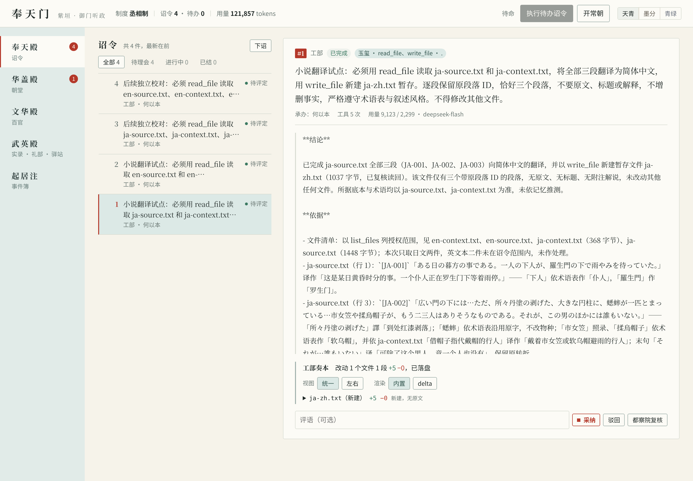
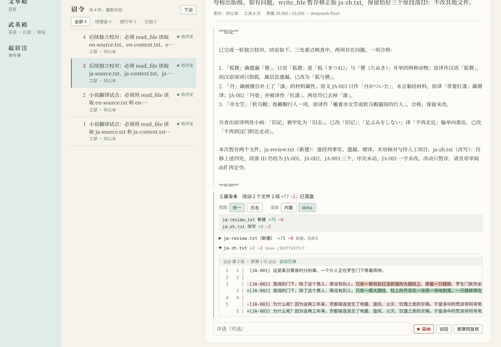

# 小说翻译：日语、英语短样本试点与操作指南

## 先看结论

- **现在能做**：用现有任务和文件审阅功能，逐份翻译、校对并批准写入。已有日文、英文各三段的真实模型试点。
- **还不能据此保证**：长篇译文一致性、自动处理中断、整本书无人值守翻译，以及达到出版质量。
- **1.1.0 已加入**：[本地文本导入、分块与译稿检查](text-projects.md)，以及独立的[作品更新提醒](subscriptions.md)。这些工具不下载正文、不自动翻译，1.0.0 没有这些工具。

想了解操作，先看[可复现工作流](#可复现工作流)；想核查样本和测量，见[实测结果](#实测结果与审阅入口)。下面的来源和版权说明用于解释历史试点的范围，不是任何小说都能上传或再发布的许可。

## 边界与来源

本次用真实 `target/debug/ziyuan`、DeepSeek `deepseek-flash`、工具读写和准奏工作流完成两个各三段的中译样本；不是直接调用模型接口。仅在临时本地 Git 工作区执行，没有提交、推送或访问 GitHub。准奏由执行本次试点的代理审阅 diff 后执行，不代表用户已批准出版。翻译执行通过 CLI，未做 UI 端到端翻译测试；下文截图另用 Web 回放既有记录，也不证明长篇翻译可靠性。

- **日文**：芥川龙之介（1892-03-01—1927-07-24）《羅生門》，初刊《帝国文学》1915 年 11 月号，开篇前三段，起于「ある日の暮方の事である」，止于「しまったのである」。[图书卡及作者年代](https://www.aozora.gr.jp/cards/000879/card127.html)；[精确正文](https://www.aozora.gr.jp/cards/000879/files/127_15260.html)。青空底本为筑摩书房《芥川龍之介全集1》（1986），输入用 1997 年第14刷，电子文本修订于 2022-07-16。去掉 HTML、振假名和段首缩进，保留正文；编号 JA-001—003。
- **英文**：Lewis Carroll（1832—1898）《Alice's Adventures in Wonderland》（1865），第一章 *Down the Rabbit-Hole* 前三段，起于 “Alice was beginning”，止于 “under the hedge.”。[书目及美国公版声明](https://www.gutenberg.org/ebooks/11)；[精确纯文本](https://www.gutenberg.org/ebooks/11.txt.utf-8)。仅合并段内换行，保留段落与原文斜体下划线；编号 EN-001—003。

版权判断基于作者年代、原作发表年代及上述书库资料，不使用现代中文译本。芥川于日本旧有死后50年期限下已过保护期；青空的[收录与利用说明](https://www.aozora.gr.jp/guide/aozora_bunko_hayawakari.html)区分权利消灭与获准公开。英文书目明确标注“Public domain in the USA”。**公版不等于全球无条件许可**：发行前应核对所在地、书库[利用规准](https://www.aozora.gr.jp/guide/kijyunn.html)、Gutenberg 页尾条款，以及版式、插图、注释和译者的独立权利。本次只翻译原作短节选，无插图、无现代注释。

### 发布前版权核对（2026-10-30）

当前仓库提交本指南的来源链接、短定位引文、操作说明及流程截图；截图可见局部译文、模型回奏与差异，文本来源及署名见本节的书目与署名说明。独立原文文件、完整译文和完整模型校对报告留在被 Git 忽略的本地证据目录，不随 rc.4 二进制包分发。在这一范围内，结合上述书目和以下条款核对，**未发现明显的第三方现代译本侵权问题；这不是全球零风险保证或法律意见**。仓库的软件许可证不替第三方文本授权，也不保证生成译文在各地取得著作权。

- **青空文本与署名**：[利用规准](https://www.aozora.gr.jp/guide/kijyunn.html)允许利用权利已消灭的作品，同时要求尊重作者人格利益，并请求保留出处、底本、输入／校对者和修改记录。本次底本信息见上；输入为野口英司、平山誠，校对为もりみつじゅんじ。处理仅为上述正文提取、编号及另行中译，不表示青空认可译文。图书卡元数据与帮助文档另有各自的 CC 条款，不能把它们的许可直接套到作品或反过来套用。
- **Gutenberg 原作与品牌条款分开**：核对的 #11 纯文本更新于 2025-06-26，署名 Arthur DiBianca、David Widger；文件自带的完整许可与[现行许可说明](https://www.gutenberg.org/policy/license.html)均要求美国以外使用者自行核对当地法律。若再分发与 Project Gutenberg 名称关联的电子书或节选，应按完整条款处理许可告示、许可文本和商业分发要求；不要只删掉文件头就认为手续齐备。指南中的书目链接是来源引用，不是书库背书或对外分发电子书的许可。
- **不要沿用现代附加内容**：当代译本、插图、校注、封面与版本编排须分别核权，不能因原作年代久远一并复制。模型提及“鲁迅旧译”等不构成授权或查证；本次未把这些说法作为事实或采用既有中文译本。
- **上传和出版是另一道审查**：使用商业模型前确认有权向第三方传输素材，并核对服务商的留存、训练使用和合同条款；未公开稿件还需保密许可。若要公开本地样本、收费出版或处理仍受保护的小说，应先完成目标地区、具体版本、来源条款及翻译／改编授权审查；本次短样本技术试点没有替这些场景作批准。

## 实测结果与审阅入口

证据在仓库根目录 `.amp/in/artifacts/novel-translation/`（本地审阅材料，不随发行包保证分发）：

- `ja-source.txt`、`en-source.txt`：可审阅输入；对应 `*-context.txt` 是前情和短术语表。
- `ja-zh-draft.txt`、`en-zh-draft.txt`：初稿；`ja-zh.txt`、`en-zh.txt`：准奏后的独立译文；`*-review.txt`：后续模型校对原始输出。
- `commands.json`、`*-proposed.json`、`*-review-proposed.json`、`final.json`、`court.log`：真实命令、状态与工具轨迹；`binary-sha256.txt` 标识被测二进制。
- `result.json`：自动核验。两组均为三个 ID、顺序一致、无重复，术语出现检查通过，原文不变；四件诏令均 `applied`，26 次工具调用、0 次工具失败。输入术语表也含未必在当前块出现的词，不能要求每个词每块都出现。

每项依次为模型统计输入/输出 tokens，以及整次 `run` 墙钟秒数（不是单次 API 延迟）：日译初稿 9,123/2,299、18.05秒；英译初稿 6,556/1,672、14.36秒；日文校对 29,985/10,098、66.05秒；英文校对 52,876/9,248、62.32秒。合计 **98,540/23,317 tokens、160.78秒**。CLI 的费用字段为 `null`，没有账单金额；不可把未知费用写成免费。token 含多步提示、工具往返与回奏，远大于原文字数。

对照审阅发现：日文初稿把「狐狸」合并成中文“狐狸”，未显出“狸”，校对改为“狐与狸”；“红漆”改为“丹涂／涂着丹”，避免无依据的材料属性。英文“好奇心起，烧得难耐”改为“好奇心大盛，按捺不住”。但日文“丹涂”生硬、“狐与狸”的读者理解、英文斜体强调丢失和“偷偷”的语气，都仍需人工统稿。校对报告本身也不是事实依据：日文报告提及“鲁迅旧译”未经查证；英文报告引述的“既无……也无……”并非译文原句。保留这些原始报告以暴露局限，不能照单全收。

## Web 工作流截图

以下截图拍于 2026-10-30，使用官方 rc.4 二进制，在真实 CLI 翻译试点事件簿的隔离副本上展示既有记录；不是设计稿、模拟模型输出或新一轮翻译。保留默认「天青」主题与 2× 像素密度。截图中的局部文本来自上述样本及本次模型输出，不是书库或译者背书，模型回奏也不构成质量认证。

**任务总览**：#1、#2 为日英初译，#3、#4 为后续独立校对；右侧展示日译初稿的完成状态、实际工具调用和 token 用量。左侧「待评定」表示尚未作业务评定，不是模型仍在执行。

**校对审阅**：选中 #3 日译校对，展开 `ja-zh.txt`，以 git-delta 统一视图展示词级增删；「此段已准／已落盘」是该本地试点的准奏状态，不代表出版批准。长段落在容器内滚动，截图并未展示完整译文或报告，仍须文学编辑终审。

## 可复现工作流

在隔离工作区先初始化本地 Git 和 ZiYuan。密钥从环境注入，不写进提示、配置样本或日志。设置 `ZIYUAN_LLM_MODEL=deepseek-flash`、`ZIYUAN_LLM_BASE_URL=https://api.deepseek.com/v1`、`ZIYUAN_MAX_STEPS=10`；不要使用生产仓库或 GitHub 授权。本次程序清除了子进程的 GitHub 环境授权。

1. 准备 `ja-source.txt` 与 `ja-context.txt`；前情只记录已知事实，不提前泄露后章。术语表应包含人名、地名、称谓及借代解释。
2. 执行 `ziyuan edict --queue --dept works --tools read_file,write_file --scope . "读取 ja-source.txt 和 ja-context.txt；逐段保留ID，中译后 write_file 暂存 ja-zh.txt；不要修改其他文件"`。
3. `ziyuan run --timeout 240`，随后 `ziyuan court --json`、`ziyuan diff 1 --plain`。确认输出尚未落盘、只涉及预期文件，再由人审阅原文与 diff 后 `ziyuan apply 1`，不加 `--commit`。诏令 ID 必须取实际状态，不能照抄示例。
4. 新诏令读取原文、上下文、已准奏译文，暂存独立校对报告及必要修订；再次检查 diff、准奏。英语替换文件前缀，流程相同。

实际复现分三阶段脚本：`reproduce.py` → **审阅初稿 diff** → `approve-and-review.py` → **审阅校对 diff** → `finalize.py`，均位于证据目录。不要无人审阅地串行执行：后两步会准奏前一阶段改动。重新实测会产生新的隔离目录、覆盖证据并消费额度，先复制证据。

## 长篇场景的操作约束

- **分块与上下文**：按场景和完整段落拆块，先试数段，测得 token 后逐渐扩大，不在对白中途截断。每块独立文件、稳定 ID；只带已批准术语、人物状态、叙述视角、前章摘要及必要衔接段；衔接段标为只读，不重复输出。每章结束由人审订摘要，防止错误滚雪球。
- **容量与配置（rc.4 起）**：rc.3 固定 48,000；rc.4 支持 `ZIYUAN_CONTEXT_TOKENS` 正整数，未设置仍默认 48000，空值、零、负数、小数及超出 u64 的值会在派工前拒绝。CLI、Web、TUI 启动时读取，常驻服务改值后须重启；Rust 使用 `AgentBackend::with_context_tokens`。它是较早工具输出的**节略触发阈值**，不是模型窗口、度支预算或硬性输入上限；最近四份工具输出不会被节略，旧输出只留开头 200 字，因此节略后也可能超过阈值。`budget` 限 token 用量，`ZIYUAN_MAX_STEPS` 限调用步数，`read_file` 单次另有 64 KiB 上限；累计账单输入可超过阈值。必须给所选模型实际窗口留出系统提示、工具 schema 和输出余量，不能凭参数扩展服务商的硬上限。本次文学试点用默认值，未证明长篇节略无损。
- **质量分层**：自动核验负责 ID 数量、顺序、原文哈希、术语候选和可疑漏段；字符串通过不代表译得对。文学编辑负责指代、否定、文化词、人物口吻、隐喻、节奏与跨章伏笔；模型校对不能替代人审与版权审查。
- **预算与人工准奏**：先设单块步数与超时、核算服务商输入/缓存/输出价及重试额度；保留费用未知标记，逐块看 usage，校对通常更贵。只授权必要工具和小范围路径，原文与译文分离；模型回奏“完成”也必须查差异，不自动准奏、提交或发布。
- **失败恢复**：超时或进程中断后先看 `tasks`、`court --json` 和 `diff`，确认是否已有暂存或已应用改动，避免重复付费与覆盖。冲突时保留人工修改、重新比对当前内容与基线，不强制覆盖；修订分新诏令。保存原文、术语版本、已批准摘要和命令记录后再续做。两个短样本各一遍，未测失败恢复、长篇一致性、不同模型或批量并发，不能据此给出成功率承诺。

例如，确认所选模型有足够窗口后，可在新版本设置 `ZIYUAN_CONTEXT_TOKENS=96000 ziyuan run --timeout 240`；Web 则在启动 `ziyuan serve` 前设置同一变量。这只是保留更多历史的选择，不保证翻译更好：上下文越长，输入费可能越高，也不能替代段落分块和已批准摘要。低阈值会更早节略，不宜拿唯一的术语库工具输出作长期记忆；必要术语应随每块重读。

## 下一阶段开发计划（拟议，尚未实现）

本节保留完整翻译流程的长期开发安排，不是现有功能。1.1.0 已交付的范围见[路线图](roadmap.md)：整理用户提供的日文／英文 UTF-8 TXT，并检查候选译稿；不自动抓书，不调用模型。后续要接入翻译时，还须确认有权把原文发给模型服务商。EPUB、DOCX、OCR 和整本书自动处理暂不做。

### 交付一 · P0：文本项目、分块与校验（下一步先做）

- **用户结果**：在 CLI 建立翻译项目，登记作者、版本、来源 URL／文件、取得日期、授权依据和适用范围；登记只记录用户声明，不自动判定授权有效。导入已有章节文件，预览自然段、块边界与字节数，并校验用户提供的候选译稿；这一交付不调用模型、不自动下诏。
- **原文怎么保存**：章节顺序由用户确认，不根据章名猜测。保留原文件和行尾，记录内容摘要。每段在同一版本中有固定编号，调整分块大小不改变编号；1.1.0 暂不原地更新已导入的原文，修改后要建立新项目，不自动匹配新旧段落。
- **怎么分块**：优先保留完整自然段和空行，不把空行当成正文。空文件和错误编码会被拒绝。单段过长时指出位置，要求人工分段，不悄悄截断。1.1.0 每块文件最多 48 KiB，编号等开销也计算在内；这比现有工具单次 64 KiB 的读取限制更小，但仍不保证适合所有模型的输入容量。
- **译稿怎么检查**：逐一核对段落编号、顺序和非空译文，报告漏段、重复、乱序、未知编号与原文变化。段数相同不等于译得准确。1.1.0 只读取用户提供的候选译稿，不覆盖译文或原件。`scope` 限定工具能接触的路径，但不是给每个路径分别设置读写权限。
- **落点与验收**：领域逻辑放 `ziyuan-app` 的独立翻译模块，CLI 参数／帮助接入既有 `args.rs`、`commands.rs`、`help.rs`，沿用 serde JSON 和现有摘要能力，不新增 crate 或依赖。项目清单显式带 schema 版本，首批不改 Court 事件格式。通过真实 CLI 测试日／英不对称样本、重复原段、CRLF、Unicode、空输入、非法编码、大小边界、超长单段及错误译稿；确认失败不留下半个项目或改动原件。

### 交付二 · P1：单块翻译、审校与准奏闭环

- **上下文包**：每块显式绑定已批准术语表、文体指南、人物状态、前文摘要及只读衔接段；列出版本和来源，不引入未来章节内容，不把会被节略的旧工具输出当永久记忆。`ZIYUAN_CONTEXT_TOKENS` 继续只控制节略，模型窗口及输出预留单独校核；窗口未知时明确提示未知，不假装自动适配成功。
- **执行合同**：复用模板、`Session::issue`、`split_scheduled` 和既有运行／预算机制。先初译暂存、结构检查、人审准奏，再交给只读审校；忠实度与文风两路可在独立的只读批次中并行，其回奏留在事件簿，由单一写入者统稿。不要给整条流水线统一写权限后声称审校并行；现有子任务继承父权限，写批次仍串行，每批 2–8 件且不嵌套。
- **准奏门控**：受管翻译任务的预期产物与校验规则须在 `ziyuan-app` 共用准奏路径生效，不能只加一个可绕过的新 CLI 检查。按逐段取舍后真正要落盘的内容重新检查 ID、输入版本和输出路径；复用 `apply_reviewed` 的预览版本与过期原文校验，CLI / Web / TUI 不各写一套判定。`artifact` 目前只是提示，须补足关联后才能作为合同。
- **审校边界**：问题必须指向源段落 ID 与具体证据；术语表支持人审的允许译法及作用范围，只对当前原文实际出现的条目检查。数字、否定、称谓与修辞的自动规则先作风险提示，不把字符串不同当作严重错译。新术语与新摘要单独待批准，不能由初译自动污染下一块。
- **验收**：以已有日英三段样本回归，再各做多个相邻块。模型说完成但漏段、提案包含原文改写、部分准奏造成段落缺失、基线过期、改动驳回、预算不足时均不能被标成可交接。真实模型样本另记 tokens、费用、耗时和人工修订，模拟模型只用于稳定复现工程边界。

### 交付三 · P1：版本关联、受影响范围与断点续做

- **身份而非万能缓存**：记录源版本、段落／块映射、已批准术语与摘要版本、提示模板和实际模型／运行配置，并关联任务 ID、提案版本及落盘译稿哈希。任务状态来自事件回放，译稿状态还须核对磁盘，不再维护一套可与事件簿分叉的“已完成”布尔值。首次持久化任务关联若需新事件，必须单独设计并登记存储兼容版本，不暗改旧事件。
- **失效规则**：原文变动先确认新旧段落映射，再列出关联块；术语／文体／模型配置变动也列出受影响块并由用户选择重译。前文摘要改变时，使用该摘要的后续块及其派生摘要都标为待复核；没有可靠映射或依赖信息时宁可扩大提示范围，不伪称精确增量。已人修译稿保留，不自动覆盖。
- **恢复规则**：启动先对齐事件、任务关联和落盘内容，分别显示未开始、运行中、待准奏、已准奏、失败／撤销和版本失效。运行中不重复派发，待准奏不重付费，已完成且版本有效的块跳过；失败／撤销通过显式新建任务重做，不改已提交 DAG。建任务后未记关联、写文件后未记准奏等不确定窗口先进入对账，不自动猜成功或重复调用。节点键不保证模型供应商请求或工具副作用恰好一次。
- **验收**：在上述中断窗口强制停进程，重启核对同一块不会被错误跳过或无提示重复执行；测外部人工修改、相同命令重试、两个进程同时续做、来源／术语／摘要更新及已结束任务。费用未知继续为未知，不把没有新账单当作恢复免费。

### 交付四 · P2：Web 的章节导航与对照审阅

- 复用既有 Web 诏令详情、只读令牌和 app 层合同，增加书／章／块导航、原文与已准译文／待准修订对照、术语证据及校验问题；不用第三套状态系统或单独的翻译应用。TUI 先展示相同状态与问题，复杂创建继续走 CLI / Web。
- 沿用天青、青绿、墨分及统一／左右／delta 组件；区分“执行完成”“结构检查通过”“待准奏”“已准奏”“待文学终审”，不再让「待评定」承担全部翻译状态含义。所有状态由共用查询结果给出。
- 截图与交互验收覆盖默认、长日文／英文段落、术语冲突、失效、失败、空状态和只读模式；宽屏／窄屏检查框体、独立滚动、固定操作区和按钮换行。阅读、滚动或刷新不得丢失正在审阅的文件、展开状态与未提交取舍；记录真实指针／键盘交互，不仅检查 DOM。

### 扩大到长篇的放行门槛

四个交付各自通过工程验收后，再选择有权使用的日／英作品各连续三章，比较同模型、同原文、同初始术语与预算规则下的直接初译和完整协作流程。保留每千源文字的 tokens、费用、耗时、人修分钟数、术语问题与严重错译，并由懂双语的人盲评；人工文学验收未完成时，只能报告工程能力通过，不能声称长篇质量过关。

必须无漏段／重段、无未批准原文改写、无无提示的状态失真；所有阻塞问题须有处置记录。文学收益不足以抵消额外人工和模型成本时先调整流程，不盲目增加代理。暂缓自动抓书／出版、向量记忆库、复杂格式导入导出、运行中改 DAG 和并行写放宽。
