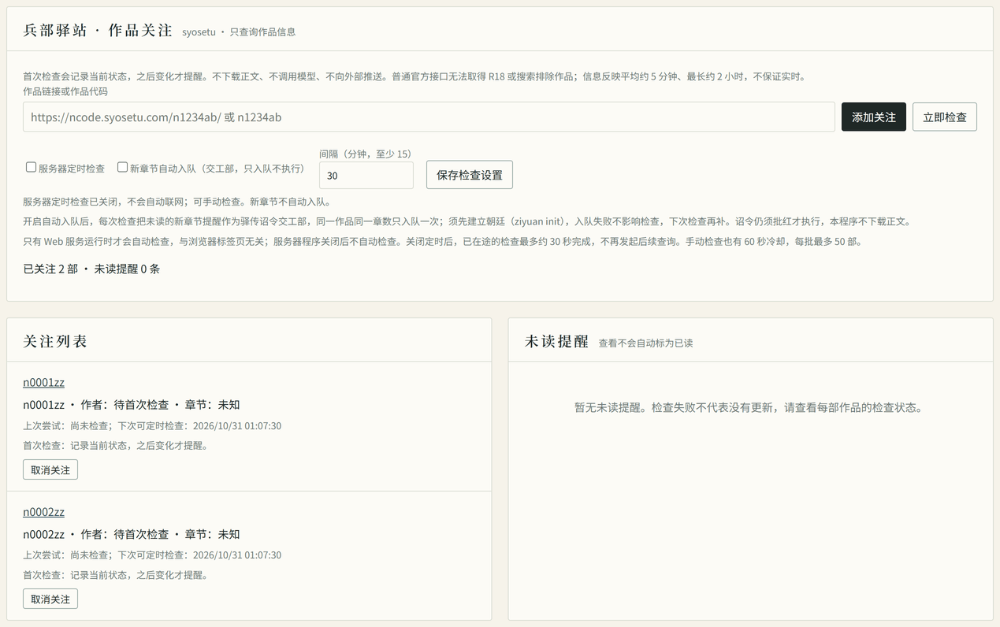

# 关注 syosetu 作品更新

本页对应 1.1.0 起的版本，1.0.0 没有这些命令和页面。1.2.0 起新增「新章节自动入队」与 Web 勾选框，见[下文](#新章节自动入队120)。

把作品加入关注列表后，紫垣可以检查章节数量或作品信息是否变化。提醒只显示在当前项目的命令行和 Web 中，不下载正文、不自动翻译、不发邮件或手机推送，也不需要模型密钥。

## 用命令行关注

在你想保存关注列表的目录中运行：

```text
ziyuan follow add n1234ab
ziyuan follow list
ziyuan follow check
ziyuan follow updates
```

`n1234ab` 只是格式示例，请换成真实作品编号。也可使用作品目录链接，例如 `https://ncode.syosetu.com/n1234ab/`；章节链接、其他网站或带查询参数的链接会被拒绝。

这些命令不需要先运行 `ziyuan init`。`add` 只保存关注，不联网；只有 `check` 会请求官方作品信息接口。命令退出后不会留下后台检查进程。

第一次成功检查只记下当前状态，不把以前发布的章节都报成更新。以后发现变化时：

- **发现新章节**：章节总数比上次增加，发布时间没有倒退。显示的是观察到的数量变化，不保证是准确的新章节数。
- **作品信息有变化**：标题、作者、作品更新时间等有变化；不代表程序已经找出正文哪里被修改。
- **信息异常**：章节数量减少或时间倒退时保留上次可信记录，提示稍后核实。作者删除或合并章节也会这样；在章节数回到原来的数量前，每次检查都会报告异常（命令退出码为 1，定时检查也会放慢）。不想等待时，可以取消关注后重新添加，以当前信息作为新的起点，但该作品原有的提醒会一并删除。

重复检查不会重复生成同一条提醒，也不会自动把未读标为已读。

## 管理提醒

```text
ziyuan follow updates --all
ziyuan follow read 提醒ID
ziyuan follow remove n1234ab
```

把 `提醒ID` 换成 `updates` 显示的 32 位编号，不要照抄占位文字。`--all` 同时显示已读提醒；取消关注会删除这部作品的提醒，重新关注后从新的首次检查开始。

各操作可加 `--json` 供脚本读取；帮助仍是普通文字。退出码：

- `0`：操作成功；检查列表为空或处于冷却中也会说明原因。
- `1`：检查、文件读写失败，或要取消的关注／标记的提醒不存在。检查部分失败时仍保存其余结果并输出报告。
- `2`：命令、链接格式或参数用错。

同一作品两次手动检查至少间隔 60 秒，一次最多检查 50 部。超出时报告会列出尚未检查的编号，再运行一次即可处理仍未轮到的作品；不要把“跳过”当成“确认没有更新”。

## 用 Web 查看和定时检查

在同一目录启动 Web 界面，打开终端打印的管理地址，进入「武英殿」的「兵部驿站 · 作品关注」。Web 启动仍需要该目录已建立朝廷；命令行的关注管理与基础文本整理不需要，但新章节入队和译书下诏需要。

```text
ziyuan init
ziyuan serve --viewer
```

已有朝廷时跳过 `init`。不要分享管理令牌；`--viewer` 生成的只读令牌只能看列表和提醒，不能检查、添加、取消、标已读或改设置。



截图中的 `n0001zz`、`n0002zz` 仅为虚构格式示例，通过 `follow add` 保存，未联系 syosetu；因此标题、作者与章节数尚未知，未读提醒为空。拍摄条件见[截图来源与验证范围](guide.md#截图来源与验证范围)。

页面支持添加作品、立即检查、标已读、取消关注，以及保存定时设置：

- 定时检查默认关闭。开启后默认每 30 分钟，最短 15 分钟。
- 关闭浏览器标签页不影响检查，**关闭 Web 服务程序才会停止后续检查**。
- 关闭设置或停止服务时，已经发出的请求可能继续完成，生产请求总超时为 30 秒。
- 查询失败会延后重试，连续失败的间隔为 30、60、120 分钟；成功后恢复正常间隔。
- 多个服务共用列表时会协调检查，避免同时查询同一作品。

## 新章节自动入队（1.2.0）

发现新章节时，可以让紫垣把这条提醒自动送进兵部驿站，作为一件交给工部的诏令。它只入队，**不会自动执行、不会自动翻译**，仍须你查看并按需处理。

默认关闭。用下面的命令查看或开关：

```text
ziyuan follow queue          # 查看当前设置
ziyuan follow queue on       # 开启：新章节提醒自动入队
ziyuan follow queue off      # 关闭
```

开启后，`follow check` 与 Web 的立即检查、定时检查会重扫未读的新章节提醒，向兵部驿站入队（包括开启前已产生且仍未读的提醒）：

- 驿站站名为 `syosetu:<作品代码>#<章节数>`，例如 `syosetu:n1234ab#120`。
- 入队的是交给工部的诏令，只入队，不执行，也不受模型配置影响。
- 同一站名只入队一次（按站名去重）；重复检查不会重复入队，已经入队的数量在报告里单独列出。
- 入队需要当前目录已经 `ziyuan init`；尚未建立朝廷时状态为 `not_founded`，检查本身仍然成功，提醒保留，下次检查再补。
- 入队失败不中断检查：其他作品照常检查，失败原因写进报告，下次检查会再试。
- 入队不会把提醒标为已读；已经标为已读的提醒不再尝试入队。作品信息变化类的提醒不入队。

`follow check --json` 因此在原有报告外多一个 `courier` 字段：

```json
{
  "courier": {
    "status": "done",
    "queued": [{"notice": "…", "station": "syosetu:n1234ab#120", "task": 12}],
    "already_queued": 1,
    "errors": [{"notice": "…", "station": "syosetu:n5678cd#40", "message": "…"}]
  }
}
```

`status` 为 `disabled`（未开启）、`not_founded`（朝廷未建立）、`done`（已完成入队尝试，单条失败见 `errors`）或 `error`（读状态或打开朝廷失败，原因在 `message`）。入队的成败不影响 `follow check` 的退出码；作品检查或本地读写失败仍以 1 结束。

Web 的「武英殿」里，「兵部驿站 · 作品关注」卡片有「新章节自动入队（交工部，只入队不执行）」勾选框，勾选后须点「保存检查设置」，与命令行共用同一份设置。作品关注已并入武英殿，旧书签会重定向到 `#wuying`。只读令牌只能查看，不能改这个设置。

注意：入队只表示“有新章节，值得看一眼”。它不等于程序取得了翻译授权，也不代表那一章会被翻译或已经检查过内容权利；正文仍需你自行取得并确认上传、翻译权限（见[小说翻译指南](novel-translation.md)）。

## 查询失败怎么办

| 情况 | 含义与处理 |
| --- | --- |
| 超时或服务不可用 | 本次没能判断更新，旧记录和未读提醒仍保留；稍后重试 |
| 官方接口查不到 | 可能是搜索排除、R18、已不可用或暂时没有返回；不会自动取消关注或判定删除 |
| 冷却中／正在检查 | 稍后再查，不是“没有更新” |
| 本地文件损坏或版本过新 | 不会重置为空；先备份 `.ziyuan/subscriptions/`，不要直接删文件试图消除错误 |
| 状态文件超过大小限制 | 旧状态仍保留；备份后可取消部分关注以清理对应提醒。标已读本身不会清理历史 |

请求只访问固定的官方 HTTPS 地址，不使用账号、Cookie 或环境代理配置。目前程序需要能直接连接 `api.syosetu.com`；其他网络工具能访问，不等于本机程序已能连通。

[官方说明](https://dev.syosetu.com/man/api/)称信息反映通常延迟约 5 分钟，最长可能 2 小时。这个功能不是实时推送，也不能检测每一处正文修改。公开可读不等于获准下载、上传模型、翻译或出版；作品提醒与这些权限无关。
