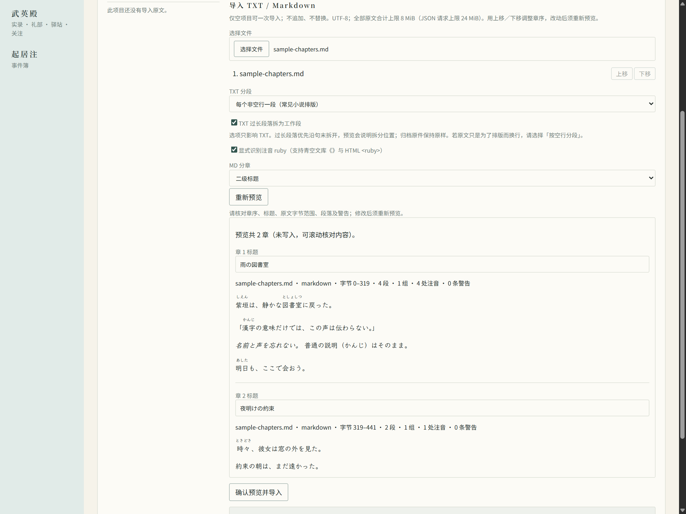
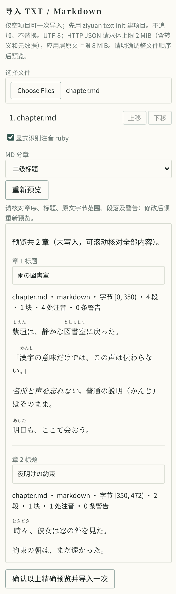
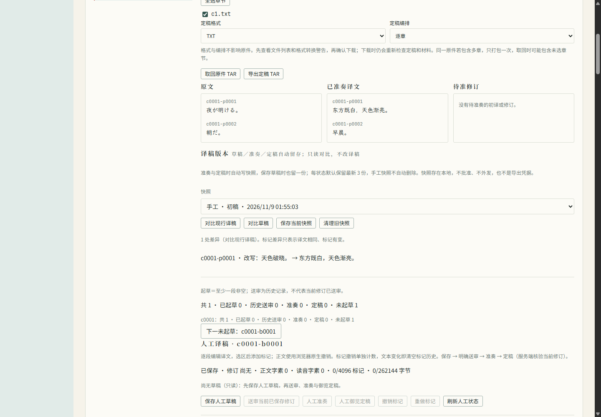

# 整理原文与检查译稿

本页对应 1.1.0 起的 `ziyuan text` 基础命令，1.0.0 没有这组命令；1.2.0 新增的翻译、审校、朱批与御览见[小说翻译指南](novel-translation.md)。

本页按 **1.12.0** 更新，涵盖基础 TXT、Markdown／注音预览、成稿导出、词证与逐段勘校、用量账本、本地术语／人物资料与确定性检查。**1.13 开发中（未发布）**另加译稿三态快照与版本对比、DOCX／EPUB 标记回填、术语表完整字段与版本清理，见[本页 1.13 一节](#113译稿版本与格式回填开发中未发布)；证据见 [1.13.0 验收记录](acceptance/1.13.0.md)。1.12.0 的验收见 [1.12.0 验收记录](acceptance/1.12.0.md)。另有一节仍在开发、未发布的**人工译稿**流程，命令行与网页都已开放，见[开发中：人工译稿](#开发中人工译稿未发布cli-与-web)。

**1.4.1 补丁已发布：** 下文主图采用较小的注音字号，并明确区分注音与普通括号；解析及操作步骤不变。版本 CI、四平台下载包与十一个 crate 的结果见[1.4.1 验收记录](acceptance/1.4.1.md)。

本页的命令只在本地整理文件，不联网、不调用模型。基础整理与取回原件不需要先运行 `ziyuan init`；导出成稿需要已建立的朝廷及有效定稿。结构检查能帮助你发现漏段、重复和顺序错误，但不会判断译文是否准确。

## 1. 准备原文

每章准备一个 UTF-8 编码的 `.txt` 文件，段落之间留空行。支持日文（`ja`）和英文（`en`），目标语言先固定为简体中文。

建议在自己的练习目录使用自写短文。下面以 `chapter1.txt` 中的两段日文为例：

```text
朝、窓を開けた。

雨はもう上がっていた。
```

原文不会被修改。软件会保留一份原样副本，并生成带编号的小块；空行作为排版信息保存。单个自然段过长时会报错，请先自行分段，不会自动截掉后半段。

## 2. 建立项目并导入

PowerShell：

```powershell
$project = ziyuan text init --title '日文练习' --language ja --source '自写短文' --rights '本人创作，仅本地练习' --json | ConvertFrom-Json
$id = $project.id
ziyuan text import $id chapter1.txt
ziyuan text show $id
```

Bash（需要 `jq` 提取项目编号）：

```bash
id=$(ziyuan text init --title '日文练习' --language ja --source '自写短文' --rights '本人创作，仅本地练习' --json | jq -r .id)
ziyuan text import "$id" chapter1.txt
ziyuan text show "$id"
```

请逐行检查是否成功，再执行下一步。项目编号由程序生成，不要照抄别人的编号。也可不用 `--json`，从普通输出中复制编号。

`--source` 和 `--rights` 只是记录你的来源及使用权限声明，软件不会据此认证版权。还可用 `--author`、`--version`、`--date`、`--scope` 补充作者、版本、取得日期与使用范围。

多章要在同一次导入中按顺序列出，例如 `chapter1.txt chapter2.txt`。一个项目只能导入一次；想换原文或增加章节，请建立新项目，不要直接修改项目内部文件。

一个项目的记录文件最大 32 MiB，其中会保存每段原文和编号，所以实际能放的原文少于这个数字（段落很短时大约只有几 MB）。太长时导入会在写入任何文件前报错，请按卷或章节范围拆成多个项目分别导入。

## 3. 查看分块

`text show` 列出每章的段落数、小块编号和文件路径；加 `--json` 可读取完整结构。

- 项目保存在当前目录的 `.ziyuan/text-projects/`。
- 每段有固定编号，例如 `c0001-p0001`；相同内容的两段仍有不同编号。
- 每块最多 48 KiB，编号和 JSON 格式也占大小。这不是模型能接收多少内容的保证。
- 原件副本和分块文件互相关联，手动改它们会使后续检查报错。

## 4. 检查一块候选译稿

候选译稿是独立 JSON 文件，保留分块文件中的 `schema_version`、`block_id` 和段落 `id`，只把各段的 `text` 换成译文。段落只写 `id`／`text`，不复制原文的 `inlines` 或字节偏移。不要改项目内部的原文块文件。

上述两段示例的 `candidate.json`：

```json
{
  "schema_version": 1,
  "block_id": "c0001-b0001",
  "paragraphs": [
    {"id": "c0001-p0001", "text": "清晨，我打开了窗。"},
    {"id": "c0001-p0002", "text": "雨已经停了。"}
  ]
}
```

PowerShell 中执行：

```powershell
ziyuan text check $id --candidate candidate.json
```

Bash 中把 `$id` 写为 `"$id"`。编号必须来自自己的项目。检查会报告漏段、重复、乱序、陌生编号和空译文；不会改写候选文件、原文或译稿，也不会自动批准文件改动。

<a id="unreleased--14-第一批源码预览与确认导入"></a>

## 1.4：预览与确认导入

旧命令 `ziyuan text import <项目ID> <章节.txt>...` 不带解析选项时仍走旧 TXT 路径，不改变既有段号或解析含义。需要 Markdown、注音、新 BOM 处理或解析选项时，必须先 `text preview`，检查后再以 `--confirm` 确认，不能把预览与导入连成无人审阅的一条命令。开发阶段证据保留在[第一批验收记录](acceptance/1.4-first-batch.md)，最终状态见本页开头的版本验收链接。

以下用自写短文展示正常注音：读音以较小字号标在汉字上方。**图中「漢字」上方的小字 `かんじ` 才是 ruby 注音；`普通の説明（かんじ）はそのまま。` 中的 `（かんじ）` 是行内普通括号文本，不是注音，也不会被自动移到汉字上方。** 两者并列，是为了说明程序不会把普通括号擅自解释成读音。含危险标签的安全测试图单独保留在[验收记录](acceptance/1.4-first-batch.md#浏览器实跑)，不作为日常导入示例。





### CLI：先检查，再确认

先按上文 `text init` 新建一个**空项目**，保留自己的 `$id`。示例假设 `book.md` 恰有两个 `##` 标题、标题前没有正文；否则按实际预览的章数调整章名参数，或先不覆盖标题。

PowerShell，第一步只读预览：

```powershell
ziyuan text preview $id book.md --ruby --heading-level 2 --chapter-title '第一章' --chapter-title '第二章'
```

Bash：

```bash
ziyuan text preview "$id" book.md --ruby --heading-level 2 --chapter-title '第一章' --chapter-title '第二章'
```

**停下来检查输出**：章序／章名、原文字节范围、派生段落、提示块、注音与所有警告；可加 `--json` 查看完整结构。需要修改时，修改后重新预览。确认无误才复制这一次输出的完整指纹。下面赋值里的文字须替换为自己的指纹，不是可用指纹。

PowerShell，第二步：

```powershell
$fingerprint = '替换为刚刚人工检查的完整预览指纹'
ziyuan text import $id book.md --ruby --heading-level 2 --chapter-title '第一章' --chapter-title '第二章' --confirm $fingerprint
ziyuan text show $id
```

Bash：

```bash
fingerprint='替换为刚刚人工检查的完整预览指纹'
ziyuan text import "$id" book.md --ruby --heading-level 2 --chapter-title '第一章' --chapter-title '第二章' --confirm "$fingerprint"
ziyuan text show "$id"
```

- 文件按命令行给定顺序导入；多个文件都要在预览和确认命令中按同序列出。重复 `--chapter-title` 按最终章序覆盖**全部**章名，不能只传要改的一章。
- 确认会重新读取原文并精确比较指纹。输入内容、文件名／来源、顺序、解析选项、章名或项目来源资料改变，都要重新预览、人工检查并使用新指纹；指纹不是授权令牌。
- `.txt` 也能用新流程：例如先 `text preview`，再用相同文件与选项加 `--confirm`。即使没有 `--ruby`，这也会选用新解析／BOM 处理；不加确认的旧 TXT 命令不会悄悄改用它。
- 项目只可导入一次，不追加、不覆盖；已有章节时须新建项目。预览不发布原文或修改项目，不调用模型。

### 编码、Markdown 与大小

只接受 UTF-8 `.txt`、`.md`、`.markdown`（扩展名不区分大小写），不自动猜测或转码。原件副本、哈希与原始字节保持不变，包括 UTF-8 BOM；新解析只跳过派生正文开头的 BOM。所有章、段落及注音偏移仍为完整未改动原件的半开字节范围，不是派生文本的字符位置；CRLF 等正文整理不重写原件。

Markdown 使用 CommonMark 解析器的默认语法，而非任意站点方言。默认每文件一章；只有显式 `--heading-level 1` 或 `2` 才按对应的顶层标题分章（列表／引用中的标题不触发分章），标题前的正文单独保留为章。分章标题作为章名，不重复放入该章正文；没有匹配标题时仍为整文件。空正文、空章或只有代码而无可翻译正文时拒绝导入，应补正文或调整分章。

段落与非分章标题形成正文，列表／引用保留文字内容，强调作为派生标记；链接只取文字，不读取链接。图片只留替代文字并警告，不下载图片。围栏／缩进代码块及行内代码只在原件保留，不交给模型；分隔线不作正文并警告。不要把它当 Markdown 渲染器或全方言兼容转换器，务必检查预览是否遗漏所需内容。

新导入所有原件合计上限 **8 MiB**；项目清单仍上限 **32 MiB**，重复正文、注音等编码开销可能使清单更早触限。提示块默认 **48 KiB** 预算按完整 JSON 编码（含包装、转义、注音及末尾换行）计算，不是仅数正文字符，也不是模型窗口保证。超大单段不自动截断，须自行分段或拆项目。

### 显式注音语法，不猜括号

默认不识别文本注音；只有 `--ruby` 开启以下保守子集，**不宣称完整青空文库、カクヨム或其他方言兼容**：

- `｜東京《とうきょう》` 或 `|東京《とうきょう》` 显式指定基字；基字非空、不跨行，不含竖线、`》` 或尖括号。
- `東京《とうきょう》` 隐式取前面连续汉字字素（含补充平面汉字）；`々`／`〻` 只能延续已有汉字串，不能起头，假名会结束该串，组合标记随字素保留。读音不得为空白、跨行或含 `《`／尖括号。
- `《《強調》》` 表示强调，不是注音；内部不跨行、不含嵌套书名括号。`東京（とうきょう）`、`word(reading)` 等普通括号永远不自动猜成注音。
- HTML 仅接受**单行、小写、无属性、单组基字／读音**：`<ruby>東京<rt>とうきょう</rt></ruby>`；基字可包一层 `<rb>…</rb>`，`<rt>…</rt>` 前后各可有一个 `<rp>…</rp>`。基字和读音非空、不含尖括号、换行或 `&`；不解码其中的实体，不接受嵌套、多组、属性或大小写变体。
- 未解释的 HTML、复杂／破损 ruby 或无法配对的标记按字面保留并给出警告，不执行 HTML。Markdown 转义／实体由 CommonMark 解码，但不会据此猜测原文字节坐标来拼出 ruby。警告不是自动修好，须人工检查；原始写法始终保留在原件中。

原文段落的 `inlines` 将基字 `base` 与读音 `reading` **配对**传给模型，正文 `text` 使用基字；强调也作为原文资料。译稿段落仍只写 `id`／`text`，不复制 `inlines` 或偏移，不自动把日文注音套到中文里，也不把读音当另一段翻译。模型是否正确理解仍须人审，不保证质量改善。新字段为空时不序列化，旧 TXT 块的提示字节不因空字段改变。

### Web：CLI 空项目的一次性导入

先用 CLI `text init` 建立空项目，再在同一工作目录启动 Web，在武英殿「翰林院 · 译书」选择该项目：

1. 选择 UTF-8 TXT／Markdown 文件，用文件顺序按钮调整章序来源，选择是否识别 ruby 以及标题分章级别。
2. 点击「重新预览」，检查每章正文、注音、字节范围、块数及警告；原文以安全生成的 ruby 显示，未解释 HTML 作为文字，不执行上传标签。
3. 如需覆盖章名，在各章标题框编辑后**重新预览**；文件、顺序或选项改变也必须重新预览。
4. 检查新预览后，才点击「确认以上精确预览并导入一次」。确认重新核对指纹；不允许追加或覆盖已有章节。只读令牌不能导入。

上传的是文件名与文字组成的 JSON，不允许浏览器指定服务器文件路径。**完整 JSON 请求上限 2 MiB**，包装与转义也占空间，因此正文可能不到 2 MiB 就需拆分；它比应用层 8 MiB 合计上限更紧。更大的材料可用 CLI，但仍受应用层与清单／提示块限制。

### 项目兼容与未完成范围

新写入的文本项目清单**外壳 schema 2**，不同于原文块／候选译稿的 `schema_version: 1`。新应用可读 schema 1 的旧 TXT 项目，不重解析原件、不改段号或提示字节；**旧 1.3 无法读取新写入的 schema 2，须升级**，不能把「没有新朝廷事件」当作项目向下兼容。损坏或更新格式不静默重置，详见[稳定性约定](stability.md)。

导入本身不新增朝廷事件。成稿导出见下文，显式参考见[译文记忆指南](memory.md)。这些是独立入口，不把结构检查当文学质量评测。

<a id="unreleased--14-第二批源码原件与成稿导出"></a>

## 1.4：原件与成稿导出

导出已纳入 1.4.0，最终工程与发布证据见[版本验收](acceptance/1.4.0.md)。开发时已检查三主题、1280／390 CSS px 的浏览器界面及实际下载 TAR 的文件、章序与 SHA-256；浏览器窄屏不等于原生移动设备验收。

### 两个独立入口，默认只预览

```text
ziyuan text export-originals <项目ID> [--chapter <章ID>]... [--output <new.tar>] [--json]
ziyuan text export-finished <项目ID> [--chapter <章ID>]... [--format txt|md] [--layout chapters|book] [--output <new.tar>] [--json]
```

`export-originals` 取回归档原件，不要求译文定稿，不做格式转换；同一归档路径只输出一次，字节（含 BOM／行尾）不变。**一个 MD 源文件可能分成多章，选择其中一章仍会取回整个源文件，含其他章**，分享前须核对权利与范围。它不是按正文裁剪的“原件”。

`export-finished` 导出有效定稿，默认 `txt`、`chapters`。逐章输出 `<章ID>.txt`／`.md`，`book` 合并为 `book.txt`／`book.md`；两种编排都保留章名和章界。章名仍为导入时标题，不自动生成译题。两个入口最终都输出**一个 TAR**，内含材料文件及 `manifest.json`，不是向目录逐章写文件，也不是旧的逐块模型材料导出。

不传 `--chapter` 选全部；重复参数选子集，但输出始终依项目顺序，不以参数顺序重排。未知或重复章 ID 拒绝。请从 `text show` 取得自己的 ID，不照抄别人的编号。

不传 `--output` **只读预览**文件名、大小、警告与清单，不写 TAR。`--json` 返回 `project`、`output`、`files`（`name`／`size`）、`manifest`、`warnings`，不直接返回正文；指定输出时仍先重新构建并检查材料，不沿用旧预览。预览不是锁定未来状态的授权凭证。

Bash，先将 `project` 替换为自己的实际项目编号，逐行执行；`exports` 须预先存在，文件名必须未被占用：

```bash
project='替换为自己的实际项目ID'
ziyuan text export-finished "$project" --format md --layout book --json
# 停下来检查文件、清单和警告；确认后再执行
ziyuan text export-finished "$project" --format md --layout book --output exports/finished-md.tar
ziyuan text export-originals "$project" --output exports/originals.tar
```

PowerShell 同理，使用自己的实际项目编号：

```powershell
$project = '替换为自己的实际项目ID'
ziyuan text export-finished $project --format txt --layout chapters --json
# 检查后再执行；exports 目录须已有，目标文件须不存在
ziyuan text export-finished $project --format txt --layout chapters --output exports/finished-txt.tar
```

### 定稿资格、快照与清单

只收当前仍有效的 `Finalized`：重新核对原文、磁盘译稿、已批准上下文、朱批与来源任务／定稿，重新做段号和正文结构检查，不只寻找最后一个定稿事件。所选章节缺块、待审、退回、失效或结构不合格时整批拒绝并报告原因，不用原文、空白或草稿补洞；未选章节不必都完成。

成稿收集前后重新回放事件并比较两份完整快照；原件也读取两次并核对摘要，变化就拒绝。返回的是已收集的不可变字节，不在下载流中重新逐文件读取。清单记录项目资料、章序、解析信息、来源任务／定稿、原文／译文／上下文／朱批版本与摘要、文件大小及 SHA-256、规则版本、警告与快照摘要。导出不新增审批事件，不修改原件、译稿或记忆资格；快照是某一时点证据，不承诺导出后材料永远不变。

### Markdown 与注音：不是任意无损转换

- MD 原件导出 MD 时，以原件字节范围为模板回填定稿段落，保留块级代码（围栏／缩进）、分隔线等非翻译节点的原位置；分章标题作为生成的章名，不再当正文重复输出。正文标题保留层级，CRLF 可整理为 LF，不宣称成稿与原件逐字节相同。
- 译文的 Markdown 符号／HTML 安全转义，不把译文解释成可执行标签、图片或链接；不套用源文行内强调、注音或图像／链接目的地址。取回原件才保留原记法，导出不是自动下载外链资源。
- **原段含行内代码时，MD 成稿导出拒绝**：现有已批准逐段译稿没有代码相对于译文的位置锚点，不能猜位置，也不能悄悄丢代码。可取回原件自行整理，或明确选 TXT：只导出定稿正文与章名，并警告代码、分隔线、链接目标及排版等损失。
- 不从日文源头复制 ruby 到中文。仅当**批准译文自身**已有结构化 `inlines`、拼接基底与 `text` 正文完全一致、注音可安全表示时，TXT 输出 `｜基底《读音》`，MD 生成安全的 `<ruby>…<rt>…</rt></ruby>`；不一致或含无法安全表示的注音则拒绝。不新增译文注音编辑器，常规候选仍写 `id`／`text`，不复制源注音或偏移。

### CLI 文件发布边界

父目录必须已存在，不自动建目录；拒绝任何 `..`、符号链接目录链／目标（含悬空链接）、已有文件或目录，以及工作区 `.ziyuan`、`translations`、`.git`、`.jj` 下的目标。相对路径以工作目录为基准，允许控制目录之外的绝对路径，**这不是文件系统沙箱**。

先校验并构造完整 TAR，在目标同目录用独占创建的临时文件写完、刷盘，再以 **hard link 单一原子发布且不覆盖**，避免按章写入产生可见的半本书。文件系统不支持硬链接时失败，不回落到复制、覆盖或非原子多文件写入。正常退出清理自己的临时文件；进程强杀可能残留临时归档。不承诺断电后的持久性、恶意进程并发替换目录防护或任意文件系统保证；须信任父目录与文件系统。

### Web：预览警告，确认后下载

武英殿译书卡片「章节导出」选择章节、TXT／Markdown 和逐章／合并编排，分别点击「取回原件 TAR」或「导出定稿 TAR」。先显示文件、清单与转换警告，再确认下载；取消不下载。实际下载重新核对材料，预览成功不保证之后一定成功。viewer 只读令牌也可预览与下载，不因此获得写入或审批权限。

内部只读接口为 `GET /api/text/{id}/export`：`kind=original|finished`（默认 finished）、`format=txt|markdown`（注意 CLI 写 `md`）、`layout=chapters|book`、`chapters=章ID,章ID`（省略／空值选全部）、`preview=true`。预览 JSON 含 `manifest`、`warnings`、`files`（`name`／`length`）；非预览返回 `application/x-tar` 附件，安全生成文件名并设置 `Cache-Control: no-store`。页面确认时附 `snapshot=<预览清单的 snapshot_sha256>`，服务端重新生成并比较，变化则拒绝并要求重预览；直接调用 API 可省略此参数，但仍核对当次一致性。原件忽略格式与编排。Web 不接受服务器输出路径；此内部 API 与页面不冻结。

导出不改变参考选择规则，也不证明文学质量提高。参考须另行[选择与确认](memory.md#unreleased--14-第三批-a显式选用参考)。

<a id="unreleased--14-第三批-b词证与操作者语义复核"></a>
<a id="unreleased--14-第三批-b词证与逐段复核"></a>
<a id="unreleased--14-第三批-b词证与逐段勘校"></a>

## 1.4：词证与逐段勘校

CLI／Web 共用下列规则，工程检查及界面证据见[3B 记录](acceptance/1.4-third-batch-3b.md)，最终状态见[1.4.0 验收记录](acceptance/1.4.0.md)。本轮没有新增付费文学质量评测，勘校记录不等于译文准确保证。

### 先加词证，再读取当前材料

词证是词义核对的出处和说明。“逐段勘校”逐段记录六类核对结果；“人工复核”仍是独立状态，不因标题改名而改变判定。

六事逐项勘校，记录所据与存疑。此为人工核对记录，不代准奏，亦非御览定稿。

```text
ziyuan text evidence add <项目ID> <块ID> --file <evidence.json> [--json]
ziyuan text verification show <项目ID> <块ID> [--json]
ziyuan text verification record <项目ID> <块ID> --file <checks.json> [--json]
```

请求是单个严格 JSON 对象（不是数组、不是含 `project`／`block` 的外壳），所有列出的字段必填，未知字段拒绝；文件最多 16 MiB。项目／块由命令参数指定，段号取自自己的 `text show`。沿用退出码 0／1／2，失败检查退出码及 stderr，不假定错误也有 JSON。

`evidence.json` 示例沿用本页两段自写原文；用于其他项目须替换段号与短引：

```json
{
  "paragraph": "c0001-p0001",
  "quote": "窓を開けた",
  "source": "作者自写练习原稿",
  "locator": "第一章第一段",
  "explanation": "动作是打开窗户；此处未单独明示主语。",
  "context": "仅适用于此练习段，不据此推断其他章节说话者。",
  "status": "tentative"
}
```

`status` 仅 `tentative|confirmed`（暂定／确认），是人工判断，不是系统认证。`quote` 必须是关联原段中真实、非空的连续短引，最多 1000 字；`source`（URL 或书目文字）2000 字、`locator` 1000 字、`explanation` 4000 字、`context` 2000 字，均非空。返回 `id` 为项目内数字序号，供复核关联；不自动访问来源 URL。

Bash（PowerShell 用 `$project`／`$block` 同样逐行执行），先替换自己的编号、准备并检查文件：

```bash
project='替换为实际项目ID'
block='c0001-b0001'
ziyuan text evidence add "$project" "$block" --file evidence.json --json
ziyuan text verification show "$project" "$block" --json
# 停下阅读原译文、结构、朱批、审校与词证；将本次 fingerprint 填入 checks.json
ziyuan text verification record "$project" "$block" --file checks.json --json
ziyuan text verification show "$project" "$block" --json
```

添加词证后再 `show`，因为追加也会改变确认指纹（用来确认保存时材料和项目记录未变的标识）。`show` 在无译稿时仍可展示原文及历史；**保存复核则必须已有结构有效的现行译稿**，没有译稿、漏段等结构错误都拒绝，不能用人工清单绕过结构检查。

<a id="六类清单意见处理与问题状态分开记录"></a>
<a id="逐段勘校六事意见处理与问题状态分开记录"></a>

### 逐段勘校六事：意见处理与问题状态分开记录

六项标题用于文案，内部 JSON 键不变；说明与短例只提示人工核对，不是自动判错规则。

| 标题 | 内部 JSON 键 | 直白说明 | 短例 |
| --- | --- | --- | --- |
| 言行归属 | `subject_speaker` | 核对谁说话、谁做事，勿张冠李戴。 | “清替我换钱”不是“我替清换钱”。 |
| 事理正反 | `agency_negation` | 核对动作方向与肯否。 | “借给他”不是“向他借”；“并非主任”不能漏“并非”。 |
| 数目分寸 | `quantity` | 核对金额、人数、约数与倍数。 | “约三圆”不是“恰好三圆”。 |
| 前后次第 | `timeline` | 核对时间先后和是否已发生。 | “来年暑假回去”不是“今年暑假回过”。 |
| 称谓名分 | `names_relations` | 核对人名、职务、昵称与人物关系。 | “副校长”不是“数学主任”。 |
| 谐趣留白 | `humor_additions` | 核对笑点、反话与含蓄，勿把解释写成原文。 | 人物原本不懂绰号，不替他补词典释义。 |

`checks.json` 完整六类输入示例（是待核对模板，**不会显示已复核**）。`fingerprint` 必须替换为刚人工检查的 `show` 顶层指纹，不能省略或自己构造：

```json
{
  "paragraph": "c0001-p0001",
  "fingerprint": "替换为刚刚人工检查的完整指纹",
  "checks": [
    {"category":"subject_speaker","disposition":"pending","resolution":"unchecked","note":"言行归属：待核对谁说话、谁做事，勿张冠李戴。","advice":[],"evidence":[]},
    {"category":"agency_negation","disposition":"pending","resolution":"unchecked","note":"事理正反：待核对动作方向与肯否。","advice":[],"evidence":[]},
    {"category":"quantity","disposition":"pending","resolution":"unchecked","note":"数目分寸：待核对金额、人数、约数与倍数。","advice":[],"evidence":[]},
    {"category":"timeline","disposition":"pending","resolution":"unchecked","note":"前后次第：待核对时间先后和是否已发生。","advice":[],"evidence":[]},
    {"category":"names_relations","disposition":"pending","resolution":"unchecked","note":"称谓名分：待核对人名、职务、昵称与人物关系。","advice":[],"evidence":[]},
    {"category":"humor_additions","disposition":"pending","resolution":"unchecked","note":"谐趣留白：待核对笑点、反话与含蓄，勿把解释写成原文。","advice":[],"evidence":[]}
  ]
}
```

- 每次保存 1–6 类，类别不得重复；新记录是本段最新清单，**不自动合并**前次漏填的类别。CLI 可存部分，Web 每次存六项。不存在记录不等于检查过。
- 意见处理 `disposition` 为 `accepted|rejected|pending|not_applicable`（接受／驳回／待查／不适用）；问题状态 `resolution` 为 `unchecked|resolved|unresolved|not_applicable`（未检查／已解决／未解决／不适用）。接受建议不等于已核实修订解决，可先记 `accepted` + `unresolved`。非 `pending` 必须有非空 `note`，最多 4000 字。
- 拒绝不一致组合：`accepted` + `not_applicable`；`pending` + `resolved`；`rejected` 或 `not_applicable` + `resolved|unresolved`。确不适用时可记 `not_applicable` + `not_applicable`，说明理由，不能为消掉未解决数虚填。
- `advice` 每项最多 8 条，形状如 `[{"task":42,"quote":"该任务回奏中的真实短引"}]`；须替换为 `show.reviews` 中本块已完成任务号及其正文真实短引（非空、最多 2000 字），同一任务／短引不重复。它是意见出处，不是自动认可。`evidence` 如 `[1]`，须替换为本段实际词证数字 ID，每项最多 16 条、不重复；不存在或其他段的词证拒绝。无关联时显式写 `[]`，不捏造任务或证据。

### 快照、历史与四种事实

`show` 返回 `fingerprint`、`source`、有效结构下的 `translation`、`structure`、`writer_task`、`reviews`、`zhupi`、`evidence`、`records`、`hints` 和逐段 `paragraphs`。材料快照（保存时的一份材料副本）绑定原文／译稿／已批准上下文／朱批摘要、匹配的准奏来源任务及已完成审校意见；指纹还绑定项目级记录序号。材料变化或他人追加词证／记录后，本次保存会被拒绝；请重新运行 `show`、阅读最新材料，再把新指纹填入文件保存，不要只换指纹自动重试。

词证和复核历史只追加、不改原记录，不提供原地编辑／删除；更正须新增，旧的暂定／确认词证仍保留。每条复核保留当时原译文、朱批、快照及 `previous`；`records[].current` 仅表示该记录材料快照是否等于当前，**不等于它是最新意见或已通过**。不同记录可同时对应当前材料；逐段结论只取最新一条。材料失效时 `reason` 说明需复核，旧内容不隐藏；`change.before/after` 比较前次与本次记录的译文，不是模型提案差异或修改原因的自动证明。

四种事实不能合成一个“质量通过”：

1. `structure.valid`：只查段号／正文结构，不判断语义。
2. `paragraphs[].opinions_handled`：最新记录对应当前材料、至少一项关联审校且全部处置非待查；不代表所有审校均覆盖或问题已解决。
3. `operator_reviewed`（人工复核）：最新当前记录六类齐全，且没有 `pending`、`unchecked`、`unresolved`。`unresolved` 也计缺类别；旧记录即使数为零仍须看 `current`。这是人工声明，不是专家终审或语义正确性保证。
4. 有效御览定稿：仍以 `text status` 为准，复核不授予定稿、不新增定稿门槛，也不改变旧 `text check` 语义。

批准词表提示仅在原文包含 `source`、译文未字面包含任何 `allowed` 时出现，保留 `scope`／`note`；自由文本 `scope` 不可自动判定适用，只请用户核对，不是错译判决，**没有新增禁译词列表**。词证不自动变成词条、朱批或模型材料；如要纳入已批准上下文，须人工选择、编辑／并入现有上下文草稿，再显式 `text context approve`，不原地改已批准快照，新版仍沿用既有失效规则。

Web 武英殿「词证与逐段勘校」逐段显示同样材料、词表提示、「本块词证」及「复核历史（保留原记录）」。六项初始均待查／未检查，模型建议不自动填写；保存错误、自动刷新和段落切换保留本地输入，材料过期后须阅读最新内容，再主动点「已读最新材料，继续核对」。未保存输入只保留在本次页面会话，**浏览器整页重载或关闭会丢失**；已保存的词证和复核历史不受影响。viewer（只读角色）只能查看，不能保存词证或复核。内部接口与页面不冻结，见[稳定性约定](stability.md#unreleased--14-第三批-b词证与逐段勘校)。

本流程不自动抓取链接、不自动导出词证／清单给模型、不入队模型任务、不自动批准上下文。继续按批次人工控制：本块核对后再显式启动下一块；有争议就停下，不新增无人值守批量翻译。本地记录含作品原译文与意见，分享内部文件或 JSON 前须核对隐私与权利。

<a id="unreleased--14-第三批-c逐阶段用量账本与请求材料精简"></a>

## 1.4：逐阶段用量账本与请求材料精简

账本与材料精简已纳入 1.4.0，检查与本地对照见[3C 记录](acceptance/1.4-third-batch-3c.md)，最终状态见[版本验收](acceptance/1.4.0.md)。没有新增付费调用，不宣称实际小说复验、文学质量或节费收益。

### CLI 只读账本

```text
ziyuan text usage <项目ID> [--json]
```

Bash，替换自己的项目编号；PowerShell 可直接把编号作为参数传入：

```bash
project='替换为实际项目ID'
ziyuan text usage "$project"
ziyuan text usage "$project" --json
```

命令先验证项目及原件，再读取现有朝廷事件簿；需要已建立的朝廷，不自动执行 `ziyuan init`，不调用模型、不联网、不改变审批或预算。项目不存在、原件损坏或事件簿不可读时报错，不冒充空账本。沿用退出码 0／1／2，脚本仍须检查退出码和 stderr。本批先提供 CLI，**没有新增 Web 用量表单**。

四阶段为 `translate`（初译）、`review_fidelity`（忠实审校）、`review_style`（文风审校）、`revise`（修订）。统计所有关联任务而非只收有效定稿：包括待办、已指派、完成、失败、撤销、旧稿与各次重试，不因重译成功而抹去先前消耗。用量单位 token 是模型计量文本的单位，不等于字数。

JSON 顶层为 `project`、`stages`、`tasks`、`totals`、`notes`；这是输出，不是要提交的请求 JSON：

| 字段 | 实际口径 |
| --- | --- |
| `stages[].kind`／`totals` | 四阶段分别汇总；顶层 `totals` 为项目合计 |
| `tasks[].task/block/kind/status` | 关联任务、块、阶段及当前状态；状态为 `pending/assigned/completed/failed/cancelled` |
| `tasks[].attempts`／`budget` | 指派尝试数／本件显式 token 预算；不是 HTTP 次数，也不是朝廷或官员剩余额度。预算为 `null` 表示未设本件限额，不等于免费或取消其他限额 |
| `tasks[].recorded_execution_usage` | 该任务已有 `ModelUsage` 的执行用量小计；没有报告为 `null`，不是零 |
| `tasks[].usage_reconciled` | 事件小计与任务累计是否一致；`true` 不证明覆盖全部调用或实际账单 |
| 各层 `totals.recorded_usage` | 执行及已记录治理开销的已报告小计；没有可计记录为 `null`；有值也不能断言完整覆盖 |
| `tasks_without_execution_usage` | 未见执行 `ModelUsage` 的任务数；不把这些任务填成零消耗 |
| `usage_events`／`tool_calls`／`tool_failures` | 承办用量记录（`ModelUsage`）数／工具调用及失败数；不是 HTTP 请求数 |
| `estimates`／`unpriced_usage` | 按币种分别列出的已定价估算小计／缺模型或费率的已报告用量；空估价不代表零费用 |
| `tasks[].charges[]` | 按 `purpose` 与 `model` 汇总的 `usage`、`rate` 和 `estimated_cost`；未知模型／费率／费用分别可为 `null` |

表中未写完整路径的合计字段均位于顶层、阶段或任务的 `totals` 内。执行开销按每条 `ModelUsage` 发生时最近的 `TaskAssigned.model` 归属，不用最后一次指派或当前模型冒充历史；治理开销按原始票拟、分办、都察院、复勘事件及廷议每条发言的模型归属。`charges[].purpose` 为 `execution/draft/split/censure/recheck/debate`，人读输出对应承办／票拟／分办／都察院审查／复勘／廷议。治理事件的零值可能是人工决定或缺失报告，不能当作已证实的零 token 调用；显式执行 `ModelUsage` 报告的零值则保留。

`rate` 有值时含 `input_per_million`、`output_per_million`、`currency`、`source`，是**本次查询**用来估价的费率，不是执行时锁价。支持的 DeepSeek 名称使用内置 **2026-10 高峰未命中缓存价（未实时核价）**；其他模型可用当前 `ZIYUAN_LLM_PRICE`（每百万 token「输入,输出[,币种]」），不提供时单列未知费率。币种不相加、不换汇。服务端缓存命中、折扣、实际账单均未知，订阅额度不能据此认定为按 token 付费。

`recorded_usage` 非空只证明有已报告小计；缺失报告、失败前未返回用量等不能补零，即使 `usage_reconciled=true` 也不能声称完整。任务数、指派尝试、用量记录、工具调用都不等于 HTTP 请求数；重试可共享 trace（追踪标识），历史完整 HTTP 数和精确耗时未知，分钟级时辰不能充当请求计时。人工用时与文学质量须另外记录。

### 请求材料精简的窄边界

运行时先执行已有 `abridge`（历史节略），再为当次发送给模型的请求另建一份材料副本，只处理**本次运行成功执行**的 `read_file`（读取文件）：参数字符串和完整返回字节必须完全相同，较早副本才可换成指向后续最新完整副本的短提示（仅短提示确实更短时替换）。保留工具调用／输出的 call ID（调用标识）配对；最新全文始终留在该请求内，不让模型猜测已丢失的材料。已节略的副本不拿来当相同全文折叠。

不同参数、返回内容已变的重读、读取错误和其他工具的输出不精简；不是正文截断、跨文件摘要、按语义去重或记忆检索。替换只存在于发给模型的请求副本，**不写回原始历史（history）**，不改变原工具记录，也不改变既有节略阈值或保护规则。

本地 HTTP 模拟服务的字节测量仅证明该固定场景发送的材料副本发生变化，不能按减少字节推算真实 token、费率、费用或小说收益；它不是付费模型或实际小说质量复验。预算与停止策略不变，不减少词义核对、朱批复核、两路审校或手工分批验收，不新增定稿门槛，也不自动启动下一块。兼容边界见[稳定性约定](stability.md#unreleased--14-第三批-c逐阶段用量账本与请求材料精简)。

## 开发中：人工译稿（未发布，CLI 与 Web）

纯人工翻译另有一条流程：不调用模型，自己写译稿，经送审、准奏、定稿后导出成品。命令行与网页都能走完（网页见下文“Web：不编辑 JSON 完成一块人工稿”），**TUI 尚未开放**；包版本仍为 1.12.0，未发版。行为与验收见 [N0 第 22.30 节](novel-workbench-n0.md#2230-本批准奏即落盘恢复收尾加固与人工定稿导出)。

### 六个命令与顺序

```text
ziyuan text human show <项目ID> <块ID> [--json]
ziyuan text human save <项目ID> <块ID> --file <草稿.json> [--json]
ziyuan text human submit <项目ID> <块ID> [--json]
ziyuan text human approve <项目ID> <块ID> [--json]
ziyuan text human finalize <项目ID> <块ID> [--json]
ziyuan text human apply <项目ID> <块ID> [--json]
```

顺序是 `show` → `save` → `submit` → `approve`（准奏即落盘）→ `apply`（只读核对，可跳过）→ `finalize` → `text export-finished`。

- `show`：只读查看当前人工草稿的修订号、段落与文本；草稿不存在时说“尚无草稿（只读）”。不取写锁、不写盘、不推进世代。
- `save`：按下面的 `DraftSave` 文件保存整块草稿。可只写部分段落；未写的段落仍算草稿未完成。
- `submit`：把当前修订号的草稿冻结成送审候选并发布送审绑定，写入朝廷事件簿。需要已建立的朝廷；文本独立项目先运行 `ziyuan init`。
- `approve`：准奏最新送审，并在**同一次受管写入**里把准奏目标写进 `translations/<项目ID>/<块ID>/zh.json`。这是“准奏即落盘”，不再需要单独落盘。准奏目标与磁盘现有字节完全相同时不重写文件，只把准奏入簿。
- `apply`：保留但**只读**。核对“准奏时已落盘”：没有未收尾的恢复记录、当前准奏来源就是本块的这份准奏、磁盘 `zh.json` 的摘要等于该准奏的目标。通过后提示下一步 `finalize`；不写任何文件。
- `finalize`：只记定稿事实，要求磁盘 `zh.json` 已是准奏目标；已定稿时幂等返回未新增。

草稿、送审、准奏、定稿都是分开的事实，`save` 不会改 `zh.json`，`approve` 之前磁盘译稿也不会变。每一步成功回执都会打印完整的下一步命令。

### 草稿文件（`DraftSave`）

```json
{
  "request_id": "save-1",
  "expected_revision": null,
  "basis": {
    "project_hash": "…",
    "source_hash": "…",
    "context_version": 0,
    "zhupi_hash": "…",
    "translation_hash": null
  },
  "paragraphs": [
    {"id": "p0001", "text": "人工译文"},
    {"id": "p0002", "text": "带注音的译文", "marks": [
      {"start": 0, "end": 2, "kind": {"type": "ruby", "reading": "よみ"}}
    ]}
  ]
}
```

| 字段 | 说明 |
| --- | --- |
| `request_id` | 本次保存请求的标识；同请求重试返回原回执，不会重复写入 |
| `expected_revision` | 期望的当前修订号；首次保存填 `null`，后续用 `show` 读到的修订号。与磁盘不符即拒绝，不覆盖别人的改动 |
| `basis` | 直接抄 `show --json` 返回的 `basis`：项目清单、原文、上下文版本与朱批的摘要，以及当时磁盘译稿的摘要（没有 `zh.json` 时为 `null`） |
| `paragraphs[].id` | 原文的段落 ID，须与项目一致 |
| `paragraphs[].text` | 该段译文；可空 |
| `paragraphs[].marks` | 可选，译文自身范围上的标记：`ruby`（带 `reading`）、`strong`、`emphasis`、`emphasis_dots`；范围按字节计、不得重叠或交叉，跨字素边界会被拒绝 |

`marks` 省略或为空时与旧纯文本草稿等价。含标记的草稿在送审后按格式第二版落盘，导出时用 `--format md`。草稿文件上限 16 MiB；`request_id`、`expected_revision`、`basis`、`paragraphs` 四个字段都在，缺字段或多项都会整份拒绝。

### 多轮修订、冲突与版本失效

- **多轮**：每块可以走多轮。改稿后重新 `save` 得到新的修订号，再 `submit` 新的一轮；请求 ID 由修订号派生（送审 `submit-r<修订号>`、准奏 `approve-<送审请求 ID>`），所以同一块的多轮互不覆盖，同请求重试仍是幂等。
- **冲突**：`expected_revision` 与磁盘当前修订号不符时整次拒绝，不合并、不覆盖；先 `show` 读最新草稿，把改动并进后再保存。
- **准奏前会重查**：送审之后若磁盘 `zh.json`、原文、上下文、朱批或当前准奏来源变了，`approve` 拒绝并且一个文件都不写，要求重新保存并重新送审。
- **准奏后定稿前材料变了**：状态显示为“版本失效”（`human_stale`），理由会写原文已变、上下文已更新、前情摘要有变、朱批已变等；此时须重新保存草稿、送审、准奏、定稿。旧译稿不会被自动覆盖或自动重新准奏。
- **准奏后改磁盘**：`zh.json` 被外部改动或删除时状态回到“不确定”，不猜是哪种情况；`apply` 也会拒绝。

### 出错与恢复

准奏是受管写入：先预留奇数代次、发布第二版恢复记录，再写 `zh.json`、追加准奏事件、标记完成、推进到偶数代次（见 [写入次序](novel-workbench-n0.md#204-写入次序与中断矩阵)）。发布之后若任一步失败，命令会保留现场并给出操作号：

```text
ziyuan text recovery status
ziyuan text recovery finish <操作ID> --yes
ziyuan text recovery abandon <操作ID> --yes
```

- `status` 只读报告恢复记录的来源（模型／人工）、项目、块、准奏请求、目标格式与下一步；下一步按状态给出完整命令。
- `finish` 用于“已经写好、事件未入簿”或“已全部写完”的现场：补记前会重新核对送审绑定位置、当前来源、材料与磁盘字节，不符就拒绝且不改盘。
- `abandon` 只用于“什么都没写成”的现场：目标仍是旧内容且事件一条未入簿。目标已被改动时不可放弃。
- 发布前中断（`Prepared`）默认不动，需人工确认旧进程已停写后再加 `--confirm-prepared`；该参数用在其他状态的记录上是用法错误（退出码 2），不会顺手处理。

收尾前请先确认没有其他 CLI／Web／TUI 进程和编辑器正在写同一工作区；工作区锁只挡其他紫垣进程。不要手工改代次文件、删恢复记录或截断事件簿。

### Web：不编辑 JSON 完成一块人工稿

`ziyuan serve` 打开网页，进武英殿“翰林院 · 译书”，选项目与块，三栏下方即人工编辑器。行为与验收见 [N0 第 22.31 节](novel-workbench-n0.md#2231-本批web-人工译稿接口与标记编辑器)。

1. 每段左边是原文，右边的输入框写人工译文；打字用浏览器自带的撤销。
2. 在译文里选中一段文字，点“注音”（再输入读音）、“着重号”“粗体”或“斜体”。下方预览即时显示效果，结构表列出每条标记的种类、UTF-8 字节范围与读音，可逐条删除。“撤销标记／重做标记”只管标记，改了文字就清空。
3. 点“保存人工草稿”。状态显示未保存／保存中／已保存／冲突／不合规；不合规时会逐条列出原因，不能保存。
4. 依次点“送审当前已保存修订”“人工准奏”（即写入 `zh.json`）“人工御览定稿”，每步都要确认。有未保存改动时这三步不可用，已定稿后编辑锁定。
5. 定稿后仍用 `ziyuan text export-finished` 导出；含注音／粗体／斜体加 `--format md`。编辑器能录入着重号，但带着重号或同范围叠加标记的定稿目前不能导出，导出前须改去。

**冲突。** 另一个标签页或命令行先存了新修订，或原文、上下文、朱批变了，本页的未保存内容不会被覆盖：选“加载磁盘（替换本地）”放弃本地，或选“确认保留本地，取最新基准”后再保存。本页没有未保存改动时直接跟随磁盘。

**会话镜像。** 未保存的内容按项目／块存在浏览器会话里，刷新后会提示“恢复会话镜像”或“忽略”，选之前不能编辑，也不会自动写盘。关掉浏览器会话后镜像即失效，离开前请先保存。

**观政只读。** 观政令牌能看草稿、状态与进度，编辑框只读，没有写按钮；四个写接口一律 403。

**进度。** 编辑器上方按章列出“已起草”（至少一段非空）、“历史送审”（送审过，不代表当前修订已送审）、准奏、定稿与未起草数，“下一未起草”跳到第一块还没有非空草稿的块。字数分正文字素与读音字素两项。

**与 CLI 等价。** Web 与 CLI 调同一批应用层接口，写同样的事件与文件。网页的保存请求号由页面生成；送审、准奏请求号都由修订号派生，因此两边可以接着对方的步骤继续。

### 导出成品

定稿后用 `ziyuan text export-finished <项目ID>` 打包；人工定稿块在清单里记 `source: human` 并带准奏操作身份，资格与校验规则同模型定稿。带注音等标记的译稿必须加 `--format md`（Markdown 走受限 HTML），TXT 会整批拒绝并提示改用 Markdown；着重点与同一范围叠加的标记两种格式都拒绝。详见[原件与成稿导出](#unreleased--14-第二批源码原件与成稿导出)。

## 1.13：译稿版本与格式回填（开发中，未发布）

本节是开发版能力，包版本仍为 1.12.0；验收结果见 [1.13.0 验收记录](acceptance/1.13.0.md)。不改变批准、权限与模型外发边界，也不把快照或回填成品当作已验收出版质量。



上图为 1440 CSS px 的真实浏览器检查；390 CSS px 窄屏无横向溢出，见[窄屏截图](images/versions-1.13-narrow.png)。截图只作界面说明，不是文学质量或真实作品样本。

### 三态自动快照

每次**保存人工草稿**、**准奏**（模型或人工）与**御览定稿**后，程序在 `.ziyuan/text-projects/<项目>/versions/<块>/` 写一份本地快照，状态分别为 `draft`、`approved`、`finalized`；手工另存的记为 `manual`。同一状态、同一正文重复触发时不重复写。

- 快照只留逐段 id、译文与译文标记，不复制原文、上下文、朱批或事件簿；**不是批准凭据，也不能代替 `zh.json`**。
- 自动快照写入失败不回滚已经完成的保存、准奏或定稿；它只是辅助材料。
- 模型准奏前另把待准候选存为 `draft`，因此模型路径也能比较“候选对已准奏”。
- 草稿快照带译文标记；`compare-draft` 比较的是**当前人工草稿**与所选快照，没有人工草稿时明确拒绝，不拿现行译稿冒充。

```powershell
ziyuan text version list <项目ID> <块ID>              # 状态、时间、摘要
ziyuan text version save <项目ID> <块ID> [标签]      # 另存当前 zh.json（手工）
ziyuan text version compare <项目ID> <块ID> <快照>    # 现行译稿对快照
ziyuan text version compare-draft <项目ID> <块ID> <快照>  # 人工草稿对快照
```

对比逐段列出 `added`／`removed`／`changed`／`markup`：`markup` 表示译文相同、标记不同。Web 的「译稿版本」面板提供同一批操作，观政只能查看和对比，不能保存或清理。

### 版本清理策略

- 每种自动状态只自动保留最新 **3** 份；更早的自动快照在下次自动写入时删除。手工快照不参与自动清理。
- 需要立即瘦身时运行 `version prune`；默认只预览，加 `--yes` 才删除。`--keep N` 改每个状态保留份数，`--include-manual` 才把手工快照纳入。

```powershell
ziyuan text version prune <项目ID> <块ID>                 # 预览
ziyuan text version prune <项目ID> <块ID> --yes           # 删除自动旧快照
ziyuan text version prune <项目ID> <块ID> --keep 5 --include-manual --yes
```

Web「清理旧快照」先显示候选清单，再次确认后才删除。未知文件、符号链接、快照目录以外的路径一律不动；删除不进入回收站，也不写入事件簿。

### DOCX／EPUB 导入与回填

1. `ziyuan text import-docx <项目ID> <文件.docx>` 或 `import-epub <项目ID> <文件.epub>`：导入可见文字，**原件字节复制到项目内** `source-docs/`，不改原件。
2. 在正常流程中完成译稿并**定稿**。
3. `ziyuan text export-docx <项目ID> <新文件.docx>` 或 `export-epub <项目ID> <新文件.epub>`：先按 `export-finished` 同一套资格检查确认全部块有效定稿，再按原段落顺序把译文写回。

保留什么、不保留什么：

- 粗体、斜体等 run 标记、表格、图片与 EPUB 的 spine 顺序保留；回填只替换文字节点，不重建版式。
- 译文按原文字节点长度比例分配，因此原有标记范围会大致保留，但不是逐字对齐；同一段内标记的切分点可能与人工排版不同。
- DOCX 以 `word/document.xml` 的段落顺序为准（含表格单元格段落）；EPUB 以 `p`／`div`／标题／`li`／`blockquote`／表格单元格为段落边界。
- **段落数与译稿段数不一致、空译、段号不符**：整批拒绝，绝不猜对应关系。
- **输出文件已存在**：拒绝覆盖；父目录必须已存在。
- DOCX 嵌套段落明确拒绝；页眉页脚、脚注／尾注与批注文字不翻译、原样保留。EPUB 的 `script`／`style` 文字不导入也不回填。
- 回填不是出版级排版保证；复杂分页、浮动对象、样式继承与字体仍需人工在 Word／阅读器中核对。没有权利的作品不要导出或分享。

### 术语表完整字段（CSV／TBX）

CSV 表头为 `kind,id,source,name,allowed,aliases,status,note,category,scope,available_from,reading,evidence,target,speaker,term,owner,terms,voice,examples`；TBX 用同名 `descrip` 保存。两类格式都只合并到**本地资料草稿**（未批准、不外发）。

| 内容 | 写入方式 |
| --- | --- |
| 类别 `category` | `person_name`／`place`／`organization`／`title`／`culture`／`common` |
| 范围 `scope` | `project` 或 `range:<起始位置>..<结束位置>`，位置写作 `c0001` 或 `c0001:p0001` |
| 可用起点 `available_from` | 同上位置写法，留空表示全书可用 |
| 读音 `reading` | 人物行文本 |
| 证据 `evidence` | JSON 数组，每项含 `paragraph`、`quote`、`explanation`、`stance`、`status` |
| 称谓规则 `kind=rule` | 一行一条，`owner` 为人物 ID，另填 `target`、`speaker`（`person:<ID>`／`narration`／`unknown`）、`term`、`scope`、`note`、`evidence` |
| 关联术语与声线 | 人物行的 `terms`（分号分隔）、`voice` 与 `examples`（JSON 数组） |

旧八列 CSV 仍可读；缺列按安全默认值处理，不把未知类别猜成 `common`。任一行无法解析即整批拒绝，不静默丢字段。导入成功仍需人工核对，批准走现有的 `text context prepare` 与 `text context approve`。

## 遗留临时文件的清理

准奏落盘时，紫垣在目标文件旁边先建一份租约 `.ziyuan-lease-<编号>`，再建临时文件 `.ziyuan-tmp-<进程序号>-<纳秒>-<计数>`，把新内容写进临时文件、刷盘，改名覆盖目标后才删掉租约。正常跑完一轮，两样都不留。

进程被强杀则可能把它们留在盘上。下一次受管写入（`ziyuan apply`）在落盘之前，会顺带清理**该目标所在目录**里可证明陈旧的临时文件与已无归属的租约；别的目录不碰。要清理整个工作目录，用这条命令：

```powershell
ziyuan text recovery temps          # 只预览，一个文件都不删
ziyuan text recovery temps --yes    # 删掉通过全部核对的项
ziyuan text recovery temps --json   # 机器可读的报告，可与 --yes 同用
```

报告分「临时文件」与「租约」两行，各给出候选、可清理、已删除、未删除的数目，再逐项列出路径、处置与原因。退出码 **0 表示这一轮跑完了**，不是「什么都没找到」：预览里列出可清理项仍算完成（报告写「可清理 N」），要不要真删由你决定加不加 `--yes`。扫描或删除时的读写失败、有读不了的目录，退出码为 1；参数写错为 2。

扫描范围是工作区根及其子目录。名为 `.ziyuan`、`.git`、`.jj`、`target`、`node_modules` 的目录一律不进入，报告按相对路径逐条列在「未进入的目录」里；报告不会声称扫过全部。超过 32 层的子目录不进入，另列在「未扫描（超过 32 层深度上限）」下，那些目录里的遗留文件不在本次报告范围内。报告里的路径一律相对工作区根，不输出绝对路径。

以下项一律保留，并写明原因：租约仍被活着的写入者持有、符号链接与 junction、目录、名字与严格模式不符的文件、恢复记录引用到的项，以及同一目录里存在读不懂的租约时的该目录全部候选。所以加 `--yes` 也不是「强制删除」——它只授权删除通过全部核对的项，证明不了陈旧的就留着。

预览模式下有一处容易看错：可清理的临时文件自己的租约必然被报成「未删除 `TempStillPresent`」——这一轮什么都没删，它当然还在盘上；同一时刻临时文件报「可清理 `WriterDeadLeaseVerified`」并不矛盾，说的是「本可删除」。加 `--yes` 之后两者才都变成「已删除」，原因分别是 `WriterDeadLeaseVerified` 与 `OrphanLease`。

## 出错时怎么办

| 提示或结果 | 处理 |
| --- | --- |
| 非 UTF-8、空原文、不是 TXT | 检查编码和扩展名，确认文件包含正文 |
| 一个自然段超过大小限制 | 在原件中手动分段，然后导入新项目 |
| 原文合计太长，需拆成多个项目 | 按卷或章节范围分成几个项目，分别导入 |
| 已导入过 | 新建项目，不覆盖旧项目 |
| 原文副本或项目数据已改变 | 保留当前文件供核对，用未改动的原件重建项目 |
| 检查未通过 | 按报告修正候选 JSON，再检查，不靠删掉原文段号消除问题 |
| 对比草稿时提示“尚无人工草稿” | 先在人工编辑器保存草稿；`compare-draft` 不拿现行译稿冒充草稿 |
| 回填提示段落数与译稿不一致 | 核对是否用同一原件重新导入；不一致时不会猜对应关系，先重建项目或改用 `export-finished` |
| 回填提示输出文件已存在 | 换一个新文件名；回填不覆盖已有文件，也不创建父目录 |
| 清理后想找回旧快照 | 删除不进回收站、不能从事件簿重建；此后只能从现行译稿重新保存，重要版本先手工另存 |

命令成功退出码为 0，文件或检查问题为 1，参数用错为 2。结构检查未通过时仍会输出报告；`--json` 便于脚本读取，脚本还应检查退出码。输入不是可识别的 JSON 时，可用 `--block` 指定块编号取得更完整的结构报告。

## 下一步：翻译

项目建好、分块检查通过后，可以进入 1.2.0 的译书流程，详见[小说翻译指南](novel-translation.md)：

- 先编辑并批准上下文草稿（`ziyuan text context approve <项目ID>`），批准后的快照才供翻译使用。
- 再用 `text translate`、`text review`、`text revise`、`text zhupi`、`text finalize` 逐块完成初译、审校、朱批、修订与御览。初译和修订只入队，须 `ziyuan run` 执行、`ziyuan apply` 准奏。
- 准奏门控与 `text check` 用同一套结构检查：漏段、重复、乱序、陌生编号、空译文都会拒绝，而且检查不过时一个文件也不写。
- `text status` 列出每块状态、失效原因与对账提示；`text resume` 只为未开始的块续做。

模型工具不能读取 `.ziyuan/`；译书流程会自己把所需材料导出到 `translations/<项目>/<块>/`，不要手动放开内部目录。若用旧方式直接把原文交给模型，请先确认上传权限和费用。这组本地命令不会替你完成授权或文学审校。
